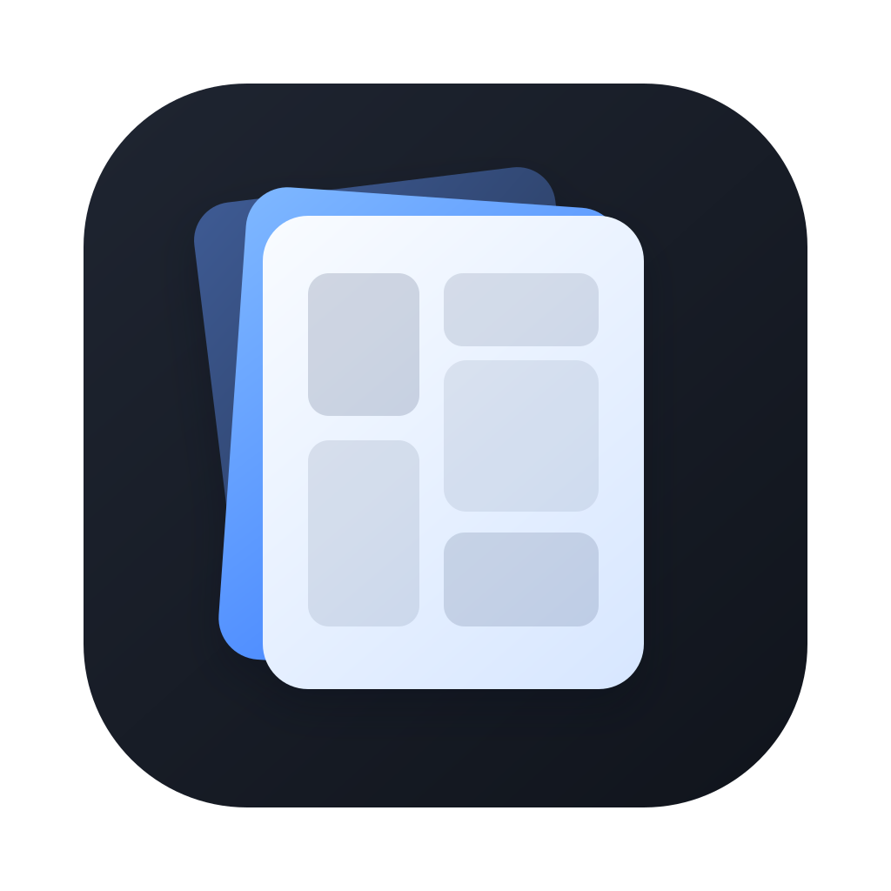

<p align="center">
  
</p>

<h1 align="center">Panely</h1>

<p align="center">
  macOS를 위한 미니멀하고 빠른 만화/이미지 뷰어.<br>
  <em>A minimal, fast comic &amp; image viewer for macOS.</em>
</p>

<p align="center">
  <a href="README.md">English</a> · <strong>한국어</strong>
</p>

<p align="center">
  📖 <a href="docs/manual.ko.md">사용 설명서</a> · <a href="docs/manual.md">User Manual</a>
</p>

<p align="center">
  
  
  
  <a href="https://github.com/sejoung/Panely/actions/workflows/ci.yml"></a>
  <a href="https://github.com/sejoung/Panely/actions/workflows/release.yml"></a>
  <a href="https://github.com/sejoung/Panely/releases/latest"></a>
  <a href="https://github.com/sejoung/Panely/releases/latest"></a>
  <a href="https://github.com/sejoung/Panely/releases"></a>
  <a href="https://github.com/sponsors/sejoung"></a>
</p>

---

## 다운로드와 저장소

[다운로드 페이지](https://sejoung.github.io/Panely/?lang=ko)에서 macOS 또는
Windows용을 선택하세요. 플랫폼별로 저장소와 릴리스를 따로 관리합니다.

| 플랫폼 | 소스 코드 | 다운로드 |
| --- | --- | --- |
| macOS | [sejoung/Panely](https://github.com/sejoung/Panely) | [macOS 최신 릴리스](https://github.com/sejoung/Panely/releases/latest) |
| Windows | [sejoung/PanelyWindows](https://github.com/sejoung/PanelyWindows) | [Windows 최신 릴리스](https://github.com/sejoung/PanelyWindows/releases/latest) |

이 저장소와 아래 설명은 **macOS용**입니다. Windows의 요구 사항, 설치 방법,
알려진 제약은 [Windows 설명서](https://github.com/sejoung/PanelyWindows/blob/main/docs/manual.ko.md)를
확인하세요.

## 개요

Panely는 사용자를 방해하지 않는 만화 리더입니다. 필요 없을 때는 UI가
사라지고, 사이드바는 필요할 때만 나타나며, 뷰어는 항상 최대 공간을 차지합니다.
밝은 크롬에서 읽는 건 피로하므로 다크 모드가 기본 고정입니다.

뷰어 코어는 AppKit 기반(`NSScrollView` + 레이어 기반 이미지 뷰)으로, 큰 페이지에서도
핀치 줌, 스크롤, 재정렬이 네이티브 수준으로 부드럽게 동작합니다.

## 기능

### 읽기
- **단일 페이지**, **두 페이지 펼침**, **세로 스크롤**(웹툰) 레이아웃 —
  툴바 세그먼트 컨트롤로 모드 직접 선택(사이클 라운드트립 없음);
  키보드는 `⌘⇧1` / `⌘⇧2` / `⌘⇧3`
- **표지 한 장(스프레드 오프셋)** — 두 페이지 모드 전용 툴바 토글. 1쪽을
  단독으로 보여주고 그다음부터 (2,3)(4,5)…로 짝지어, 단독 표지 때문에
  펼침이 한 칸 밀려 보이는 문제를 해소. 영구 저장, 기본은 꺼짐. 모든
  스프레드 계산(네비게이션·가시 영역·위치 복원)이 `SpreadCalculator`
  한 곳을 거쳐 어디서나 짝짓기가 일관됨
- **좌→우** 또는 **우→좌** 읽기(만화 친화). 세로 모드에서는 RTL 무시
  (웹툰은 위→아래), 방향 토글 자동 비활성화
- **세 가지 맞춤 모드** — 툴바 세그먼트 픽커(한 번 탭으로 직접 선택)와
  `⌘1`/`⌘2`/`⌘3` 단축키:
  - **화면에 맞춤** — 페이지 전체가 보이도록
  - **가로에 맞춤** — 뷰포트 가로에 맞춤
  - **세로에 맞춤** — 뷰포트 세로에 맞춤

  픽커는 **선택 해제** 가능 — 줌이나 이동으로 맞춤 배율에서 벗어나면 어떤
  모드도 강조 표시하지 않고, 현재 모드를 다시 탭하면 곧장 맞춤으로 되돌아감
  ("맞춤으로 리셋" 동작)
- **세로 모드 지연 윈도잉** — 페이지 크기를 미리 가져와서(폴더는 헤더만)
  회색 플레이스홀더로 즉시 레이아웃을 잡은 뒤, 보이는 범위의 실제 이미지를
  동시 로드하고 배치된 SwiftUI 패스로 업데이트 (이미지마다 재레이아웃 폭주 방지)
- **줌 컨트롤** — `⌘+` / `⌘-` / `⌘0`(맞춤으로 리셋) + 툴바 버튼.
  `⌘ + 스크롤 휠`은 커서 중심으로 연속 줌(스크롤 단위당 ~1%).
  트랙패드 핀치, 더블클릭 1× ↔ 2× 그대로
- **뷰 크기 잠금(`⌘L`)** — 창/사이드바 리사이즈와 레이아웃 전환 사이에서
  현재 배율을 고정하는 opt-in 토글. 강제 리셋(새 책, 명시적 `⌘1`/`⌘2`/`⌘3`)은
  여전히 적용됨
- **뷰포트 리사이즈 시 자동 재맞춤**(잠금 해제 시) — 창이나 사이드바 크기가
  바뀌면 새 맞춤으로 스냅. 수동 줌은 기본으로 보존
- **시리즈 안에서 줌 유지** — 형제 권 사이를 오갈 때 수동 줌이 유지되고, 각
  시리즈의 줌을 세션 동안 기억(종료 시 초기화). 다른 시리즈로 점프하면 새 책의
  맞춤으로 스냅되고, 나중에 돌아오면 그 시리즈의 줌이 복원됨
- **자동 센터링** — 뷰포트가 더 클 때 이미지를 중앙에 유지
- **±2페이지 프리로드**(페이지 모드, 두 페이지 모드에서는 ±2펼침) — 다음
  페이지 전환이 즉시 체감
- **시리즈 연속 읽기** — 한 권의 마지막 페이지에 닿고 다음 시블링이 있으면
  뷰어 하단에 다음 권 파일명 + "Next volume" 버튼이 뜬 카드(Up next)가
  표시됨. 대칭으로 페이지 0에서 backward를 명시적으로 누르면 상단에
  "Previous" 카드가 등장 — Vol N을 처음 페이지 0에서 열었을 땐 카드가
  안 뜨고 사용자가 더 뒤로 가려는 의도를 표현해야만 노출. 카드가 떠 있는
  동안 forward/backward 키 한 번이면 권을 이동
- **진행 오버레이** — 큰 소스를 처리하는 동안 단계별 메시지
  (Opening / Extracting / Loading / Building vertical strip), 전부 백그라운드 스레드
- **리로드와 소스 변경 알림** — `⌘R`로 현재 책을 다시 읽음. 소스가
  디스크에서 바뀌면 읽던 위치를 갑자기 옮기지 않고 Reload / Dismiss
  액션이 있는 작은 배너를 표시. 감시 대상은 아카이브(파일 자체)뿐 아니라
  **열린 폴더** — 디렉터리와 그 안의 모든 페이지 이미지 — 까지 포함하므로,
  읽고 있는 폴더에 페이지를 추가·삭제·수정해도 같은 알림이 뜸
- **이미지 오류 플레이스홀더** — 읽을 수 없는 페이지는 라벨이 있는 오류
  타일로 남겨 한 장의 깨진 이미지가 펼침/스트립 레이아웃을 무너뜨리지 않음
- **스크롤 휠 페이지 넘김** — 단일/두 페이지 레이아웃에서 일반 스크롤 휠이나
  트랙패드 스크롤로, 더 이상 이동할 여백이 없을 때 페이지를 넘김(아래 = 다음,
  위 = 이전, 트랙패드는 스와이프당 1페이지). 읽기 방향과 권 카드도 화살표 키와
  똑같이 따름. 기본 켜짐·영속 저장이며 **View → Disable / Enable Scroll Page
  Turning** 으로 전환

### 파일 지원
- **폴더**, **CBZ/ZIP**, **CBR/RAR** 열기 (RAR 4 · RAR 5, solid 아카이브 포함).
  컨테이너 형식은 파일 내용으로 판별하므로 `.cbr`로 이름만 바뀐 ZIP(또는
  `.cbz`로 바뀐 RAR)도 열림
- **시리즈 루트 자동 감지** — 볼륨들이 들어있는 폴더를 고르면 첫 번째가 열림
- **중첩 아카이브 추출**(최대 3단계 재귀, 누적 추출 5 GB 안전 상한 —
  zip-bomb 보호)
- **영속 zip-in-zip 캐시** — 추출된 중첩 아카이브가 content-addressed
  키(SHA256 of 경로 + 크기 + mtime)로
  `~/Library/Caches/panely-extraction-cache/`에 보관됨. 10 GB LRU 예산
  안에서 관리되어 같은 아카이브를 다시 열 때 즉시 표시. 소스 파일 편집
  시 mtime이 바뀌어 키도 바뀌므로 자동 재추출. 캐시 용량 확인과 수동
  정리는 **File → Settings…**(또는 **Panely → Settings…**)와
  **File → Clear Extraction Cache** 에서 가능.
- **진단 리포트 내보내기** — **File → Export Diagnostic Report…** 에서
  앱 버전/build, macOS 버전, 최근 Panely 로그, redacted 열기/로드 이벤트,
  캐시 용량, 현재 설정, 마지막 reader 에러를 담은 zip을 생성해 버그
  리포트에 첨부할 수 있음. 같은 기능은 **Settings → Diagnostics** 에도 있음.
  Diagnostics에는 현재 파일 로그 크기, 로그 레벨, 로그 폴더 바로 열기
  (**File → Open Diagnostic Logs Folder** 로도 가능), bounded
  `recent-log.txt`를 비우는 **File → Clear Diagnostic Logs** 도 있음.
- 자연 파일명 정렬(`1, 2, 10` — `1, 10, 2` 아님) — `NaturalSort` 헬퍼로
  모든 로더/스캐너에서 일관 적용
- 비이미지 파일과 숨김 항목 필터링

### 네비게이션
- **키보드 우선** — `← → Space` 페이지, `[ ]`(또는 `⌘[ ⌘]`) 볼륨,
  `⌘1 ⌘2 ⌘3` 맞춤 모드, `⌘+ ⌘- ⌘0` 줌, `⌃⌘S` 사이드바 고정,
  `⌃⌘T` 툴바 고정, `⌘L` 뷰 크기 잠금, `⌘O` 열기, `⌘R` 리로드
- **라이브러리 사이드바 기본 고정** — fresh install에서는 폴더 트리가
  보이도록 고정되어 시작. `⌃⌘S`(또는 고정 버튼)로 고정을 풀면 자동
  숨김 모드가 되고, **왼쪽 가장자리**에 호버(200 ms) 시 오버레이로
  슬라이드 인(드롭 섀도, 페이지 시프트 없음). 마우스가 나가면 300 ms
  후 자동 해제, `ESC`는 즉시 해제
- **툴바 + 슬라이더 자동 숨김** — 뷰어 상/하단 근처에 커서 있을 때만
  플로팅. `⌃⌘T`(또는 고정 버튼)로 항상 표시
- **사이드바 / 툴바 고정** — 둘 다 `pin` ↔ `pin.fill` 토글 패턴. 고정
  상태는 실행 간 유지
- **사이드바 트리** — 폴더와 아카이브가 시각적으로 구분됨:
  `folder` vs `doc.zipper` 아이콘, 아카이브엔 빠른 식별용으로 희미한
  `.cbz` / `.zip` / `.cbr` / `.rar` 접미사
- **트리에서 현재 책 표시** — 책을 열면 상위 폴더들이 자동으로 펼쳐져
  현재 권이 항상 사이드바에 보이고, 권 사이를 이동하면 펼침 상태도 따라감
- **파일 트리 새로고침** — 라이브러리 폴더 아래에서 파일이 추가·삭제·이름
  변경되면 사이드바가 자동으로 재스캔(FSEvents, 1.5초 디바운스 — 계속 쓰기가
  일어나는 루트나 클라우드 동기화 루트는 잠잠해진 뒤 한 번만 재스캔)하고,
  사이드바 헤더의 **새로고침 버튼**으로 즉시 재스캔도 가능. 어느 쪽이든 갱신은
  제자리 diff라 트리가 비거나 접히지 않고 펼쳐둔 폴더도 유지됨
- **읽기 진행도** — 추적된 책마다 사이드바에 배지 표시: 읽는 중엔 진행 링,
  완독하면 체크. 영속 `{page, total, finished}` 기록(정확 복원용 위치 저장소와
  별개)에서 계산. 최상단의 **이어보기** 한 줄로 가장 최근에 읽던 미완독 책으로
  바로 복귀. 진행도는 책을 여는 순간부터 쌓이므로 읽을수록 채워짐 — 이 기능
  출시 전에 마지막으로 연 책은 다시 열기 전까지 일반 "읽는 중" 표시만 보임
- **세로 모드 페이지 네비게이션** — `← → Space`로 스트립에서 이전/다음
  이미지로 스크롤(키보드로 마지막 이동한 위치가 아니라 현재 뷰포트 중앙에
  있는 페이지 기준)
- 같은 폴더의 형제 책 간 **볼륨 네비게이션**
- **최근 항목** — **파일 → 최근 항목 열기**에 최근 연 항목 10개 표시(**메뉴
  지우기**로 비우기). security-scoped bookmark로 실행 간 유지, 동일한
  아이콘 스킴으로 표시
- **실행 시 마지막 라이브러리 자동 복원** — 마지막에 보던 폴더를
  자동으로 다시 열어(security-scoped bookmark) 콜드 스타트가 빈 사이드바가
  아니라 내 라이브러리에서 시작됨. 파일로 실행(Open With)한 경우엔 그쪽이
  우선이라 복원을 건너뜀. **Settings → Library** 탭에 **실행 시 마지막 폴더
  다시 열기** 토글(기본 켜짐), 기억된 경로, 일회성 **Forget Now**(저장 폴더
  삭제)가 있음
- **폴더 접근 허용** — 단일 파일을 열었고 형제 책들이 안 보일 때,
  사이드바에서 상위 폴더를 고를 수 있는 원클릭 프롬프트 제공. 이 상태에서
  이전/다음 책을 요청하면(`[` / `]`, 툴바, 이동 메뉴) 아무 일도 안 일어나는
  대신 같은 프롬프트가 뜸. 한 번 허용한 폴더는 기억되어, 나중에 그 폴더 안의
  책을 단독으로 열어도 같은 폴더 권한으로 열리므로 다시 묻지 않고 이전/다음
  책으로 이동 가능
- **책을 넘나드는 페이지 북마크** — 사이드바에 현재 책의 북마크(페이지 썸네일,
  행마다 삭제 버튼, 전체삭제)와 다른 책에 남겨 둔 북마크가 함께 표시됨. 다른
  책의 북마크를 고르면 그 책이 해당 페이지로 열림. 같은 목록을 툴바의 북마크
  메뉴와 **이동 → 북마크**에서도 바로 볼 수 있음
- **즐겨찾기** — `⌘⇧D`(또는 툴바 별 버튼, **이동 → 즐겨찾기에 추가**)로 책에
  별표를 하면 사이드바 **즐겨찾기** 섹션에 표시되어 한 번 클릭으로 다시 열 수
  있음. 행의 컨텍스트 메뉴에서 제거
- **썸네일 사이드바** — `⌃⌘P`(또는 툴바 버튼)로 오른쪽에 페이지 썸네일 목록을
  열고(지연 로드), 썸네일을 클릭하면 해당 페이지로 이동. 기본은 숨김, 표시
  상태는 영구 저장
- **페이지로 이동** — `⌘G`로 페이지 번호 입력 창을 열거나, 하단 슬라이더 위
  페이지 카운터를 클릭해 번호를 입력(Enter로 이동, Esc로 취소)
- **즉시 뜨는 툴바 설명** — 툴바 아이콘에 마우스를 올리면 시스템 툴팁 지연
  없이 이름과 단축키가 바로 표시됨
- **창 크기에 맞는 툴바** — 창이 좁거나 라이브러리를 고정해 툴바가 다 들어가지
  않으면, 양 끝 버튼이 잘리는 대신 맞춤/줌 → 레이아웃 순으로 메뉴로 접힘
- **한국어 UI** — 메뉴, 툴바 설명, 사이드바, 설정, 메시지가 Mac의 기본 언어를
  따르고, 기본 언어가 영어·한국어가 아니면 영어로 표시됨. **설정 → 일반 →
  언어**에서 시스템 설정 따르기 / English / 한국어를 고르면 macOS 기본 메뉴
  항목(편집, 윈도우, 종료 등)까지 바로 바뀌며, 다시 시작할 필요가 없음
- **창 컨트롤** — 타이틀바가 숨겨진 상태에서도 상단 28 px 스트립에서
  네이티브 드래그 이동과 더블클릭 확대(시스템 `AppleActionOnDoubleClick`
  환경설정 존중) 지원. 드래그 영역은 open-hand 커서로 표시

### 번역 보조 (실험적 기능, macOS 26 이상)
읽지 못하는 언어로 된 만화의 내용 이해를 돕는 기능: 말풍선의 글자를 기기
안에서 읽어 기계 번역을 페이지 위에 보여줌. 기본은 꺼져 있고
**설정 → 실험적 기능**에서 켬. 줄거리를 따라가도록 돕는 용도이며 정식 번역을
대신하지 않음. 원문은 언제나 클릭 한 번(또는 `⇧⌘T`)으로 볼 수 있고, 어떤
데이터도 Mac 밖으로 나가지 않으며 원본 파일도 건드리지 않음.

- **기기 내 처리** — Vision 문서 인식(OCR, 세로쓰기 일본어 포함) + Apple
  Translation. 언어팩이 없으면 번역 패널이나 상태 배너에서 시스템 안내로 한 번
  다운로드
- **빠르게 / 정확하게**(설정 → 실험적 기능 → **번역 방식**) — 기본인 빠르게는 한 권을
  1분 정도에, 정확하게는 관용 표현을 더 잘 옮기지만 20배 정도 걸림. 방식마다 언어팩이
  따로이며, 빠르게는 macOS 26.4 이상 필요(그 전에는 모두 정확하게)
- **할 일마다 한 곳** — 툴바 번역 버튼은 원문 ↔ 번역 전환(`⇧⌘T`), 옆의 언어 이름
  ("한국어 ▾")은 언어 전환·추가와 패널·편집 모드를 여는 메뉴. **번역 패널**은 이 책 번역에만 집중: 큰 버튼 하나
  (번역 / 언어팩 다운로드 / 일시정지 / 이어서)와 상태 한 줄, **보기** 목록(원문
  또는 책의 번역 언어, 다른 언어는 **⋯** 메뉴로 시작·중지), 접혀 있는 **이 책과
  시리즈**(책의 언어, 자동 번역, 시리즈 전체 번역). 진행은 페이지 위 표시,
  백그라운드의 모든 일은 **윈도우 → 작업**(`⌥⌘J`), 앱 전체 설정은 ⚙︎ → 설정. 언어 선택과 책의 언어(자동 감지)는
  시리즈별로 기억
- **책 하나에 여러 언어** — 언어마다 작업과 캐시가 따로이며, 말풍선을 클릭하면
  번역·다른 언어 번역·원문을 함께 보여줌(텍스트 선택 가능, 사전 찾기 지원)
- **AI 채팅으로 다듬기** — 책 전체(또는 고른 페이지)의 말풍선 번호, 원문, 번역을 텍스트 파일로 저장해
  화면의 안내문(프롬프트)과 함께 ChatGPT, Claude 등 아무 채팅에 첨부하고, 답 파일을 열면 바뀐 번역이
  직접 고친 내용으로 반영됨(한 번에 실행 취소, 빠진 말풍선은 번호로 알려줌). API 키가 필요
  없고, 채팅에 줄 때만 Mac 밖으로 나감
- **다시 번역** — 페이지(우클릭, 언어 메뉴, 편집 막대) 또는 책 전체(패널)를 지금 방식으로 다시 읽고 번역해,
  개선 전에 번역된 페이지도 캐시를 지우지 않고 적용
- **놓친 글자** — 감지 모델이 찾았는데 OCR이 비워 둔 글자 상자는 자동으로 확대해서 다시
  읽음. 그래도 남은 글자는 편집 모드에서 드래그로 상자를 그려 추가(확대해서 읽고 번역,
  못 읽으면 원문 고치기로 입력). [드래그 인식·번역 사용법과 화면](docs/manual.ko.md#ocr이-놓친-글자-드래그해서-번역하기)
- **본 자리에서 바로 고치기** — 말풍선 클릭 팝오버나 페이지 우클릭 메뉴에서 번역·원문
  고치기, 숨기기, 이 페이지 다시 번역, 말풍선 추가 시작까지 모드 없이 바로
- **읽기 / 편집 모드** — 읽을 때는 번역만 보임. 편집 모드(`⇧⌘E`, 패널, 언어 메뉴, 우클릭
  메뉴)에서 말풍선 팝오버로 번역을 직접 고치거나, 잘못 인식된 원문을 고쳐
  다시 번역하거나, 그림을 글자로 잘못 읽은 말풍선을 숨기고(직후 실행 취소 가능),
  **원래대로**로 말풍선 하나만 되돌림. 편집 중에는 고친 말풍선에 연필 표시, 숨긴
  말풍선은 점선 윤곽(클릭하면 다시 보임), 페이지 위 편집 막대에 고친 수·쪽별 숨긴
  말풍선·**이 책 되돌리기**. 고친 내용은 캐시와 따로 Application Support에
  저장되어 캐시를 지우거나 다시 번역해도 유지되며, **설정 → 실험적 기능**에서 삭제
- **백그라운드 작업** — 다른 책을 열어도 번역이 계속됨. 페이지 위 표시로 다른
  책의 진행률을 보여주고, 누르면 **윈도우 → 작업**(`⌥⌘J`: 일시정지 / 재개 / 중지 /
  책 열기, 내보내기, 내보낸 책)이 열림. 번역은 한 번에 하나씩, 지금 보는 것부터 실행
- **번역본 내보내기** — 번역이 페이지에 입혀진 사본을 CBZ, ZIP 또는 이미지 폴더로
  저장(편집 내용 반영, 숨긴 말풍선 제외, 원본은 그대로). 언어 메뉴, **파일 →
  번역본 내보내기…**, 패널(시리즈 전체), 라이브러리 우클릭 메뉴(책 하나 또는 권들이
  든 폴더 — 열지 않아도 됨)에서 시작. 백그라운드에서 번역 안 된 페이지를 먼저
  번역하고(또는 그대로 두고) 페이지를 씀. 작업 창에서 진행을 보고, 완료된 책은 앱을
  다시 켜도 남아 **Finder에서 보기** / **열기**를 바로 누를 수 있음
- **시리즈 전체 번역** — 권 번호를 뺀 제목이 같은 다른 권만 대기열에 넣음(같은
  폴더의 다른 작품은 제외). 시작 전에 패널에 넣을 권 이름을 보여줌
- **웹툰 대응** — 세로 스크롤에서는 페이지를 하나의 스트립으로 읽어, 이미지
  조각 경계에서 잘린 말풍선도 하나로 인식. 긴 스트립은 겹치는 구간으로 나눠 읽음
- **눈에 보이는 진행** — OCR이 찾은 말풍선이 바로 나타나고 번역이 하나씩
  채워짐(대기 중인 말풍선은 깜빡임). 남은 시간이 표시되는 진행 표시, 모델을
  처음 불러올 때의 안내, 썸네일 사이드바 배지, 페이지 슬라이더 아래 막대
- **말풍선 감지 모델** — 만화로 학습한 모델(앱에 포함, GPU에서 페이지당 약 0.1초,
  OCR과 동시에 실행)이 어떤 글자 줄이 같은 말풍선인지, 어떤 "글자"가 사실은 그림인지
  판단. 한 말풍선의 여러 줄은 읽는 순서대로 합치고, 붙어 있는 말풍선은 나눔. 모델이 놓친
  글자도 기존 방식으로 묶어 번역함. 번역은 원문 글자 영역만이 아니라 말풍선 안쪽
  공간을 넓게 씀 — 그 공간이 비어 있을 때만이라, OCR이 놓친 줄을 덮어버리지 않음. 모델이
  없거나 아무것도 못 찾은 페이지는 기존 규칙으로 묶음
- **말투 맞추기**(일본어 ↔ 한국어, Apple Intelligence) — Apple 번역은 원문과 상관없이
  존댓말로 기우는데, 원문 어미로 말투를 판단해 기기 내 모델이 어미만 고침. 단어·시제·
  부정·문장 종류가 그대로인지 코드로 확인한 뒤에만 반영. 캐시된 페이지는 열 때 맞춰짐
- **효과음**(スッ, パチパチ…)은 번역하지 않음 — 그려진 효과음은 OCR이 거의 읽지 못하고
  읽어도 조각뿐(48페이지 측정 시 11개, 대부분 한 글자)
- **제약은 해당 위치에 표시** — 압축 파일 안의 책은 백그라운드로 이어가지 않고
  일시정지, 앱을 종료하면 번역이 멈춤(완료된 페이지는 저장), 백그라운드 실패는
  확인할 때까지 목록에 남음
- 결과는 페이지·언어별로 `~/Library/Caches/panely-translation-cache/`에
  캐시되며, 용량 확인과 삭제는 **설정 → 실험적 기능**에서

### 상태 유지
- **읽던 위치에서 이어보기** — 임시 디렉터리 추출을 버티는 안정적인 키로
  책별 페이지 기억. 외장 디스크의 mount 경로가 바뀌어도 위치를 복구할 수
  있도록 volume + file resource identifier 기반 보조 키를 함께 저장
- **시리즈별 읽기 설정** — 레이아웃·읽기 방향·맞춤 모드를 시리즈 단위(볼륨이
  든 폴더, zip-in-zip은 아카이브)로 기억 — 만화 시리즈는 RTL, 웹툰 시리즈는
  세로로 각각 유지됨. 하나를 바꾸면 해당 시리즈와 함께, 처음 여는 시리즈에
  쓰이는 전역 기본값에도 반영. 사이드바 고정·툴바 고정·자동 맞춤 잠금은 전역
  유지(레거시 `panely.sidebarVisible` 키는 새 고정 플래그로 자동 마이그레이션)
- **북마크/즐겨찾기 안전 장치** — 책당 페이지 북마크 상한(500개) + 총 책
  엔트리 상한(200개)으로 `UserDefaults` 4 MB 한계 도달로 인한 일괄
  손실 방지. `bookmarkDataIsStale` 감지 시 자동 재생성으로 파일을
  옮겨도 즐겨찾기/최근이 끊기지 않음
- 완전 샌드박스 호환(사용자 선택 파일 + 앱 스코프 북마크)

## 요구 사항

- **macOS 14** (Sonoma) 이상
- 실험적 기능인 번역 보조는 **macOS 26** 이상
- **Xcode 26.4** 이상 (소스 빌드 시 — 번역 코드가 macOS 26.4 SDK의 API를 사용)

## 릴리스 설치

[Releases 페이지](https://github.com/sejoung/Panely/releases/latest)에서 최신
`Panely-x.y.z.zip`을 내려받아 압축을 풉니다.

Panely는 오픈 소스이지만 **Apple 노타라이즈가 되어 있지 않습니다**(유료 개발자
등록을 하지 않음). 그래서 첫 실행 시 Gatekeeper가 *"Panely을(를) 열 수 없습니다.
Apple이 악성 소프트웨어를 검사할 수 없기 때문입니다."* 라고 경고합니다. 안전하게
열 수 있으며, 한 번만 macOS에 실행을 허용해 주면 됩니다:

1. **Panely.app**을 **/Applications** 폴더로 드래그합니다.
2. **Panely.app**을 **우클릭**(또는 Control-클릭)하고 **열기**를 선택합니다.
   더블클릭과 달리 이 대화상자에는 앱을 실행하는 **열기** 버튼이 있습니다.
3. 그래도 macOS가 막으면 **시스템 설정 → 개인정보 보호 및 보안**을 열고 보안
   섹션까지 스크롤한 뒤 Panely 알림 옆의 **확인 없이 열기**를 클릭합니다.

터미널을 선호한다면, Panely를 `/Applications`로 옮긴 뒤 격리(quarantine) 플래그를
제거하세요:

```bash
xattr -dr com.apple.quarantine /Applications/Panely.app
```

## 소스에서 빌드

```bash
git clone https://github.com/sejoung/Panely.git
cd Panely
open Panely.xcodeproj
```

**Panely** 스킴을 선택하고 **⌘R**을 눌러 실행.

Release 구성으로 빌드해 직접 써 보려면:

```bash
scripts/install-local.sh            # Release → /Applications/Panely.app 설치 후 실행
scripts/install-local.sh --debug    # 설정이 분리된 Debug 빌드 → "Panely Debug.app"
scripts/install-local.sh --help     # 그 밖에 --test, --dest DIR, --no-open, --reveal
```

로컬 Release 빌드는 정식 설치본과 설정·캐시를 공유하고
`/Applications/Panely.app`을 교체합니다. 분리하려면 `--debug`를 쓰세요.

### 의존성

Panely는 Swift Package Manager를 사용합니다:

- **[ZIPFoundation](https://github.com/weichsel/ZIPFoundation)** — CBZ/ZIP 아카이브 읽기 및 추출
- **[swift-log](https://github.com/apple/swift-log)** — `AppLog` 뒤의 로깅 facade
  (OSLog + bounded 진단 로그 파일)
- **[UnrarKit](https://github.com/abbeycode/UnrarKit)** — CBR/RAR 아카이브 읽기 및 추출.
  업스트림에 SwiftPM 매니페스트가 없어 `Packages/UnrarKit`에 로컬 패키지로
  vendoring했고, RARLAB의 최신 UnRAR 소스로 빌드. 버전과 로컬 패치는
  `Packages/UnrarKit/README.md` 참고

포함된 모델(번역 보조):

- **[comic-text-and-bubble-detector](https://huggingface.co/ogkalu/comic-text-and-bubble-detector)**
  (ogkalu, Apache-2.0) — 만화·웹툰·서양 코믹으로 학습한 말풍선·글자 감지 모델
  (RT-DETR-v2). `scripts/convert-text-detector.py`로 Core ML(8비트, 약 42MB)로 변환해
  `Panely/Resources/ComicTextDetector.mlpackage`에 둠. 변환 시 우회한 부분과 원본과의
  비교 방법은 스크립트 머리말 참고

Xcode가 첫 빌드에서 자동 해결합니다.

## 파인더 연동

Panely는 Finder에서 폴더 · `.cbz` · `.zip` · `.cbr` · `.rar`을 바로 열 수 있도록 등록됩니다.

- **파일** (`.cbz`, `.zip`, `.cbr`, `.rar`) — 우클릭 → **다음으로 열기 → Panely**
- **폴더** — macOS는 폴더에 "다음으로 열기"를 표시하지 않으므로
  폴더를 Panely.app(또는 Dock 아이콘)에 **드래그**, 혹은 메뉴바
  **파일 → 다음으로 열기 → Panely**

### 문제 해결

우클릭 메뉴에 Panely가 안 보이거나 옛 버전이 여러 개 보일 때:

```bash
# 1) 디스크에 등록된 모든 Panely.app 위치 확인
mdfind "kMDItemCFBundleIdentifier == 'io.github.sejoung.Panely'"

# 2) 안 쓰는 사본을 휴지통으로 보낸 뒤 휴지통도 비우기
#    (DerivedData/Debug 빌드는 그대로 둬도 됨 — 다음 빌드 때 자동 재등록)

# 3) LaunchServices DB 초기화 + Finder 재시작
/System/Library/Frameworks/CoreServices.framework/Versions/A/Frameworks/LaunchServices.framework/Versions/A/Support/lsregister -kill -r -domain local -domain system -domain user
killall -KILL Finder
```

Release 빌드를 `/Applications`에 두는 게 가장 안정적입니다 —
DerivedData의 Debug 빌드는 LaunchServices가 보통 후순위로 노출합니다.
다운받은 zip을 더블클릭하면 Archive Utility 임시 폴더에 풀어둔 사본이
LaunchServices 캐시에 남을 수 있으니, 우클릭 → "다음으로 압축 해제"로
풀어 바로 `/Applications`에 옮기는 걸 권장합니다.

## 단축키와 제스처

| 입력 | 동작 |
|:------|:-------|
| `⌘O` | 폴더 / CBZ / ZIP / CBR / RAR 열기 |
| `⌘R` | 현재 책 다시 읽기 |
| `←` / `→` | 이전 / 다음 페이지 (방향 반영. 매칭되는 권 카드가 떠 있으면 다음/이전 권으로 이동) |
| `Space` | 다음 페이지 (Up next 카드가 떠 있으면 다음 권으로 이동) |
| `[` / `]` (또는 `⌘[` / `⌘]`) | 이전 / 다음 볼륨 — 같은 폴더의 이전 / 다음 책·압축파일 |
| `⌘G` | 페이지 번호로 이동… (모달 프롬프트) |
| `⌘D` | 페이지 북마크 추가 / 제거 |
| `⌘⇧D` | 현재 책 즐겨찾기 추가 / 제거 |
| `⌘⇧[` / `⌘⇧]` | 현재 책의 이전 / 다음 페이지 북마크로 이동 |
| `⌘⇧1` / `⌘⇧2` / `⌘⇧3` | 단일 페이지 / 두 페이지 / 세로 스크롤 레이아웃 |
| `⌘1` / `⌘2` / `⌘3` | 화면 맞춤 / 가로 맞춤 / 세로 맞춤 |
| `⌘+` / `⌘-` | 줌 인 / 아웃 (뷰포트 중심, 한 단계) |
| `⌘0` | 현재 맞춤 모드로 줌 리셋 |
| `⌘ + 스크롤 휠` | 커서 중심 연속 줌 |
| `⌘L` | 뷰 크기 잠금 / 해제 (리사이즈와 레이아웃 전환 시 줌 유지) |
| `⌃⌘S` | 라이브러리 사이드바 고정 / 해제 |
| `⌃⌘T` | 툴바(하단 슬라이더 포함) 고정 / 해제 |
| `⌃⌘P` | 썸네일 사이드바 표시 / 숨김 |
| `⇧⌘T` | 번역 보조: 원문 ↔ 번역 전환 |
| `⌥⌘T` | 번역 보조: 이 책 번역하기 / 일시정지 |
| `⇧⌘E` | 번역 보조: 말풍선 편집 모드 켜기 / 끄기 |
| `⌥⌘J` | 작업 창: 백그라운드 번역·내보내기, 내보낸 책 |
| 말풍선 클릭 | 번역 보조: 번역·다른 언어 번역·원문 보기 (편집 모드에서는 고치기·숨기기·원래대로) |
| 왼쪽 가장자리 호버 | 사이드바 오버레이로 나타냄 (자동 숨김 모드에서) |
| `ESC` | 사이드바 오버레이 해제 (고정 안 된 상태). 말풍선 편집 모드가 켜져 있으면 먼저 편집 모드 종료 |
| 이미지 위 더블클릭 | 1× ↔ 2× 줌 토글 |
| 스크롤 휠 / 트랙패드 스크롤 | 페이지 레이아웃: 더 이상 스크롤할 여백이 없으면 페이지 넘김 (아래 = 다음, 위 = 이전. 트랙패드는 스와이프당 1페이지). View → Disable Scroll Page Turning으로 끄기 |
| 트랙패드 핀치 | 줌 인 / 아웃 |
| 상단 28 px 스트립 드래그 | 창 이동 |
| 상단 28 px 스트립 더블클릭 | 창 확대 / 최소화 (시스템 환경설정에 따름) |

## 테스트

```bash
scripts/test.sh          # fast 티어 (= 일반 `xcodebuild test`, CI가 실행하는 것)
scripts/test-slow.sh     # + slow 티어: 실제 FSEvents, 실제 Vision OCR, 모든 랜덤 시드
scripts/test-visual.sh   # PanelyTests/Snapshots/Reference/ 기준 스크린샷 비교
scripts/benchmark-translation.sh [--book PATH]   # 번역 단계별·작업 전체 소요 시간 측정
```

티어는 `PanelyTests/TestTiers.swift`에서 정합니다. slow와 visual 티어는
`PANELY_SLOW_TESTS=1` / `PANELY_VISUAL_TESTS=1`로 켜는 opt-in이며(벤치마크
`PanelyTests/Benchmarks/TranslationBenchmarkTests.swift`는 자체
`PANELY_BENCHMARK=1`), 스크립트가 이를 `TEST_RUNNER_…`로 넘겨 xcodebuild가
테스트 프로세스에 전달합니다. fast 티어는 테스트 시간 약 6–8초, visual
티어는 약 10초, slow 티어는 fast 위에 약 3초를 더합니다(FSEvents 테스트는
대부분 기다리는 시간).

모든 테스트의 임시 파일은 실행마다 하나인 `tmp/paneltest-run-*` 디렉터리
아래에 있고(`Fixture.runDirectory`), 테스트가 여는 폴더에 볼륨으로 나열될
형제가 없도록 각자 별도 부모 폴더를 씁니다. 각 실행은 이전 실행이 남긴
1시간 이상 지난 항목을 지웁니다. (예전에는 잔여물이 `tmp`에 그대로 쌓여 —
55k개 — 폴더를 여는 테스트가 갈수록 느려졌습니다.)

`SnapshotGalleryTests`는 기본 테스트에서 발견은 되지만
`scripts/generate-snapshots.sh`가 스냅샷 생성을 활성화할 때만 실행됩니다.
따라서 기본 `xcodebuild test` 경로는 매뉴얼 PNG를 렌더링하거나 복사하지 않습니다.


### 매뉴얼 화면 캡처 유틸

매뉴얼 이미지는 `scripts/generate-snapshots.sh`로 다시 만들 수 있습니다.
macOS·Xcode와 Python 3(표준 라이브러리만 사용)가 필요합니다.

```bash
scripts/generate-snapshots.sh --list                         # 화면 ID와 PNG 목록
scripts/generate-snapshots.sh --only balloon-add             # 드래그 선택 + 추가 후 번역
scripts/generate-snapshots.sh --only 25,27                    # 이미지 번호로 선택
scripts/generate-snapshots.sh --only translation-panel --output build/manual-preview
scripts/generate-snapshots.sh --only balloon-add --dry-run   # 실행 명령만 확인
scripts/generate-snapshots.sh                                # 전체 27장 재생성
```

기본 저장 위치는 `docs/screenshots/`입니다. `--only`에는 화면 ID, 테스트 이름,
PNG 파일명 또는 두 자리 번호를 넣으며, 쉼표로 나누거나 옵션을 반복할 수 있습니다.
한 시나리오가 여러 장을 만들면 함께 생성합니다(25번 또는 26번을 골라도 두 장 모두).
선택하지 않은 이미지는 바꾸지 않습니다. `--output`으로 임시 폴더에 먼저 생성해
검토할 수 있고, `--derived-data` 또는 `PANELY_DERIVED_DATA_PATH`로 빌드 캐시를 지정합니다.

실제 UI를 샘플 데이터와 함께 별도 창에 렌더링하므로 화면 녹화 권한이나 실제 책,
다운로드된 번역 언어팩이 필요하지 않습니다. 샘플 번역 문구는 미리 준비한 값이며
OCR·기계 번역 품질을 검증하는 테스트와는 목적이 다릅니다. 실행마다 출력 폴더를
분리하고, 선택한 PNG가 모두 생성됐는지와 PNG 구조·체크섬을 검사한 뒤 복사합니다.
성공한 실행의 임시 이미지는 지웁니다. 실패하면 전체 Xcode 로그와 임시 이미지
위치를 출력하므로, 이전 실행의 이미지를 새 캡처로 착각하지 않고 확인할 수 있습니다.

새 캡처를 추가하는 순서:

1. `PanelyTests/Snapshots/SnapshotGalleryTests.swift`에 `@Test func` 시나리오를
   추가합니다. 공통 `SnapshotRenderer.render(_:size:named:)`로 화면을 저장합니다.
2. 클릭·드래그나 모델 변경 후 찍어야 하면 `SnapshotRenderer.host(_:size:)`로
   띄우고, `defer { hosted.close() }`로 정리합니다. `hosted.drag(in:from:to:release:)`,
   `hosted.sendMouse(_:in:at:)`로 조작하고 `hosted.capture(named:)`로 저장합니다.
   좌표는 대상 뷰 기준이며, `release: false`는 드래그 상자가 보이는 상태를 유지합니다.
   비동기 상태가 바뀌는 화면은 기존 `hosted.settle`로 준비 완료를 기다린 뒤 찍으세요.
3. `scripts/manual-snapshots.json`에 고유 `id`, 메서드 이름인 `test`(괄호 제외),
   생성하는 PNG 목록 `files`를 등록합니다. 실행 스크립트의 별도 목록은 고칠 필요가 없습니다.
4. `--only 새-ID --output build/manual-preview`로 생성해 이미지 내용을 확인한 뒤,
   기본 위치에 생성하고 한글·영문 매뉴얼에 연결합니다.

유틸의 선택·실패 처리와 목록 일치 검증은 다음 명령으로 실행합니다.

```bash
PYTHONDONTWRITEBYTECODE=1 python3 -m unittest discover -s scripts/tests -p 'test_*.py'
```

### 화면 렌더링 검증

여러 스위트가 모델만이 아니라 실제로 화면에 닿는 것을 지킵니다:

- **`LibrarySidebarRenderingTests`**는 실제 사이드바를 픽스처 라이브러리 위에
  오프스크린 렌더링하고 AppKit이 만든 `NSOutlineView`(행, 레벨, 어떤 폴더가
  펼쳐지는지)를 검사합니다. 스캔은 잘 되는데 평평하게 그려지는 트리는 실패.
- **업데이트 렌더링 테스트**(`LibrarySidebarUpdateRenderingTests`,
  `ReaderToolbarRenderingTests`, `TranslationEditBarRenderingTests`,
  `ThumbnailSidebarRenderingTests`, `GoMenuRenderingTests`)는 실제 뷰를 호스팅하고
  뷰 모델을 바꾼 뒤(페이지 넘김, 다른 책 열기, 진행도 기록, 번역 도착) 호스팅된
  뷰가 따라오는지 확인합니다. 헬퍼는
  `PanelyTests/Snapshots/HostedViewInspection.swift`.
- **`ReaderViewerRenderingTests`**는 실제 뷰어가 각 페이지를 어디에 놓는지(단일,
  두 쪽, 오른쪽→왼쪽, 표지 단독, 세로 스트립) 확인하고,
  **`TranslationOverlayDrawingTests`**는 번역 오버레이가 그리는 내용을 읽어 와
  호버 시 부분 다시 그리기가 전체 다시 그리기와 일치하는지까지 검사합니다.
- **`VisualRegressionTests`**(opt-in: `scripts/test-visual.sh`)는 여러 화면을
  렌더링해 `PanelyTests/Snapshots/Reference/`의 기준 PNG와 비교합니다
  (`SnapshotComparator`: 6단계 넘게 다른 픽셀이 0.1%를 넘으면 실패 — 어두운
  크롬에는 이 정도 민감도가 필요하고, 폰트 스무딩 노이즈는 ~0.01%). 실패하면
  렌더링 이미지와 회색 바탕 빨간 diff가 Debug 샌드박스의
  `Caches/panely-visual-diffs/`에 남습니다. 기준 이미지는 기록한 macOS 메이저
  버전에 묶여 있고 다른 버전에서는 스위트가 skip됩니다. 의도한 UI 변경 후에는
  `scripts/update-reference-snapshots.sh`로 다시 기록하고 커밋 전에 PNG를
  검토하세요.

스위트가 커버하는 범위:

- 순수 데이터 타입 (`ComicPage`, `ComicSource`, `RecentItem`, enum raw 값)
- 자연 정렬 규약 (Panely가 의존하는 Foundation 동작)
- 임시 디렉터리 추출(중첩 zip 시나리오)에서의 **위치 키 안정성**
- 실제 임시 디렉터리와 통합한 **FolderLoader**
- **FileNode.loadTree** 스캔, 정렬, 비어있음/읽기 불가 케이스, 사이드바 배지용
  `fileExtension` 노출
- 프로그래매틱하게 만든 zip 픽스처 및 커밋된 RAR 픽스처(`PanelyTests/Fixtures/Archives`)와의 **ArchiveLoader** 통합 — 재귀 중첩 아카이브
  추출 포함
- **ImageLoader.dimensions** — 파일 URL과 아카이브 엔트리 모두 헤더만 읽어 크기 추출
- **FitCalculator** 다양한 종횡비와 0 입력에 대한 순수 계산 (세로 소스에서
  fit-height가 fit-screen과 동일해지는 케이스 포함)
- 반복된 맞춤 모드 토글에 대한 **NSScrollView** 배율 안정성
- **뷰어 리사이즈 자동 맞춤** — 줌 안 했을 때 뷰포트 따라가고, 리사이즈 시 수동 줌
  보존, `⌘L` 잠금은 문서 크기 변경에도 유지, 강제는 여전히 리셋, deinit에서 옵저버 해제
- **CenteringClipView** — 문서가 뷰포트보다 작을 때 중앙 정렬
- **SidebarMode / 사이드바 선호값** — pinned / overlay 상태 전이를 다루는
  순수 값 타입(값 타입 기본은 unpinned, pin 멱등, pinned 중 overlay
  no-op, unpin 시 남아있는 overlay 정리)과 `ReaderPreferences`의 기본
  고정 및 영속성
- **PageLayout 순환** — `single → double → vertical → single` 순서,
  모드별 `navigationStep`, 세로용 `isContinuous` 플래그
- **`ReaderViewModel` 페이지 모드 동작** — `visiblePages` 슬라이싱,
  세로 모드 외에서 `setCurrentPageFromScroll` no-op, 페이지 모드에서
  `toggleDirection` 동작
- **`ReaderViewModel` 세로 모드 동작** — `visiblePages`가 전체 스트립 반환,
  `setCurrentPageFromScroll` 인덱스 업데이트, `effectiveDirection`은
  항상 LTR, 페이지→세로 전환 시 로딩 인디케이터 즉시 표시, applyFit이
  맞춤 계산에 첫 이미지 사용
- **`ImageStackView` 세로 레이아웃** — `pageIndex(forViewportY:)`,
  `pageIndexRange(visibleIn:)`, 개수+축 일치 시 `setImages`의 점진적 교체
  (뷰 재빌드 없음) vs 축 변경 시 전체 재빌드
- 최소/최대 클램핑과 함께 `NSScrollView` 대상 **`ViewerController`** 줌 인/아웃/리셋
- **`ScrollZoomCalculator`** — 스크롤 휠 delta에서 min/max 클램프한 곱셈형
  줌 팩터 계산
- **툴바 고정 상태** — 기본 unpinned, 토글이 저장된 플래그를 뒤집음
- **썸네일 사이드바 토글** — 기본 숨김, `toggleThumbnailSidebar`가 저장된
  플래그를 뒤집음
- **Quick-jump 계산** — 단일+이중 레이아웃에서 `currentPageNumber` /
  `currentPageRangeEndNumber`, `jump(toPageNumber:)`는 범위 밖 입력 클램프 및
  이중 모드에서 네비게이션 step에 스냅
- **`PageBookmarksStore`** — 토글 추가/제거, 키 격리, 페이지 인덱스로
  정렬, next/previous 네비게이션, ID로 제거, 주입된 `KeyValueStoring`
  영속성 왕복
- **`FavoritesStore`** — 실제 임시 파일에 대한 토글 추가/제거,
  security-scoped 북마크가 원래 URL로 resolve
- **`ReaderPreferences`** — 모든 영속 설정(레이아웃 / 방향 / 맞춤 /
  사이드바 고정 등)의 `KeyValueStoring` 왕복, 잘못된 raw 값은 기본값으로
  fallback, 레거시 `panely.sidebarVisible` 키가 새 고정 플래그로 자동
  마이그레이션
- **`ReaderPositionStore`** — 빈 store는 0 반환, 캐시 lazy hydration,
  300 ms 디바운스가 빠른 `savePosition` 호출들을 합쳐서 마지막 값만 기록,
  primary 키가 file-identity fallback보다 우선, 두 키 모두에 미러 기록
- **`ReaderLibraryScope`** — `contains()`가 at-or-below 경로는 허용하고
  sibling-prefix 충돌은 거부, acquire/release 라이프사이클(비-Powerbox
  URL에서 acquire가 실패해도 이전 URL은 해제됨)
- **`ReaderTempDirectory` / `ExtractionCacheStore`** — 실제 임시 디렉터리
  대상 session adopt/cleanup, contains() 경계 정확성, session candidate
  유일성, `cleanupStaleEntries()` mtime 게이트(stale 제거, fresh 유지,
  비-panely 항목 무시), 그리고 추출 캐시: 파일별 안정적 `cacheKey`
  (mtime 민감), `cachedEntry` 히트/미스 + 히트 시 mtime touch,
  `enforceBudget()` 10 GB 초과 시 LRU eviction, `cacheSizeBytes(in:excluding:)` /
  `clearCache(in:excluding:)` 수동 정리, `cleanup()`이 session dir은 삭제하되
  cache dir은 보존
- **`ReaderImageLoader`** — reset / `prepareForLayoutRebuild` /
  `cancelPreload` 상태 전이, `estimatedBitmapCost`가 Retina 백킹에는 픽셀
  치수 사용 + 플레이스홀더에는 size fallback, RAM 비례 cost 상한이
  [150 MB, 1 GB]로 클램프, `lazyConcurrencyLimit`이
  [2, 8]로 클램프
- **`AppKitScrollerCoordinator`** — bounds 옵저버가 연속 레이아웃에서는
  page index + range 콜백 fire하지만 페이지 모드에서는 no-op,
  programmatic scroll 중에는 page 콜백 억제(lazy load는 여전히 진행),
  같은 페이지 알림 dedupe, 두 옵저버 모두 재부착해도 콜백 중복 발생 없음
- **`FavoriteBook` / `PageBookmark` Codable** — 왕복 충실도 + `isDirectory`
  없는 레거시 `FavoriteBook` JSON의 forward-compat 디코드
- **`ReaderViewModel` 북마크 가드** — 소스 미로드 시 `toggle*`,
  `canGo*Bookmark`, `currentPositionKey`가 no-op / false / nil
- **`ThumbnailLoader`** — 접근 불가 URL은 nil, 실제 PNG는 non-nil, 동일
  `ComicPage.id`는 `===`로 캐시된 `NSImage` 반환, 서로 다른 페이지는 별개 캐시 엔트리
- **`ImageLoader.load`** — eager-decode 파이프라인(`CGImageSource` +
  `kCGImageSourceShouldCacheImmediately`), 비이미지/누락 파일에 throw,
  반환된 NSImage의 `cgImage(...)`가 추가 디코드 패스 없이 즉시 resolve
- **End-of-volume / previous-volume 카드** — 가시성 술어, 파일명 라벨,
  `advanceForward()` / `goBackward()` 디스패치, prev 카드의 비대칭 트리거
  (사용자 명시 의도가 있어야만 cue arm). 페이지 0의 첫 fresh open에선
  카드가 안 뜨는 것까지 대칭 보장 테스트 포함
- **위치 메모리 in-memory mirror** — 첫 restore에서 주입된 key-value
  store로부터 캐시 hydrate, 이후 save/read 모두 in-memory dict에 hit.
  여러 책이 올바르게 공존하고, 같은 VM 내 최신 write가 재읽기 없이 반영됨
- **`TitleBarPassthrough`** — 주입된 settings reader를 통한 시스템
  더블클릭 선호값 매핑(`zoom` / `minimize` / `none`)
- **`PanelyAppDelegate`** — `applicationShouldTerminateAfterLastWindowClosed`가
  true 반환해서 빨간 닫기 버튼이 앱 종료
- **`SpreadCalculator`** — 표지 한 장 오프셋 유무에 따른 스프레드 짝짓기
  (스프레드 시작/끝, step 이동, 도달 가능한 마지막 스프레드)
- **`WheelPageTurnEngine`** — 스크롤 휠 페이지 넘김 상태 머신: 가장자리에서
  이동 vs 넘김, 트랙패드 스와이프당 1회, 모멘텀·마우스 휠 쿨다운 처리
- **줌 유지 / 시리즈별 설정** — `ReaderSeriesIdentity` 판별(폴더 vs
  zip-in-zip), `ReaderSeriesPreferencesStore` 영속성과 상한,
  `ReaderViewModel`의 시리즈 단위 줌·레이아웃·방향·맞춤 복원
- **읽기 진행도 & 라이브러리** — `ReadingProgressStore`(디바운스, 최근성
  상한, 배지, 이어보기), `LastLibraryRootStore`, `LibrarySidebarModel`
  (현재 책 상위 폴더 펼침), `SecurityScopedBookmark` stale 갱신
- **소스 변경 & 진단** — `SourceChangeMonitor` 파일/폴더 감시,
  `AppLog` / `DiagnosticLogStore` 파일 로깅, `DiagnosticReportExporter`
  zip 내용
- **번역 보조** — OCR 구간 분할과 경계 처리, 말풍선 묶기, 효과음·언어 판별,
  페이지/스트립 작업 계획, 작업 매니저(책 × 언어당 작업 하나, 백그라운드 작업,
  재연결, 대기열, 열려 있어야 하는 책), 캐시 키와 저장, 오버레이 위치와 클릭
  판정, 시리즈 권 판별, 말풍선 검출과 놓친 텍스트 다시 읽기, 말투 맞추기,
  말풍선 수정, AI 채팅 왕복, 번역본 내보내기, 리더 연동(시리즈별 언어,
  원문 ↔ 번역, 화면 이미지를 따라가는 오버레이)
- **현지화** — `AppLocalization`(시스템 설정 따르기 → Mac의 주 언어, 없으면
  영어), `AppMenuLocalizer`의 기본 메뉴 제목, 빌드된 `ko.lproj`로 카탈로그 키를
  확인하는 `KoreanLocalizationTests`
- **라이브러리 감시 & 저장 데이터** — `LibraryDirectoryWatcher` /
  `LibraryChangeFilter`(어떤 FSEvents 플래그가 트리 재스캔을 일으키는지, slow
  티어에서는 실제 스트림), `Debouncer`, 북마크 resolve 시 볼륨을 마운트해도
  되는 호출 지점, 레거시 `UserDefaults` 형식이 여전히 디코드되는지
- **`EntitlementsTests` / `FileAssociationTests`** — 저장 패널 대상용 샌드박스
  entitlement, Info.plist 문서 타입 / imported UTI(폴더, CBZ/ZIP, CBR/RAR)

테스트는 소스 트리를 그대로 반영합니다: `PanelyTests/Core/{Comic, Diagnostics,
Extensions}/`, `PanelyTests/Commands/`, `PanelyTests/Features/Library/`,
`PanelyTests/Features/Settings/`, `PanelyTests/Features/Translation/`, 그리고
`PanelyTests/Features/Reader/{Model, Scene, Viewer, Thumbnails, ViewModel,
ViewModel/Collaborators}`, 그 밖에 `PanelyTests/Localization/`,
`PanelyTests/Snapshots/`, `PanelyTests/Benchmarks/`. 공유 픽스처(실제 PNG
생성기 포함)는 `PanelyTests/TestFixtures.swift`에, 커밋된 RAR 아카이브는
`PanelyTests/Fixtures/Archives/`에 있고, persistence 테스트는
`PanelyTests/TestKeyValueStore.swift`를 씁니다.

`RecentItem.Codable`은 `isDirectory`용 `decodeIfPresent` 경로를 포함하여
오래된 저장 엔트리가 스키마 범프를 넘어 살아남습니다.

## 프로젝트 구조

각 폴더의 최상단에는 그 폴더 외부에서 참조하는 타입만 둡니다. 내부 구현
(extensions, sub-views, AppKit 브리지, collaborators)은 하위 폴더로
모아두어 어떤 디렉터리든 열면 공개 API가 한눈에 보입니다.

```
Panely/
├── PanelyApp.swift                     # @main, 윈도우 스타일, .commands { fileCommands + viewCommands + goCommands }
├── ContentView.swift
├── AppDependencies.swift               # 주입되는 앱 서비스(cache, bookmark, persistence, system settings, 파일 감시,
│                                       # 파일 선택, UI 언어, 번역 저장소) + collaborator 팩토리
├── AppIcon.icns                        # docs/icon/*.svg에서 생성
├── Assets.xcassets                     # 강조 색상
├── Credits.rtf                         # About 패널 크레딧 (release.sh가 빌드 커밋 SHA를 기록)
├── Localizable.xcstrings               # 문자열 카탈로그: 영어 원문 + 한국어
├── Resources/
│   └── ComicTextDetector.mlpackage     # Core ML 말풍선 / 텍스트 검출기 (scripts/convert-text-detector.py로 생성)
├── Commands/                           # PanelyApp에 대한 @CommandsBuilder extension
│   ├── PanelyApp+FileCommands.swift    # Open / Open Recent
│   ├── PanelyApp+ViewCommands.swift    # chrome / 레이아웃 / 맞춤 / 줌 / autofit
│   └── PanelyApp+GoCommands.swift      # 페이지 이동 / 북마크 / 즐겨찾기 / 볼륨
├── Core/
│   ├── Comic/                          # loader, ComicSource/Page, natural sort, 이미지 메타데이터
│   │   ├── ComicPage.swift / ComicSource.swift / ComicPageSource.swift
│   │   ├── FolderLoader.swift
│   │   ├── ArchiveLoader.swift         # 평면 + 재귀 중첩 추출 + 5 GB 안전 상한
│   │   ├── ArchiveReader.swift         # ArchiveReader 프로토콜 + ArchiveFormat(매직 바이트 판별)
│   │   ├── ZIPArchiveReader.swift      # ZIPFoundation.Archive 감싼 actor
│   │   │                               # (헤더 전용 읽기용 loadDataPrefix)
│   │   ├── RARArchiveReader.swift      # UnrarKit URKArchive 감싼 actor
│   │   │                               # (solid 아카이브는 최초 접근 시 1회 추출)
│   │   ├── NaturalSort.swift           # 로케일 인식 자연 정렬 헬퍼
│   │   └── ImageLoader.swift           # async NSImage + dimensions(for:) 헤더 읽기
│   ├── Diagnostics/
│   │   ├── AppLog.swift                # swift-log facade + OSLog/file 진단 backend
│   │   └── DiagnosticLogStore.swift    # rolling recent-log.txt 캐시 파일
│   ├── SourceChangeMonitor.swift       # DispatchSource 기반 다중 URL 파일/폴더 감시 (세션 가드)
│   ├── LibraryDirectoryWatcher.swift   # 라이브러리 루트 재귀 FSEvents 감시 → 사이드바 자동 갱신
│   ├── Debouncer.swift                 # 공용 트레일링 디바운스 헬퍼 (위치/진행도 저장)
│   ├── AppLanguage.swift               # 시스템 설정 따르기 / 영어 / 한국어 선택
│   ├── AppLocalization.swift           # 현재 적용 언어, 즉시 전환용 `Bundle.localized`
│   ├── AppMenuLocalizer.swift          # macOS 기본 메뉴 언어 즉시 전환
│   ├── FilePicking.swift               # NSOpenPanel seam (주입) → open / folder-access 흐름 테스트 가능
│   └── Extensions/                     # 공유 Foundation 유틸 extension (DRY)
│       ├── URL+IsAncestor.swift        # path-component 단위 접두사 포함 체크
│       ├── UserDefaults+Codable.swift  # KeyValueStoring + JSON encode/decode 헬퍼
│       └── Dictionary+CapByRecency.swift # persistence store 공용 최근성 기반 상한
├── DesignSystem/
│   ├── Tokens/                         # Color / Spacing / Typography / Motion
│   └── Primitives/                     # 아이콘 버튼, 아이콘 메뉴, 슬라이더
├── Features/
│   ├── Reader/
│   │   ├── ReaderScene.swift           # ZStack: SidebarHost + ViewerArea + ThumbnailSidebarHost (진입 뷰)
│   │   ├── Scene/                      # ReaderScene 하위 뷰 (파일당 struct 하나)
│   │   │   ├── HotEdgeReveal.swift
│   │   │   ├── SidebarHost.swift               # 뷰모델 액션과 연결된 LibrarySidebar
│   │   │   ├── ThumbnailSidebarHost.swift      # 뷰모델 액션과 연결된 ThumbnailSidebar
│   │   │   ├── ViewerArea.swift                # 뷰어 + 키 핸들러 + 오버레이
│   │   │   ├── ReaderToolbarOverlay.swift
│   │   │   ├── ReaderSliderOverlay.swift
│   │   │   └── VolumeCardOverlays.swift        # end-of- + previous-volume 카드
│   │   ├── Model/                      # 값 타입 및 순수 헬퍼
│   │   │   ├── PageLayout.swift        # single/double/vertical + 순환 + isContinuous
│   │   │   ├── ReadingDirection.swift  # LTR / RTL
│   │   │   ├── FitMode.swift           # 3가지 + 순환
│   │   │   ├── FitCalculator.swift     # 순수 배율 계산
│   │   │   ├── PositionKey.swift       # 책별 안정적 위치 키
│   │   │   ├── SidebarMode.swift       # pinned / overlay 상태 값 타입
│   │   │   └── SpreadCalculator.swift  # 스프레드 짝짓기 (+ 표지 한 장 오프셋)
│   │   ├── ViewModel/                  # @Observable @MainActor 리더 상태
│   │   │   ├── ReaderViewModel.swift           # 세션 상태 + 합성
│   │   │   ├── Extensions/                     # 관심사별 로직 분할
│   │   │   │   ├── ReaderViewModel+Navigation.swift   # 페이지 네비, Quick jump, chrome 토글
│   │   │   │   ├── ReaderViewModel+Source.swift       # 로드 진입점 + ReaderLoadIntent
│   │   │   │   ├── ReaderViewModel+LoadPipeline.swift # 다단계 load() 상태 머신 + 소스 변경 감시
│   │   │   │   ├── ReaderViewModel+Cache.swift        # 추출 캐시 비우기 (파일 메뉴 + 설정)
│   │   │   │   ├── ReaderViewModel+Toolbar.swift      # PanelyToolbar 상태/액션 번들
│   │   │   │   ├── ReaderViewModel+Volumes.swift      # 형제 권 카운터 + 볼륨 카드
│   │   │   │   ├── ReaderViewModel+ImageLoading.swift # ReaderImageLoader 위 얇은 facade
│   │   │   │   ├── ReaderViewModel+Bookmarks.swift    # 즐겨찾기 + 페이지 북마크 연동
│   │   │   │   ├── ReaderViewModel+ReadingProgress.swift # 진행도 기록 → 사이드바 배지 + 이어보기
│   │   │   │   ├── ReaderViewModel+Translation.swift  # 번역 보조: 언어, 작업, 오버레이
│   │   │   │   ├── ReaderViewModel+TranslationExport.swift # 번역본 책 / 시리즈 내보내기 (백그라운드 작업)
│   │   │   │   └── ReaderViewModel+AIChat.swift       # AI 채팅 왕복: 말풍선 저장, 답변 적용, 되돌리기
│   │   │   └── Collaborators/                  # ReaderViewModel이 합성, 각각 단일 책임
│   │   │       ├── ReaderPreferences.swift     # KeyValueStoring 기반 레이아웃 / 맞춤 / 고정
│   │   │       ├── ReaderPositionStore.swift   # 디바운스된 책별 페이지 메모리
│   │   │       ├── ReaderSeriesIdentity.swift  # 시리즈 키 (권 폴더 / 연 아카이브)
│   │   │       ├── ReaderSeriesPreferencesStore.swift # 시리즈별 레이아웃 / 방향 / 맞춤
│   │   │       ├── FolderResolver.swift        # 오프메인 폴더/권 스캐너 (순수 파일시스템 탐색)
│   │   │       ├── ReaderImageLoader.swift     # 캐시 + 페이지 새로고침 + 세로 지연 윈도 + 프리로드
│   │   │       ├── ReaderImageLoadingSupport.swift # 이미지 메모리 캐시 + 로딩 헬퍼
│   │   │       ├── ReaderTempDirectory.swift   # zip-in-zip session 추출 라이프사이클
│   │   │       ├── ExtractionCacheStore.swift  # content-addressed 추출 캐시 (10 GB LRU)
│   │   │       └── ReaderLibraryScope.swift    # security-scope grant 보유
│   │   ├── Viewer/                     # AppKit 기반 스크롤 가능 이미지 스테이지
│   │   │   ├── ViewerContainer.swift           # SwiftUI 셸 (스크롤러 진입점)
│   │   │   ├── ViewerController.swift          # 줌 리모트 (⌘+/-/0, 스크롤 휠)
│   │   │   └── AppKit/                         # 내부 AppKit 브리지
│   │   │       ├── AppKitImageScroller.swift       # NSViewRepresentable + applyFit
│   │   │       ├── AppKitScrollerCoordinator.swift # 옵저버 + 상태 diff
│   │   │       ├── PanelyScrollView.swift          # ⌘+휠 줌 + 휠 페이지 넘김 NSScrollView
│   │   │       ├── TitleBarPassthrough.swift       # 상단 28 px 드래그 + 커서 처리
│   │   │       ├── CenteringClipView.swift         # 작은 문서 중앙정렬 NSClipView
│   │   │       ├── ImageStackView.swift            # 페이지 프레임 + 풀링된 NSImageView
│   │   │       └── WheelPageTurnEngine.swift       # 스크롤 휠 페이지 넘김 상태 머신
│   │   ├── Toolbar/
│   │   │   ├── PanelyToolbar.swift     # 5개 버튼 그룹: chrome / 레이아웃 / 맞춤·줌 / 북마크 / 네비. 좁으면 그룹이 메뉴로 접힘
│   │   │   ├── ToolbarHint.swift       # 툴바 컨트롤 아래에 즉시 뜨는 설명
│   │   │   └── QuickJumpField.swift    # 페이지 카운터 인라인 편집
│   │   ├── Overlays/
│   │   │   ├── LoadingOverlay.swift
│   │   │   ├── VolumeCardChrome.swift  # 공유 머티리얼/섀도우/보더 ViewModifier
│   │   │   ├── EndOfVolumeCard.swift   # 하단 카드: "Up next" + start/restart
│   │   │   └── PreviousVolumeCard.swift # 상단 카드: "Previous" (의도 게이트)
│   │   └── Thumbnails/
│   │       ├── ThumbnailSidebar.swift  # 우측 썸네일 패널 (LazyVStack)
│   │       └── ThumbnailLoader.swift   # Image I/O 썸네일 + NSCache
│   ├── Translation/                    # 실험적 기능: 번역 보조 (macOS 26 이상)
│   │   ├── TranslationManager.swift    # 앱 전체 작업: 책 × 언어당 하나, 백그라운드 + 대기열
│   │   ├── TranslationController.swift # 책 하나를 한 언어로: 작업 계획, OCR → 번역, 진행 상황
│   │   ├── TranslationStore.swift      # Caches 아래 페이지별 JSON 캐시 (페이지 id + 언어 + 범위 + 모드)
│   │   ├── TranslationEdits.swift      # 열린 책의 말풍선 수정 내용
│   │   ├── TranslationEditStore.swift  # Application Support 아래 수정 내용 저장 (캐시 비우기에도 유지)
│   │   ├── LanguagePackDownloads.swift # 앱 전체 언어팩 상태와 다운로드
│   │   ├── SeriesVolumeMatcher.swift   # 같은 시리즈의 다른 권 판별
│   │   ├── Model/                      # TranslationLanguage, TranslationMode(빠르게 / 정확하게),
│   │   │                               # TranslatedPage / TranslatedBubble, PageEdits
│   │   ├── AIChat/                     # AIChatExchange: 말풍선을 사용자의 AI 채팅으로 보내고 답변을 받아옴
│   │   ├── Export/                     # 번역본 내보내기: TranslationExportManager(작업, 기록, 저장 폴더),
│   │   │                               # TranslationExportJob(옵션, 기록), TranslationExportWriter
│   │   │                               # (CBZ / ZIP / 폴더), TranslatedPageRenderer
│   │   ├── Pipeline/                   # OCRTiling, TranslationPlan (page / strip), PageAnalyzer,
│   │   │                               # PageTextRecognizer (Vision), PageTranslator (Translation),
│   │   │                               # BubbleGrouper, BalloonDetector(Core ML), MissedText, SpeechLevel,
│   │   │                               # BubbleBackgroundSampler, TextClassifiers
│   │   ├── Viewer/                     # TranslationOverlayView (+ 레이아웃, TranslationPatchPainter), 말풍선 팝오버
│   │   └── UI/                         # 번역 패널, 언어 행, 진행 표시, 작업 목록, 편집 모드 막대,
│   │                                   # 내보내기 시트, AI 채팅 시트, 작업 창
│   ├── Settings/
│   │   ├── SettingsView.swift          # General + Library + Storage + Diagnostics + Experimental 탭
│   │   ├── ExperimentalSettingsView.swift # 번역 보조: 켜기, 번역할 언어, 모드, 말투 맞추기,
│   │   │                                  # 언어팩, 내 수정 내용, 캐시
│   │   ├── GeneralSettingsView.swift   # 인터페이스 언어 선택(즉시 적용)
│   │   ├── LibrarySettingsView.swift   # 마지막 폴더 다시 열기 토글 + Forget Now
│   │   ├── StorageSettingsView.swift   # Storage 설정 UI + 캐시 용량 / 삭제 컨트롤
│   │   ├── DiagnosticsSettingsView.swift # 진단 리포트 export UI
│   │   ├── DiagnosticReportExporter.swift # zip 리포트 writer
│   │   └── CacheMaintenance.swift      # 캐시 삭제 결과와 포맷팅 헬퍼
│   └── Library/
│       ├── LibrarySidebar.swift        # 고정 버튼 + 확장자 배지 + 2단계 로드
│       ├── BookmarkAlerts.swift        # 북마크 일괄 삭제 확인
│       ├── LibrarySidebarModel.swift   # 사이드바 표시 모델 + 현재 책 상위 폴더 펼침
│       ├── LibraryTreeLoader.swift     # 주입 가능한 FileNode.loadTree 래퍼
│       ├── Model/
│       │   ├── FileNode.swift          # iconName + fileExtension + 최상위 병렬 스캔
│       │   ├── RecentItem.swift        # security-scoped 최근 항목
│       │   ├── FavoriteBook.swift      # 영속 즐겨찾기 (security-scoped bookmark)
│       │   ├── PageBookmark.swift      # 영속 페이지 북마크
│       │   └── ReadingProgress.swift   # 영속 {page,total,finished} + ReadingBadge
│       ├── Store/
│       │   ├── FavoritesStore.swift            # 즐겨찾은 책 (security-scoped, stale 자동 갱신)
│       │   ├── PageBookmarksStore.swift        # 책당 + 총 책 상한이 적용된 페이지 북마크
│       │   ├── RecentItemsStore.swift          # 재열기 시 북마크 중복 제거
│       │   ├── ReadingProgressStore.swift      # 책당 진행도 (디바운스, 최근성 상한) → 배지 + 이어보기
│       │   ├── LastLibraryRootStore.swift      # 마지막 라이브러리 루트 security-scoped 북마크 → 실행 시 복원
│       │   └── SecurityScopedBookmark.swift    # 공용 북마크 생성/resolve + stale 갱신
│       └── Rows/                       # 사이드바 row 뷰 (파일당 struct 하나)
│           ├── FileNodeRow.swift
│           ├── FavoriteRow.swift
│           ├── VolumeRow.swift
│           ├── PageBookmarkRow.swift
│           └── ReadingBadgeView.swift  # 진행 링 / 완독 체크

PanelyTests/                            # 소스 트리를 미러링
├── TestFixtures.swift                  # 공유 temp-dir / zip / PNG 헬퍼
├── PanelyAppDelegateTests.swift
├── FileAssociationTests.swift
├── EntitlementsTests.swift
├── TestKeyValueStore.swift             # persistence 테스트용 in-memory KeyValueStoring
├── TestTiers.swift                     # fast / slow / visual 티어 (환경 변수로 제어)
├── Fixtures/Archives/                  # 커밋된 RAR4 / RAR5 픽스처 (solid, 중첩, 암호)
├── Benchmarks/                         # TranslationBenchmarkTests (opt-in: scripts/benchmark-translation.sh)
├── Commands/                           # GoMenuRenderingTests
├── Localization/                       # KoreanLocalizationTests
├── Snapshots/                          # docs/screenshots/ 생성기 (CI에서 skip) + 시각 회귀
│   ├── SnapshotRenderer.swift          # NSHostingView + offscreen window → PNG
│   ├── SnapshotSampleContent.swift     # placeholder 페이지 + LibraryFixture
│   ├── TranslationSnapshotContent.swift # 번역 스크린샷용으로 직접 그린 만화 페이지 + 번역
│   ├── SnapshotGalleryTests.swift      # 매뉴얼 시나리오
│   ├── SnapshotComparator.swift        # 허용 오차 있는 픽셀 diff + diff 이미지
│   ├── VisualRegressionTests.swift     # 화면 vs Reference/*.png
│   ├── HostedViewInspection.swift      # 호스팅 뷰 렌더링 테스트용 헬퍼
│   └── Reference/                      # 기준 PNG + 기록한 macOS 버전
├── Core/Comic/                         # ArchiveLoader(+ handoff), ZIP/RAR 리더(취소, 손상,
│                                       # 인덱스 동등성), FolderLoader, ImageLoader{Load,Dimensions},
│                                       # ComicModel, LoaderExtension, NaturalSort, GatedArchiveReader
├── Core/Diagnostics/                   # AppLog(+ 레벨), DiagnosticLogStore(+ 복원력)
├── Core/Extensions/                    # URL 상대 하위 경로 헬퍼
├── Core/                               # SourceChangeMonitor, LibraryDirectoryWatcher, LibraryChangeFilter,
│                                       # Debouncer, AppLocalization, AppMenuLocalization
├── Features/Library/                   # FavoritesStore, PageBookmarksStore(+ memo), RecentItem,
│                                       # FileNode, FavoriteBook, PageBookmark,
│                                       # ReadingProgressStore, LastLibraryRootStore,
│                                       # LibrarySidebarModel, SecurityScopedBookmark,
│                                       # LibraryTreeScan, 북마크 마운트 정책, 레거시 형식,
│                                       # LibrarySidebar(Update)Rendering
├── Features/Settings/                  # CacheMaintenance, diagnostic report export
├── Features/Translation/               # OCR 구간 분할, 말풍선 묶기, 말풍선 검출, 놓친 텍스트, 말투,
│                                       # 판별기, 작업 계획, 컨트롤러, 매니저, 캐시, 수정, 내보내기,
│                                       # AI 채팅, 오버레이 그리기 / 클릭 판정, 시리즈 판별, 리더 연동
└── Features/Reader/
    ├── Model/                          # FitCalculator, PositionKey, ReaderEnum, SidebarMode,
    │                                   # SpreadCalculator
    ├── Scene/                          # ReaderToolbarRenderingTests
    ├── Viewer/                         # CenteringClipView, FitMagnificationStability,
    │                                   # ImageStackVertical, ScrollZoomCalculator,
    │                                   # ViewerController, ViewerResizeFit,
    │                                   # AppKitScrollerCoordinator, TitleBarPassthrough,
    │                                   # WheelPageTurnEngine, ZoomCarryOver, ReaderViewerRendering
    ├── Thumbnails/                     # ThumbnailLoader, ThumbnailSidebarRendering
    └── ViewModel/                      # ReaderViewModel 통합 테스트 18개 (AppLanguage,
        │                               # Bookmarks, BookmarkList, BookSwitchStripReset,
        │                               # EndOfVolume, Library, OpenSource, PagedCancellation,
        │                               # PagedMode, PositionMemory, QuickJump, ReadingProgress,
        │                               # SeriesPreferences, SetLayout, ThumbnailSidebar,
        │                               # ToolbarPin, VerticalMode, VolumeStepping)
        │                               # + ReaderSeriesIdentity / SeriesPreferencesStore,
        │                               # ContinueReading{Index,Randomized},
        │                               # PositionKeyConsistency, PositionPersistenceSafety
        └── Collaborators/              # collaborator들의 포커싱된 단위 테스트

docs/
├── index.html                          # 프로젝트 소개 페이지
├── manual.md                           # 영문 사용 설명서 (스크린샷 둘러보기)
├── manual.html                         # 매뉴얼 HTML 버전
├── manual.ko.md                        # 한글 사용 설명서
├── screenshots/                        # SnapshotGalleryTests가 생성하는 27개 PNG
├── panely_design_system_mac_os.md
└── icon/panely-icon-stacked.svg

scripts/
├── generate-app-icon.sh                # SVG → .icns 파이프라인
├── test.sh                             # fast 테스트 티어 (CI가 실행하는 것)
├── test-slow.sh                        # fast + slow 티어 (실제 FSEvents / OCR, 모든 시드)
├── test-visual.sh                      # 스크린샷 비교만
├── benchmark-translation.sh            # 번역 단계별 / 작업별 소요 시간 (opt-in 벤치마크)
├── generate-snapshots.sh               # 매뉴얼 캡처 실행 (--list / --only / --output)
├── manual-snapshots.py                 # 선택 실행·PNG 검증·저장 (Python 표준 라이브러리)
├── manual-snapshots.json               # 캡처 ID → 시나리오·PNG 목록
├── tests/test_manual_snapshots.py      # 캡처 선택·실패 처리·목록 일치 검증
├── update-reference-snapshots.sh       # PanelyTests/Snapshots/Reference/*.png 다시 기록
├── convert-text-detector.py            # Resources/ComicTextDetector.mlpackage(Core ML) 다시 만들기
├── install-local.sh                    # 로컬에서 빌드 + 설치해 직접 테스트 (--debug, --test…)
└── release.sh                          # 버전 범프 + 태그 + 푸시 자동화

Packages/UnrarKit/                      # UnrarKit + RARLAB unrar 소스를 로컬 Swift 패키지로 포함

.github/
├── FUNDING.yml                         # GitHub Sponsors (sejoung)
└── workflows/
    ├── ci.yml                          # main 대상 push/PR에서 빌드 + fast 티어 테스트
    └── release.yml                     # v* 태그에서 zip + GitHub Release

Info.plist                              # 번들 아이콘, 문서 타입(폴더, CBZ/ZIP, CBR/RAR), imported UTI
Panely.entitlements                     # 샌드박스 + 사용자 선택 읽기/쓰기 + 앱 범위 북마크
```

## 아키텍처 노트

- **`@Observable` + `@MainActor`** — `ReaderViewModel`은 메인 액터 격리
  상태로 async 로드를 지휘하며, 로딩 오버레이를 위한 명시적 단계 메시지를
  보냅니다. 클래스 본체는 세션 상태와 포커싱된 **collaborator**
  (`ReaderPreferences`, `ReaderSeriesPreferencesStore`, `ReaderPositionStore`,
  `ReaderImageLoader`, `ReaderTempDirectory`, `ReaderLibraryScope`), 라이브러리
  store들, 번역 담당 객체(`TranslationManager`, `TranslationEdits`,
  `TranslationExportManager`), 그리고 공유 서비스용
  `AppDependencies`(추출 캐시, security-scoped bookmark, 라이브러리 트리
  로딩, key-value persistence, 시스템 설정, 파일 감시, UI 언어, 번역 저장소)를
  보유합니다. 각 observable
  프로퍼티를 forwarding으로 노출해서 뷰 호출(`viewModel.layout`,
  `viewModel.currentImages`)이 그대로 동작하면서도 내부 타입들은 독립적으로
  상태를 소유합니다. 관심사별 로직은 extension(`+Navigation`,
  `+Source`, `+LoadPipeline`, `+Cache`, `+Toolbar`, `+Volumes`,
  `+ImageLoading`, `+Bookmarks`, `+ReadingProgress`, `+Translation`,
  `+TranslationExport`, `+AIChat`)에 분할됩니다.
- **번역 보조** — `TranslationManager`(앱 전체, 메인 액터)가 책 × 번역 언어마다
  `TranslationController`를 하나씩 가지므로, 책을 바꿔도 작업이 유지되고 여러
  언어가 공존합니다. 작업은 한 번에 하나, 화면에 보이는 것부터 실행합니다.
  컨트롤러는 책을 작업 단위로 나누고(`TranslationPlan`: 페이지 하나씩, 또는
  세로 스트립을 겹치는 구간으로 나눠 이미지 조각 경계에서 잘린 말풍선도
  하나로 읽음), 현재 단위를 말풍선 하나씩 번역하는 동안 다음 단위를 OCR하며
  (Apple Translation은 호출 방식과 무관하게 한 번에 한 문장씩 처리 — 측정값.
  `TranslationMode`로 저지연 모델(macOS 26.4 이상, 말풍선당 약 0.03초)과
  고품질 모델(약 0.6초) 중 선택), 항상
  읽고 있는 페이지 이후의 첫 단위를 다음으로 고릅니다. 작업은 detached task에서
  돌고 generation 카운터로 보호된 채 메인 액터에 결과를 전달합니다. 단위마다
  `PageAnalyzer`(actor)가 `PageTextRecognizer`(Vision 문서 인식기, 긴 페이지는
  `OCRTiling` 구간으로)로 텍스트를 읽고, `BalloonDetector`(번들된 Core ML
  `ComicTextDetector`)로 말풍선을 찾아 `BubbleGrouper`로 줄을 말풍선으로 묶고,
  OCR이 놓친 검출 박스를 다시 읽으며(`MissedText`), 효과음은 그려진 그대로
  두고(`SoundEffectClassifier`) 말풍선 배경 톤을 샘플링합니다
  (`BubbleBackgroundSampler`). 이어서 `PageTranslator`가 말풍선마다 번역하고,
  `SpeechLevel`은 선택적으로 일본어 ↔ 한국어 번역을 온디바이스 모델(Apple
  Intelligence)로 원문의 말투(존댓말/반말)에 맞춰 고쳐 씁니다. 매니저의
  `LanguagePackDownloads`가 어떤 언어팩이 설치됐는지·내려받는 중인지 추적합니다. 뷰어는
  `TranslatedPage`만 읽습니다: `ImageStackView`가 화면에 있는 페이지마다
  `TranslationOverlayView`를 모든 이미지 위에 두어, 스트립의 말풍선이 조각
  경계를 넘어 그려질 수 있습니다. 완료된 페이지는 Caches 아래에 페이지 id +
  언어 + 범위 + 모드 기준으로 캐시됩니다(`TranslationStore`). 사용자의 말풍선
  수정(`PageEdits`, `TranslationEdits` 경유)은 Application Support 아래
  `TranslationEditStore`에 따로 보관되고 표시할 때만 위에 덮어 쓰므로, 캐시를
  비우거나 다시 번역해도 사라지지 않습니다. `AIChatExchange`는 책의 말풍선을
  텍스트 파일로 사용자의 AI 채팅에 보냈다가 답변을 받아오며, 답변의 번역은
  수정 내용이 되어 한 번에 되돌릴 수 있습니다. 내보내기(`TranslationExportManager`)는
  같은 대기열로 책의 번역을 기다린 뒤, 메인 액터 밖에서 한 번에 한 권씩
  렌더링해(`TranslationExportWriter` → `TranslatedPageRenderer`, 화면 오버레이와
  `TranslationPatchPainter`를 공유) CBZ, ZIP이나 폴더로 씁니다.
- **Dependency-injected 앱 서비스** — production은 `AppDependencies.live`를
  쓰고, 테스트는 protocol 기반 서비스(`ExtractionCacheManaging`,
  `SecurityScopedBookmarking`, `LibraryTreeLoading`, `KeyValueStoring`,
  `SystemSettingsReading`, `SourceChangeMonitoring`, `LibraryDirectoryWatching`,
  `FilePicking`, `SpeechLevelCorrecting`), 별도의 `AppLocalization`, 임시
  디렉터리를 가리키는 `TranslationStore` / `TranslationEditStore`를 주입해 실제
  앱 preference, cache root, sandbox bookmark, 온디바이스 모델을 건드리지 않음.
- **`nonisolated` 코어 타입** — `ComicPage`, `FolderLoader`, `ArchiveLoader`,
  `ImageLoader`, `FitCalculator`, `PositionKey`는 `Task.detached`로
  메인 스레드 밖에서 실행.
- **`ArchiveReader` actor들** — `ZIPArchiveReader`는 ZIPFoundation의
  `Archive`를, `RARArchiveReader`는 UnrarKit의 `URKArchive`를 감싸 순차적,
  스레드 안전한 엔트리 읽기 제공. unrar는 에러 상태를 프로세스 전역 객체에
  두기 때문에 모든 UnrarKit 호출은 공유 락 하나를 추가로 거침. solid RAR
  (하나의 연속 압축 스트림이라 N번째 엔트리를 읽으려면 0..<N을 모두 풀어야
  함)는 엔트리 단위로 읽지 않고, 최초 접근 시 리더 전용 임시 폴더에 1회 추출.
- **AppKit 뷰어 코어** — `ViewerContainer`는 SwiftUI지만 스크롤 가능한 줌
  스테이지는 `AppKitImageScroller`(`NSViewRepresentable`)가 `NSScrollView`
  + `CenteringClipView` + 커스텀 `ImageStackView`를 감쌈.
  `acceptsFirstResponder`를 꺼두어 키보드 이벤트가 SwiftUI의
  `.onKeyPress`로 흘러감. `AppKitScrollerCoordinator`가 브리지의 AppKit
  쪽 상태(직전에 본 SwiftUI props — 변화 감지용, 두 NotificationCenter
  옵저버 토큰, `applyFit` 호출)를 모두 소유하여 representable 자체는
  SwiftUI ↔ AppKit 핸드셰이크에만 집중.
- **`CenteringClipView`**는 `constrainBoundsRect(_:)`를 오버라이드하여
  뷰포트가 더 클 때 문서를 중앙에 둠 — 사이드바 토글 시 이미지 중심 유지.
- **`TitleBarPassthrough`** — 뷰어 상단 28 px에 얹는 얇은 NSView.
  `mouseDownCanMoveWindow = true`로 네이티브 창 드래그,
  두 개의 `NSTrackingArea`가 띠를 신호등 영역(~78 pt) 경계에서 나눠
  open-hand 커서가 close/minimize/zoom 버튼 위에 새지 않도록 함, `mouseDown` 오버라이드에서
  주입된 `SystemSettingsReading`을 통해 더블클릭 zoom/minimize/none 처리
  (production에서는 `AppleActionOnDoubleClick`). `.hiddenTitleBar` 아래에서
  실제 창 가장자리와 정렬되도록 `.ignoresSafeArea(edges: .top)` 사용.
- **`SpreadCalculator`** — 두 페이지 짝짓기의 단일 진실 공급원. 표지 한 장
  오프셋이 켜지면 0쪽이 단독 스프레드이고 나머지는 (1,2)(3,4)…로 짝지어짐.
  네비게이션 step, `visiblePages`, 위치 복원이 모두 여기에 물어보므로 서로
  어긋날 수 없음.
- **`WheelPageTurnEngine`** — 스크롤 이벤트 스냅샷 위의 순수 상태 머신
  (`NSEvent` 의존성 없음). 일반 스크롤은 이동으로 흡수할 수 없을 때(페이지가
  뷰포트에 맞거나, 밀고 있는 가장자리에 이미 닿아 있을 때)만 페이지를 넘기고,
  트랙패드 제스처는 스와이프당 최대 1회(넘긴 뒤 남은 제스처와 모멘텀은 흡수),
  일반 마우스 휠은 쿨다운을 두고 노치당 1페이지. `PanelyScrollView`가
  이벤트를 넘기고 결과는 `advanceForward()` / `goBackward()`로 라우팅됨.
- **`FitCalculator`** — 물리 뷰포트(`scrollView.contentSize`)가 배율
  불변이라서, 맞춤 모드 토글이 안정적인 배율을 생성(피드백 루프 없음).
- **리사이즈 시 뷰어 자동 재맞춤** — `AppKitImageScroller`가 자신의
  `NSScrollView` `frameDidChangeNotification`을 구독. 핸들러는
  `MainActor`로 훅 걸고 맞춤을 재계산하며, 사용자가 수동 줌을 안 했고
  뷰 크기 잠금이 꺼져 있을 때만 배율을 씀. `applyFit`은 `force` 플래그를
  분해: identity(새 책)나 fitMode 변경은 강제 리셋, 레이아웃 전용 변경은
  잠금+줌 상태에 따름.
- **세로(웹툰) 지연 윈도잉** — 세로 모드 진입 시 모든 페이지의 픽셀
  크기를 동시에 미리 가져옴(헤더만 `CGImageSource` 읽기. 아카이브 엔트리는
  `ArchiveReader.loadDataPrefix(maxBytes: 64 KB)`로 ZIP/RAR 추출을
  조기 중단해 너비/높이만 읽기 위해 엔트리 전체를 압축 해제 안 함.
  `ZIPArchiveReader`는 ZIPFoundation의 선형 `archive[path]` 탐색 대신 한 번
  만든 경로 인덱스로 엔트리를 찾음).
  크기 페치와 디코드 둘 다 `min(8, cores)`로 제한된 청크 `withTaskGroup`으로
  실행해 큰 폴더에서 cooperative pool을 날려버리지 않음.
  `currentImages`는 같은 크기의 회색 플레이스홀더 `NSImage`로 채워지고
  (지연 `drawingHandler` — 즉시 비트맵 없음), bounds 옵저버가
  `setVisibleRange(...)`를 발화해 보이는 범위 + 버퍼의 실제 이미지를 로드.
  결과는 태스크당 **한 번의 배치 assignment**로 `currentImages`에 커밋 —
  N번이 아니라 청크당 1번의 SwiftUI 렌더. visible 범위가 다시 바뀌면
  in-flight 태스크들이 취소되고, `ImageLoader.load`가 페치와 디코드 사이에
  취소를 체크하여 버려진 작업이 즉시 중단됨.
- **윈도우 eviction** — 가시 범위가 이동하면 `[range ± 10]` 밖 페이지가
  플레이스홀더로 돌아가 1000페이지 스트립이 모든 디코드된 이미지를
  메모리에 고정하지 않음. 윈도는 바이트 예산(`NSCache`와 같은 RAM 비례
  상한)도 가져서, 이를 넘으면 뷰포트에서 가장 먼 페이지부터 내보내되 보이는
  페이지와 `± 2` 로드 버퍼는 항상 유지. 최근 eviction된 페이지는 스크롤 백 시 보통
  `NSCache`에서 즉시 복원.
- **치수 캐시** — 헤더에서 읽은 치수는 책별로 페이지 id 기준으로 보관되어,
  페이지 ↔ 세로 전환 시 모든 헤더를 다시 읽지 않고 스트립을 재구성. 처음
  진입할 때는 여전히 전부 미리 가져옴: 스트립에는 스크롤 앵커링이 없어서,
  복원된 페이지를 보여준 뒤 실제 높이를 채우면 화면 밖으로 밀려나기 때문.
- **페이지 모드 취소** — 페이지 변경은 추적되는 새로고침 태스크 하나로 처리되고,
  새 변경이 이전 태스크를 취소. `ImageLoader.load`가 그 취소를 detached 디코드
  태스크(와 아카이브 읽기)까지 전달하므로, 페이지 슬라이더를 훑어도 최종
  도착한 spread만 디코드.
- **`ImageStackView` 뷰 재사용** — 스택은 모든 페이지의 `pageFrames`를
  저장(모든 geometry 쿼리를 구동)하지만 실제 `NSImageView` 인스턴스는
  프레임이 보이는 뷰포트 ± 뷰포트 1개 버퍼와 겹치는 페이지만 생성.
  작은 `viewPool`(cap 24)이 재활용 뷰를 캐시해 스크롤 시 할당/해제
  churn 방지. 1000페이지 스트립이 1000개가 아니라 ~10–15개의 NSImageView
  트리에 살게 됨. `setImages` 빠른 경로(카운트+축 일치)는 라이브 뷰에 대해
  `imageView.image`만 변경하므로 페이지별 지연 로드가 포인터 쓰기 하나씩
  비용.
- **`ViewerController`** — `@Observable @MainActor` 리모트 컨트롤이며
  `PanelyApp`이 소유하고 environment로 공유. weak `NSScrollView` 참조 +
  `applyFit`으로 동기화되는 `baseMagnification` 보유, `zoomIn`/`zoomOut`
  (min/max 클램프된 1.25×, 뷰포트 중심)과 `resetZoom` 노출하여 툴바
  버튼 + 메뉴 단축키(`⌘+`/`⌘-`/`⌘0`)와 `⌘ + 스크롤 휠`이 모두 같은
  코드 경로를 탐.
- **`SidebarMode`** — `pinned`와 `overlayVisible`을 가진 작은 순수 값 타입.
  `ReaderPreferences`가 인스턴스를 들고 `pinned`만 영속화하며,
  `ReaderViewModel`이 `sidebarPinned` / `sidebarOverlayVisible` /
  `sidebarVisible`(computed)을 forwarding하므로 뷰 호출은 그대로. 핫엣지
  호버 노출은 `ReaderScene`의 작은 `HotEdgeReveal` SwiftUI 뷰에 있고,
  200 ms 지연 후 `revealSidebarOverlay()` 발화; 오버레이에서 마우스 아웃
  시 300 ms 후 해제 예약. 툴바는 같은 고정 패턴(`toolbarPinned`)을
  따르고 자동 숨김/고정 오버레이 로직을 공유.
- **`PositionKey.make(for:opened:tempRoot:)`** — `/tmp`로 추출된 소스의
  경우, 키가 연 URL과 임시 루트 내 상대 경로로부터 파생되어 재추출을
  가로질러 읽기 진행 유지. 페이지 북마크(`PageBookmarksStore`)도 같은
  키를 써서 temp-dir 재추출에도 유지됨. 추가로 `PositionKey.fileIdentity(for:)`로
  `(volumeIdentifier, fileResourceIdentifier)` 기반 보조 키를 생성해
  외장 디스크 mount 경로가 변경돼도 위치 복구. 저장 시 두 키 모두에
  현재 인덱스를 기록하고, 조회 시 path 키 → fileIdentity 키 순서로
  fallback.
- **결정적 `ComicPage.id`** — 페이지 식별자는 source와 파일의 내용
  시그니처(크기 + 수정 시각)에서 파생된 결정적 문자열
  (`file:<path>#<signature>` 또는 `archive:<archiveURL>#<signature>#<entryPath>`).
  책을 다시 열어도 같은 `id`가 나오므로 이미지/썸네일 `NSCache`가 그대로
  히트하고, 파일을 같은 자리에서 교체하면 id가 바뀌어 캐시(번역 포함)가 낡은
  페이지를 내주지 않음 — 기존 무작위 UUID 방식은 reopen마다 전량 재디코드 발생.
- **`NSCache` 기반 이미지 캐시** — 페이지별 디코드된 `NSImage`를 메모리
  압박 시 자동 eviction. `countLimit = 100`로 vertical lazy window의
  `±lazyKeepBuffer` 페이지가 cost 여유에도 LRU eviction 당하는 문제를
  해소. 실제 예산인 `totalCostLimit`은 호스트 RAM에 비례(~1/16,
  `[150 MB, 1 GB]`로 클램프)해서 고해상도 스캔 시리즈가 큰 머신에선 고정
  상한에 thrash하지 않고 작은 머신에선 보수적으로 동작. bitmap rep의
  `pixelsWide × pixelsHigh × (bitsPerSample × samplesPerPixel / 8)`로
  per-entry cost를 계산해 Retina backing 이나 16-bit/HDR 스캔이
  과소평가되지 않음. 프리로드는 페이지 모드에서 현재 페이지 ±2 주변으로
  취소 가능한 `Task` 실행. 취소는 `ImageLoader.load`와 `preloadIfNeeded`로
  전파되어 빠른 키보드 네비게이션 중 버려진 작업이 캐시를 오염시키지 않음.
- **북마크/즐겨찾기 영속성 안전 장치** — `PageBookmarksStore`의 페이지
  북마크는 `maxBookmarksPerBook = 500`(초과 시 오래된 항목부터 drop),
  전체 책 엔트리는 `maxBookEntries = 200`(초과 시 가장 오래 손대지 않은
  책의 엔트리 drop). `pruneOrphaned(keeping:)`로 라이브 키 집합 바깥의
  고아 엔트리를 일괄 GC 가능. `RecentItemsStore.resolve` /
  `FavoritesStore.resolve`는 `bookmarkDataIsStale` 감지 시 즉시 새
  bookmark를 만들어 store에 갱신해 외장 디스크 이름 변경/파일 이동을
  실패 없이 흡수. `RecentItemsStore.record`의 빠른 reopen 경로도 같은
  stale 체크를 수행. 세 store 모두 `Core/Extensions/`의
  `KeyValueStoring.loadCodable(_:forKey:)` / `saveCodable(_:forKey:)`를
  공유해 JSON 인/디코드 보일러플레이트를 한 곳에 둠
  (`LiveKeyValueStore`는 `UserDefaults` 기반).
- **아카이브 추출 안전 상한** — `ArchiveLoader.maxExtractedBytes = 5 GB`. 최상위
  추출이 누적 바이트 합계를 시드(destination 1회 walk)하고, 각 중첩
  추출은 방금 펼친 폴더의 바이트만 더하고 대체된 아카이브 크기는 빼므로
  전체를 한 번만 합산(O(n), 중첩마다 트리 재walk 안 함). 누적 합계가 상한을
  넘으면 `LoadError.extractedSizeExceeded`를 throw하고 부분 추출물을 정리 —
  zip-bomb / `maxNestingDepth`를 빠져나간 비정상 중첩 아카이브로부터 디스크 보호.
- **앱 시작 시 임시 디렉터리 청소** — `ReaderTempDirectory.cleanupStaleEntries`는
  mtime이 10분 이상 지난 session `panely-<uuid>` 디렉터리만 정리. 첫 실행
  중 진행 중인 추출 디렉터리가 동시에 삭제되는 경쟁 방지.
  `~/Library/Caches/panely-extraction-cache/` 아래의 캐시 디렉터리는
  주입된 extraction cache manager가 관리하며, 같은 startup 훅이
  `enforceBudget()`을 호출.
- **Content-addressed 추출 캐시** — `ExtractionCacheStore`의 `cacheKey(for:)`가
  소스 아카이브의 경로 + 크기 + mtime을 SHA256으로 해시(64 bit로 truncate).
  `cachedEntry(forKey:)`는
  캐시 디렉터리가 존재하고 비어있지 않을 때만 반환(비어있지 않은지 체크는
  부분 추출이 serve되는 것을 방지)하며, 히트 시 디렉터리 mtime을
  touch해서 LRU 정책에서 가장 최근으로 마크. 새 추출은
  `makeCachedCandidate(forKey:)`로 가고, 소스가 stat 불가일 때만 UUID
  기반 session dir로 fallback. `enforceBudget()`은 새 캐시 entry adopt 후
  백그라운드에서 + 앱 시작 시 실행.
- **마지막 spread 도달 가능한 위치 복원** — `clampedRestoredIndex`가
  `pageCount - 1`이 아니라 step 정렬된 마지막 인덱스
  (`((pageCount - 1) / step) * step`)로 클램프. 더블 페이지 모드에서
  마지막 spread로 종료한 책을 다시 열면 한 spread 뒤가 아니라 정확히
  그 spread로 복원.
- **AppKit 옵저버 방어** — `AppKitScrollerCoordinator.attachFrameObserver(to:)`
  / `attachBoundsObserver(to:)`가 등록 전 기존 토큰을 명시 제거하므로,
  SwiftUI가 representable을 재생성해도 coordinator에 auto-fit / 스크롤
  핸들러가 중복 누적되지 않음. 두 토큰 모두 coordinator의 `deinit`에서
  해제됨. `AppKitScrollerCoordinatorTests`(재부착 시 중복 발사 없음,
  deinit 누수 없음)로 보장.
- **Eager-decode 이미지 파이프라인** — `ImageLoader.load`는
  `CGImageSourceCreateWithURL`(파일 URL은 zero-copy mmap) /
  `CGImageSourceCreateWithData`(아카이브 엔트리)를 `Task.detached` 안에서
  돌리고, `kCGImageSourceShouldCacheImmediately: true`로 반환되는
  NSImage가 완전히 realize된 CGImage를 백킹하도록 함. `NSImage(data:)`가
  첫 그리기까지 미루는 lazy decode를 회피.
- **페이지 모드 새로고침 병렬화** — `refreshPaged`가 보이는 spread
  (double-page 모드의 2페이지)를 `withTaskGroup`으로 동시 디코드하고
  원래 순서로 `currentImages`를 한 번에 커밋. single 레이아웃은 영향
  없음, double 레이아웃은 ~2배 빠름.
- **시리즈 연속 읽기** — `ReaderViewModel.showsEndOfVolumeCard`는 순수
  술어 `isAtLastPage && canGoNextVolume`. 대칭 prev 카드
  (`showsPreviousVolumeCard`)는 transient cue
  `wantsPreviousVolumePrompt`로 게이트되어 사용자 명시 의도(페이지 0에서
  backward 누름, 또는 더 위에서 `goBackward()`로 0에 도달)가 있을 때만
  arm. 이후 `currentPageIndex` 변경은 cue를 클리어하고, `load(url:)`은
  새 책 로드 시 cue를 리셋해 새 권 첫 페이지에서 카드가 미리 뜨지
  않도록 함. forward/backward 키보드 핸들러는 `advanceForward()` /
  `goBackward()`로 라우팅되어, 매칭되는 카드가 떠 있을 때 한 번 누르면
  권 이동.
- **썸네일 캐시** — `ThumbnailLoader`가 `CGImageSourceCreateThumbnailAtIndex`로
  다운스케일된 NSImage 생성(풀 디코드 회피)하고 `NSCache`에 저장
  (`countLimit = 400`, `totalCostLimit ≈ 60 MB`). 썸네일 사이드바의
  `LazyVStack`이 보이는 셀만 머티리얼라이즈하고, 셀이 스크롤아웃되면
  `.task` 자동 취소로 in-flight 디코드를 자연 제한.
- **사이드바 2단계 로드** — 새 라이브러리 루트에서는
  `LibrarySidebarModel.reload`(`LibrarySidebar`가 호출)가 depth-1 스캔을 UI로
  즉시 전달한 뒤, 더 깊은 depth-3 스캔을 백그라운드에서 실행하고 준비
  완료 시 트리 교체. 같은 루트 새로고침(수동 또는 FSEvents)은 얕은 스캔을
  건너뛰고 깊은 트리가 달라졌을 때만 교체해 깜빡임이 없음. `FileNode.loadTree`는 최상위 서브트리 스캔을 청크
  `TaskGroup`으로 병렬화하여 큰 라이브러리가 1–2초 대신 ~100–200 ms에 열림.
- **설정 배치 읽기** — `ReaderPreferences.init`이 주입된
  `KeyValueStoring.dictionaryRepresentation()`을 한 번 스냅샷하고 메모리
  dict에서 모든 키를 읽어, live store 기준 콜드 스타트 때 수십 개의
  개별 cross-process `UserDefaults` 호출 회피.
- **디바운스된 위치 저장 + in-memory mirror** — `currentPageIndex`
  didSet이 `ReaderPositionStore.savePosition(...)`으로 라우팅되어 300 ms
  디바운스된 쓰기를 예약하므로 세로 스크롤의 ~60 Hz 페이지 변경이
  `UserDefaults` 쓰기로 이어지지 않음. save와 read는 lazy in-memory
  mirror를 거쳐서 매 save가 저장된 모든 책의 dict를 read-modify-write하지
  않고 작은 dict 변경 + 단일 `set(_:forKey:)`로 끝남.
  `NSApplication.willTerminateNotification`이 종료 직전 pending write를
  flush.
- **Security-scoped 북마크** — 최근 항목과 즐겨찾기가 실행 간 유지되는 이유는
  `.withSecurityScope` 북마크를 생성하고 클릭 시 resolve하기 때문. 활성
  라이브러리 루트 grant는 `ReaderLibraryScope`가 보유(한 번에 하나의 URL,
  `acquire`/`release` 쌍)하므로 선택된 트리 내 형제 네비게이션이
  재프롬프트를 요구하지 않고, 새 grant 획득 전에 이전 grant가 항상
  release됨.
- **창 닫기 → 앱 종료** — `PanelyAppDelegate`가
  `applicationShouldTerminateAfterLastWindowClosed`에서 true 반환하여
  단일창 뷰어의 빨간 닫기 버튼 동작이 종료와 일치.
- **방해 없는 크롬** — `.windowStyle(.hiddenTitleBar)`와
  `.preferredColorScheme(.dark)`가 전체 창을 뷰어 자체처럼 동작하게 함;
  신호등 버튼은 남아있되 타이틀 텍스트는 사라짐.

## 릴리스

릴리스는 `v*`와 일치하는 태그가 푸시될 때
[`.github/workflows/release.yml`](.github/workflows/release.yml)에 의해
자동 빌드 및 공개됩니다.

가장 쉬운 방법은 헬퍼 스크립트:

```bash
scripts/release.sh patch   # 1.0.0 → 1.0.1
scripts/release.sh minor   # 1.0.1 → 1.1.0
scripts/release.sh major   # 1.1.0 → 2.0.0
scripts/release.sh 1.2.3   # 명시적 버전
scripts/release.sh         # 인터랙티브 프롬프트
```

스크립트 동작:

1. 작업 트리가 깨끗하고, `main`에 있으며, origin과 동기화되어 있고,
   태그가 로컬·원격 모두에 비어있는지 확인.
2. 로컬 테스트 실행 (`SKIP_TESTS=1`로 건너뛸 수 있음).
3. `project.pbxproj`의 `MARKETING_VERSION` 범프, `CURRENT_PROJECT_VERSION`을
   git 커밋 수로 설정, 현재 커밋의 짧은 SHA를 `Panely/Credits.rtf`에 기록
   (About 패널에 표시).
4. diff를 보여주고 확인을 받은 뒤 커밋(`chore: release vX.Y.Z`) 및 주석 태그 생성.
5. 한 번 더 확인한 뒤 `main`과 태그 푸시 (`NO_PUSH=1`로 푸시 전 중단 가능).

릴리스 커밋과 태그 푸시는 각각 `ci.yml`(Debug 빌드 + 테스트)과
`release.yml`(Release 빌드 + zip + GitHub Release)을 트리거. 둘 다
의도된 것으로, 범프 커밋 CI가 릴리스 소스 트리가 Debug에서 깨끗이
빌드되는지 검증하고, `release.yml`이 출시할 아티팩트를 생성.

수동으로 하고 싶다면:

```bash
git tag v1.0.0
git push origin v1.0.0
```

### CI / 저장소

- **CI**는 `main` 대상 push/PR에서 실행(`**/*.md`, `docs/**`, `LICENSE`
  제외, 새 push가 진행 중인 실행을 취소), ad-hoc
  서명으로 Debug 빌드, 스냅샷 제외 테스트 suite 실행, 아티팩트 업로드
  없음 — 저장소 풋프린트는 사실상 0. `SnapshotGalleryTests`는 어설션이
  없는 매뉴얼 스크린샷 생성기라서 기본으로 gate off; 매뉴얼 PNG가 필요하면
  `scripts/generate-snapshots.sh`로 수동 재생성. CI는 fast 티어만 실행하고,
  `VisualRegressionTests`와 slow 티어는 opt-in(`scripts/test-visual.sh`,
  `scripts/test-slow.sh`).
- **릴리스**는 GitHub Releases에 `ditto`로 단일 zip(~45 MB, 대부분 번들된
  Core ML 텍스트 검출기)을 첨부하여 리소스 포크 보존, 자동 생성 릴리스
  노트와 설치 안내 포함.
- **SPM 캐시**가 이후 실행을 빠르게 하고, `Package.resolved`나
  `project.pbxproj` 변경 시 무효화.

## 앱 아이콘 재생성

`docs/icon/panely-icon-stacked.svg`를 수정했다면 icns를 재생성:

```bash
scripts/generate-app-icon.sh
```

이 스크립트는 SVG를 필요한 모든 사이즈(16–1024)로 래스터화하고,
ImageMagick으로 sRGB 프로파일을 임베딩하며, `iconutil`로
`Panely/AppIcon.icns`를 생성합니다. Homebrew의 `librsvg`와 `imagemagick`
필요.

## 기여

기여를 환영합니다. 다음을 유념해 주세요:

- **디자인 원칙 존중** — 방해 없고 미니멀한 UI 우선. 영구 크롬을
  추가하는 변경에는 매우 좋은 이유가 있어야 합니다.
- **macOS 컨벤션** — 아이콘은 SF Symbols, 네이티브 메뉴, 키보드 우선.
- **샌드박스 호환** — 사용자가 허용하지 않은 경로 접근 금지.
- **테스트된 로직** — 비트리비얼한 순수 함수는 `PanelyTests/`에 테스트와
  함께 들어와야 합니다.

이슈나 PR은 [github.com/sejoung/Panely](https://github.com/sejoung/Panely)에 열어주세요.

## 라이선스

Apache License 2.0 — [LICENSE](LICENSE) 참조.
