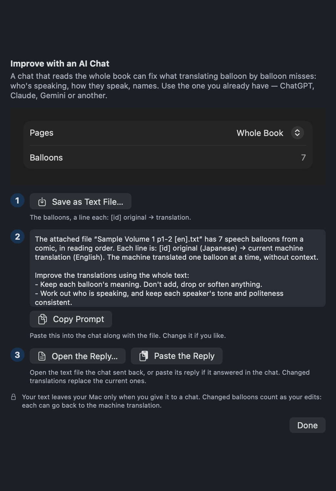

  <a href="manual.md">English</a> · <strong>한국어</strong>

# Panely — 사용 설명서

Panely 리더 인터페이스의 시각적 둘러보기입니다. 전체 기능 목록과 단축키,
빌드 방법은 [README](../README.ko.md)를 참고하세요.

> 스크린샷은 영어 UI로 찍은 것입니다. 시스템 언어가 한국어면 같은 자리에
> 한국어 이름이 표시됩니다.

---

## 한눈에 보기

리더는 레이아웃과 무관하게 사용자를 방해하지 않는 크롬을 유지합니다:

- **라이브러리 사이드바** (왼쪽, 고정 가능) — 폴더 트리, 즐겨찾기, 책별 페이지 북마크
- **플로팅 툴바** (위, 자동 숨김) — 레이아웃 / 맞춤 / 줌 / 즐겨찾기 / 북마크 / 네비게이션
- **뷰어** — 페이지 자체. 자동 중앙 정렬, 핀치 + 스크롤 휠 줌 지원
- **페이지 슬라이더** (아래, 자동 숨김) — Quick-jump 필드 + 권/페이지 카운터

---

## 책 열기

처음 실행 시 라이브러리는 비어있습니다:

**Pick Folder…** 를 클릭(또는 `⌘O` 누르거나 폴더를 앱 아이콘으로
드래그)해서 접근 권한을 부여합니다. 한 번 부여되면 사이드바가 트리와 책별
상태로 채워집니다:

사이드바는 자동으로 최대 세 가지 섹션을 노출합니다:

- **즐겨찾기**(Favorites) — ★ 버튼(또는 `⌘⇧D`)으로 별 표시한 책
- **북마크**(Bookmarks) — 🔖 버튼(또는 `⌘D`)으로 표시한 현재 책의 페이지들
- **다른 책의 북마크**(Bookmarks in Other Books) — 다른 책에 남겨 둔 북마크
- **Files** — 라이브러리 폴더 트리. 폴더와 아카이브(`.cbz` / `.zip`)가 시각적으로 구분됨

사이드바 상단의 핀 아이콘(또는 `⌃⌘S`)으로 영구 고정 가능. 고정하지
않으면 왼쪽 가장자리에 호버 시 오버레이로 슬라이드 인되고, 마우스가
떠나면 슬라이드 아웃됩니다.

---

## 읽기 레이아웃

세 가지 레이아웃이 모든 읽기 스타일을 커버합니다. `⌘⇧1` / `⌘⇧2` /
`⌘⇧3`로 원하는 모드 직접 선택 — 원치 않는 모드 거치는 사이클 없음.

### 단일 페이지 (`⌘⇧1`)

한 페이지가 뷰어를 채웁니다. 페이지 한 장이 독립적으로 의미를 가지는
포트레이트 스캔에 적합. 다음/이전 컨트롤이 페이지를 한 장씩 넘깁니다.

### 두 페이지 펼침 (`⌘⇧2`)

두 페이지가 나란히 — 실제 책 읽는 경험과 일치합니다. 두 페이지가
병렬로 디코드되어 스프레드 전환이 빠릅니다. 아래의 RTL 방향과 함께
쓰면 자연스러운 만화 셋업이 됩니다.

**표지 한 장(스프레드 오프셋).** 대부분의 스캔본은 1쪽이 단독 표지이고
실제 펼침 그림은 2–3쪽부터 시작합니다. 기본값은 (1,2)(3,4)…로 짝지어서
진짜 펼침이 두 화면에 쪼개지고 — 책 전체가 한 페이지씩 밀려 보입니다.
**오프셋 버튼**(book-pages 아이콘, 두 페이지 모드에서만 표시)을 켜면
표지를 단독으로 두고 그다음부터 짝지어 1 | (2,3) (4,5)… 가 됩니다. 이
설정은 다음 실행에도 유지되며, 펼침이 이미 맞는 책에서는 꺼 두면 됩니다.

### 세로 스크롤 (`⌘⇧3`)

위→아래로 끊김 없이 이어지는 스트립 — 웹툰을 위해 설계됨. 스크롤하면
페이지가 lazy하게 스트림되고, 뷰포트를 벗어난 페이지는 placeholder로
돌아가서 1000페이지 스트립이라도 모든 이미지를 메모리에 고정하지
않습니다.

### 만화용 우→좌 (RTL) 읽기

읽기 방향 토글(툴바 화살표 버튼)로 만화 읽기 순서를 뒤집습니다. RTL은
페이지 레이아웃에만 적용 — 세로 스크롤은 항상 위→아래로 읽으므로 세로
모드에서는 방향 토글이 자동 비활성화됩니다.

---

## 툴바

왼쪽에서 오른쪽으로 그룹화:

1. **Chrome** — 파일 열기(`⌘O`), 라이브러리 고정(`⌃⌘S`), 툴바 고정(`⌃⌘T`)
2. **레이아웃** — 단일 / 이중 / 세로, 읽기 방향 토글, 그리고 (두 페이지 모드일 때) 표지 한 장(스프레드 오프셋) 토글
3. **맞춤 & 줌** — 화면 / 가로 / 세로 맞춤(`⌘1`/`⌘2`/`⌘3`), 줌 인/아웃(`⌘+`/`⌘−`), 뷰 크기 잠금(`⌘L`)
4. **북마크** — 책 즐겨찾기(`⌘⇧D`), 페이지 북마크(`⌘D`), 북마크 목록 메뉴, 썸네일 사이드바 토글(`⌃⌘P`), 그리고 실험적 기능인 번역 보조를 켰을 때 번역 패널
5. **네비게이션** (오른쪽 끝) — 이전/다음 권(`[`/`]`), 이전/다음 페이지(`←`/`→`)

아이콘에 마우스를 올리면 이름과 단축키가 바로 표시됩니다.

창이 좁아서(작은 창, 또는 라이브러리를 고정한 상태) 툴바가 다 들어가지
않으면 **맞춤 & 줌** 그룹, 그다음 **레이아웃** 그룹이 각각 메뉴 버튼 하나로
접혀서 어떤 버튼도 잘리지 않습니다.

툴바는 커서가 상단 가장자리에서 벗어나면 자동으로 숨겨집니다. `⌃⌘T`로
읽는 동안 계속 표시하도록 고정할 수 있습니다.

---

## 페이지 네비게이션

하단 슬라이더 영역에는:

- **권 + 페이지 카운터** (`Vol 1 / 3 · 1 / 24`) — 현재 형제 권의 인덱스와 책 내 페이지 위치
- **Quick-jump 필드** — 클릭 후 페이지 번호 입력, Return으로 이동
- **슬라이더** — 책 전체를 드래그해서 시각적으로 탐색

슬라이더는 툴바와 같은 자동 숨김 규칙을 따릅니다. 하단 가장자리에 호버
시 다시 나타나며, `⌃⌘T`로 둘 다 고정할 수 있습니다.

큰 점프가 필요할 때는 **Go to Page…** 프롬프트(`⌘G`)가 1부터 전체
페이지 수까지의 번호를 받아 범위를 벗어나면 조용히 클램프합니다.

### 스크롤로 페이지 넘기기

페이지 레이아웃(단일·두 페이지)에서는 마우스 휠이나 트랙패드로 그냥
스크롤하면 페이지가 넘어갑니다. 아래로 스크롤 = 다음 페이지, 위로
스크롤 = 이전 페이지. 페이지가 뷰포트보다 크게 확대돼 있으면 스크롤이
먼저 패닝을 하고, 페이지가 이미 위/아래 끝에 붙은 상태에서 새로 시작한
스크롤만 페이지를 넘깁니다 — 긴 페이지를 끝까지 내리다가 실수로
넘어가는 일이 없습니다. 트랙패드 스와이프는 한 번에 정확히 1페이지만
넘기며 남은 관성은 무시됩니다. 세로 스크롤 레이아웃에서는 스크롤이
곧 읽기 동작이므로 이 기능이 적용되지 않습니다.

스크롤은 항상 패닝만 하길 원한다면 **View → Disable Scroll Page
Turning**으로 끌 수 있습니다.

---

## 권 연속 읽기

같은 폴더 안의 여러 파일로 구성된 시리즈에서, Panely는 그 파일들을
형제 권으로 인식하고 권 경계에서 이동 카드를 표시합니다.

언제든 `]` / `[` (또는 `⌘]` / `⌘[`)를 누르면 같은 폴더의 다음 / 이전
책·압축파일로 바로 이동합니다.

### 파일 하나만 열었을 때

macOS는 사용자가 직접 연 것만 Panely가 읽을 수 있게 합니다. 압축파일 하나만
열면(Finder에서 더블클릭, **열기…**) 같은 폴더의 다른 파일은 읽을 수 없어서
이동할 곳이 없습니다. 이때 `]`를 누르면 그 사실을 알려 주고 **폴더 접근
허용…** 버튼을 보여 줍니다. 폴더를 한 번 골라 주면 권 이동이 동작합니다.
허용한 폴더는 기억되므로, 다음에 그 폴더의 책을 열면 바로 이전/다음 책으로
이동할 수 있습니다.

### 권 끝

현재 권의 마지막 페이지에 도달하고 다음 형제가 있으면 뷰어 하단에
**Up next** 카드가 나타납니다. 다음 권의 파일명을 보여줘서 무엇이
시작될지 알 수 있습니다. `→` 또는 `Space` 한 번(또는 **Next volume**
클릭)으로 다음 권을 로드합니다. **Restart** 는 현재 권을 1페이지로
되감습니다.

### 이전 권

첫 권이 아닌 권의 0페이지에서 `←` 를 누르면 **Previous** 카드가
무장됩니다. 한 번 더 뒤로 누르면 이전 권으로 이동합니다.

이 카드는 의도 게이트가 적용됨 — 매번 0페이지에서 자동으로 뜨지 않아서
Vol 2를 처음 열었을 때 Vol 1에 대해 잔소리하지 않습니다. 명시적인
backward 신호가 있어야 표시됩니다.

### 시리즈별 기억

레이아웃·읽기 방향·맞춤 모드는 **시리즈 단위**로 기억됩니다 — 여기서
시리즈란 권들이 들어 있는 폴더(zip-in-zip이면 아카이브 자체)를 말합니다.
한 시리즈는 우→좌 두 페이지로, 다른 시리즈는 세로 웹툰으로 읽어 두면 각각
마지막 상태 그대로 다시 열립니다. 설정을 바꾸면 전역 기본값에도 함께 반영되며,
이 기본값은 처음 여는 시리즈의 출발점이 됩니다.

수동 **줌**도 같은 방식으로, 현재 세션 동안 따라갑니다 — 형제 권 사이를 오갈
때 유지되고, 각 시리즈의 줌을 앱 종료 전까지 기억하며, 다른 시리즈로 점프하면
새 책의 맞춤으로 스냅됩니다(이전 시리즈로 돌아오면 그 줌이 복원). 사이드바
고정·툴바 고정·뷰 크기 잠금은 모든 책에 걸쳐 전역으로 유지됩니다.

---

## 로딩 상태

무거운 작업은 중앙 오버레이로 현재 단계를 표시해서 무엇이 진행 중인지
항상 알 수 있게 합니다:

- **Opening…** — 파일 초기 검사
- **Analyzing archive…** — 중첩 아카이브 확인
- **Extracting archive…** — zip-in-zip 압축 해제 (5 GB 안전 상한)
- **Scanning folder…** — 디렉터리에서 페이지 목록 빌드
- **Loading pages…** — 이미지 데이터 디코드
- **Building vertical strip…** — 웹툰 모드용 lazy window 레이아웃

추출과 디코딩 모두 백그라운드 스레드에서 실행되므로 UI는 내내
반응성을 유지합니다.

성공적으로 추출된 zip-in-zip 아카이브는
`~/Library/Caches/panely-extraction-cache/`에 캐시됩니다 (10 GB 예산,
LRU 정리). 따라서 같은 아카이브를 다시 열 때는 즉시 표시됩니다.

---

## 일반 설정

Panely는 Mac의 기본 언어가 영어나 한국어면 그 언어를, 그 밖의 언어면 영어를
표시합니다. 직접 고르려면 **파일 → 설정… → 일반 → 언어**에서 **시스템 설정
따르기**, **English**, **한국어** 중에서 고르세요. 언어 이름은 항상 그 언어
자체로 표시되므로 화면이 어떤 언어든 원하는 항목을 쉽게 찾을 수 있습니다.

고르는 즉시 창, 메뉴, 설정이 새 언어로 바뀝니다. 다만 macOS가 직접 그리는 일부
메뉴 항목(편집·윈도우 메뉴, 종료 등)은 Panely를 다시 시작해야 바뀌며,
**지금 다시 시작**을 누르면 읽던 책을 다시 연 채로 재시작합니다.

---

## 라이브러리 설정

**File → Settings…**(또는 **Panely → Settings…**)의 **Library** 탭에서
Panely가 라이브러리 폴더를 기억하는 방식을 제어합니다.

- **Reopen last folder on launch** — 기본 켜짐: 콜드 런치 시 마지막으로
  열람한 폴더를 다시 엽니다(매번 폴더를 고를 필요 없음). 끄면 항상 빈
  상태로 시작합니다. 저장된 폴더는 유지되므로 다시 켜면 이어집니다.
- **Last opened** — 실행 시 다시 열릴 폴더. 마우스를 올리면 전체 경로가
  보입니다.
- **Forget Now** — 저장된 폴더를 즉시 삭제합니다. 일회성이라 다음에 폴더를
  열면 다시 기억됩니다.

---

## 저장 공간과 캐시

**File → Settings…**(또는 **Panely → Settings…**)의 Storage 탭에서
zip-in-zip 추출 캐시 용량을 확인하고 비울 수 있습니다.

- **Extraction cache** — 추출된 중첩 아카이브가 현재 디스크에서
  사용하는 전체 용량.
- **Clearable cache** — 즉시 삭제 가능한 용량. 현재 책이 캐시된 추출
  디렉터리에서 열려 있으면 해당 활성 캐시 entry는 읽기를 끊지 않도록
  보존됩니다.
- **Cache limit** — 자동 LRU 예산(10 GB).
- **Clear Cache** — 삭제 가능한 추출 캐시를 제거하고 용량을 다시 계산.

같은 정리는 **File → Clear Extraction Cache** 에서도 실행할 수 있습니다.
책을 로딩하거나 압축 해제 중일 때는 캐시 삭제가 비활성화됩니다.

## 진단

### Export Diagnostic Report

**File → Export Diagnostic Report…** 를 누르면 버그 리포트에 첨부할 수
있는 zip을 생성합니다. 같은 기능은 **Settings → Diagnostics** 에도
있습니다. 포함 내용:

- 앱 버전/build와 macOS 버전.
- 최근 Panely 로그.
- 파일 경로가 filename, extension, type 수준으로 redacted 된 최근 열기/로드 이벤트.
- 추출 캐시 용량, 현재 reader 설정, 마지막 reader 에러.
- 리포트와 최근 로그를 맞춰볼 수 있는 세션 ID와 앱 실행 시간.
- 진단 로그 레벨과 파일 로그 보존 정책.

### Clear Diagnostic Logs

**File → Clear Diagnostic Logs** 는 Panely의 최근 파일 로그를 비웁니다.
같은 버튼은 **Settings → Diagnostics** 에도 있습니다.

이 동작은 diagnostics cache 안의 `recent-log.txt` 파일만 삭제합니다.
그래서 다음 진단 리포트부터는 새로 쌓인 파일 로그만 포함됩니다. macOS
시스템 OSLog, 추출 캐시, 최근 열기 목록, 북마크, 즐겨찾기, 읽던 위치는
삭제하지 않습니다.

파일 로그는 무한히 쌓이지 않습니다. Panely는 `recent-log.txt` 하나만
최대 768 KB까지 유지하고, 한도를 넘으면 약 384 KB로 잘라냅니다. 진단
리포트에는 최신 256 KB만 포함됩니다. 파일을 직접 보려면 **Settings →
Diagnostics** 의 **Open Logs Folder** 를 사용하세요.

**Log level** 컨트롤은 앞으로 Panely가 OSLog와 파일 로그에 기록할 진단
이벤트의 최소 레벨을 바꿉니다. 이미 기록된 로그를 다시 필터링하거나
수정하지는 않습니다.

---

## 북마크와 즐겨찾기

### 책 즐겨찾기

책을 연 상태에서 `⌘⇧D` (또는 ★ 툴바 버튼)를 누르면 사이드바의
**즐겨찾기** 섹션에 추가됩니다. 즐겨찾기는 security-scoped bookmark로
실행 간 유지되며, 같은 볼륨 내에서 파일이 이동되어도 stale bookmark가
즉시 재생성되어 계속 동작합니다.

### 페이지 북마크

`⌘D` (또는 🔖 툴바 버튼)로 현재 페이지를 사이드바의 **북마크** 섹션에
표시합니다. 각 책은 자체 목록을 가지며(책당 500개 / 총 200권 상한),
zip-in-zip 임시 디렉터리 재추출에도 살아남는 안정적인 식별자로 관리됩니다.

각 행에는 해당 페이지의 썸네일이 표시됩니다. 행을 클릭하면 그 페이지로
이동하고, 마우스를 올려 ✕를 누르면(또는 우클릭 → **북마크 제거**) 삭제됩니다.
섹션 제목 옆의 휴지통 버튼은 확인을 거쳐 그 책의 북마크를 모두 삭제합니다.

`⌘⇧[` / `⌘⇧]` 로 현재 책 내의 북마크 사이를 이동할 수 있습니다.

### 다른 책의 북마크

다른 책으로 넘어가도 북마크는 사라지지 않습니다. 사이드바의 **다른 책의
북마크** 섹션에 북마크가 있는 다른 책이 모두 나열됩니다. 책을 펼쳐 페이지를
클릭하면 그 책이 해당 페이지로 바로 열립니다.

사이드바 없이도 같은 목록을 볼 수 있습니다.

- 툴바의 **북마크 목록** 버튼(🔖 옆)
- 메뉴 막대의 **이동 → 북마크**

**이동 → 모든 북마크 삭제…** 는 모든 책의 북마크를 지웁니다.

---

## 번역 보조 (실험적 기능)

읽지 못하는 언어로 된 만화를 위한 기능입니다. 말풍선의 글자를 읽어 기기 안에서
기계 번역한 결과를 페이지 위에 보여줍니다. 정식 번역을 대신하는 것이 아니라
줄거리를 따라가도록 돕는 용도라서, 원문은 언제나 클릭 한 번으로 볼 수 있습니다.
어떤 데이터도 Mac 밖으로 나가지 않으며 원본 파일은 바뀌지 않습니다.

**macOS 26** 이상에서 쓸 수 있고, 기본은 꺼져 있습니다.

### 켜기

**파일 → 설정… → 실험적 기능**에서 **번역 보조**를 켭니다. 같은 탭에서
다음을 정할 수 있습니다.

- **기본 언어** — 새 시리즈를 보여줄 언어. **시스템 기본**은 Panely의 인터페이스
  언어를 따릅니다.
- **말투 맞추기** — 기본은 켜짐(일본어 ↔ 한국어, Apple Intelligence 필요). Apple
  번역은 모든 대사를 존댓말로 바꾸는 경향이 있어서, 왕의 명령이 부탁처럼 되고 "안 돼"가
  "だめです"가 됩니다. Panely가 원문 어미로 말투를 판단하고, 기기 내 모델이 어미만
  고칩니다. 단어·시제·부정·문장 종류(질문, 명령)가 그대로일 때만 고친 문장을 쓰고,
  아니면 원래 번역을 둡니다. 전에 번역한 페이지는 다음에 책을 열 때 맞춰집니다.
- **직접 고친 내용** — 고친 페이지 수와 모두 삭제 버튼. 캐시와 따로 저장됩니다.
- **번역 캐시** — 완료된 번역이 차지하는 용량과 삭제 버튼.

효과음(スッ, パチパチ, 쾅)은 그려진 그대로 둡니다. 그려진 효과음은 OCR이 거의 읽지 못하고
읽어도 조각뿐이라, 번역하면 뜻보다 잡음이 늘었습니다.

### 어디에 무엇이 있나

번역 기능은 하는 일에 따라 몇 곳에 나뉘어 있습니다.

- **툴바의 번역 버튼** — 원문과 번역을 전환합니다(`⇧⌘T`). 아직 번역된 것이 없는
  책에서는 번역 패널을 엽니다.
- **그 옆의 언어 이름**("한국어 ▾" 또는 "원본 ▾") — 메뉴입니다. 보여줄 언어를
  고르거나, 다른 언어 번역을 시작하거나, 번역 패널·편집 모드를 엽니다. 화면에
  실제로 보이는 것을 표시하므로, 한국어로 읽던 시리즈의 새 권은 번역 전까지
  "원본"으로 나오고 메뉴 맨 위에 **이 책을 한국어로 번역**이 나옵니다.
- **번역 패널** — 이 책을 번역하는 곳: 다음에 할 일, 볼 언어, 이 책의 설정.
- **페이지 위 진행 표시** — 번역 중 진행률.
- **편집 모드**(`⇧⌘E`) — 페이지 위에서 바로 말풍선을 고치는 곳.
- **윈도우 → 작업**(`⌥⌘J`) — 백그라운드에서 돌아가는 모든 일(다른 책 번역,
  내보내기)과 내보낸 책 목록. 페이지 위 진행 표시를 눌러도 열립니다.
- **설정 → 실험적 기능** — 앱 전체 설정. 패널의 ⚙︎로 바로 열립니다.

### 책 번역하기

번역 버튼(또는 언어 메뉴의 **번역 패널…**)으로 패널을 열고 큰 **이 책 번역하기**
버튼(`⌥⌘T`)을 누릅니다. 지금 보고 있는 페이지부터 번역하고, 읽는 위치보다 앞서
나갑니다.

- 만화로 학습한 감지 모델이 말풍선을 찾아서, 한 말풍선의 여러 줄은 함께 번역되고
  붙어 있는 말풍선은 따로 번역됩니다. 번역은 말풍선 안쪽
  공간도 쓸 수 있어서(다른 것이 그려져 있지 않을 때만) 긴 번역이 원문의 좁은 줄에
  구겨지지 않습니다. 그래도 남는 것은
  **숨기기**로 처리합니다(아래 참고).
- 말풍선을 찾는 즉시 깜빡이는 테두리와 "…"가 나타나고, 번역이 하나씩 채워집니다.
- 버튼 아래 한 줄과 페이지 위 진행 표시에 진행률과 남은 시간이 보입니다. 설치 후
  처음 번역할 때는 모델을 불러오느라 1~2분 걸리며, 진행 표시에 안내가 나옵니다.
- 번역이 끝난 페이지는 썸네일 사이드바에 배지가, 페이지 슬라이더 아래에 표시가
  생깁니다.

같은 줄에 언어팩 설치 여부도 나옵니다. 언어팩이 없으면 큰 버튼이 **언어팩
다운로드…**로 바뀝니다.

시리즈를 처음 번역할 때 책의 언어를 자동으로 감지해 시리즈별로 기억합니다. 잘못
감지했다면 패널의 **이 책과 시리즈**를 펼쳐 **책의 언어**를 바꾸세요. 같은 곳에
**이 시리즈 자동 번역**과 **시리즈 전체 번역**이 있습니다.

**세로 스크롤**에서는 페이지를 하나의 스트립으로 읽기 때문에, 여러 이미지로 잘린
웹툰도 말풍선이 잘리지 않고 인식됩니다.

### 보는 언어 고르기

번역 버튼 옆의 언어 메뉴나 패널의 **보기** 목록에서 **원문 (번역 끄기)** 또는 번역된
언어를 고릅니다. 선택은 시리즈별로 기억됩니다. `⇧⌘T`는 원문과 번역을
전환합니다.

다른 언어로도 보고 싶다면 **다른 언어로 번역**을 고릅니다. 언어마다 따로 번역되고
저장되므로, 한국어로 읽는 동안 영어 번역을 돌릴 수도 있습니다. 각 언어의
**⋯** 메뉴에서 시작·일시정지·중지합니다.

말풍선을 클릭하면 번역, 다른 언어 번역, 원문을 함께 볼 수 있습니다. 텍스트를
선택해 복사하거나 단어를 찾아볼 수 있습니다.

### 말풍선 고치기

문제를 본 그 자리에서 바로 고칩니다. 모드를 먼저 찾을 필요가 없습니다.

- **말풍선 클릭**: 번역 옆에 **편집**, **원문 고치기**, **숨기기**가 있습니다.
- **말풍선 우클릭**(두 손가락 클릭): **번역 고치기…**, **원문 고치기…**, **이 말풍선 숨기기**,
  그리고 페이지 어디서든 **이 페이지 다시 번역**, **여기에 말풍선 추가…**.

**편집 모드**(`⇧⌘E`, 언어 메뉴, 패널, 우클릭 메뉴)는 책 전체의 고친 내용을 살펴볼 때 씁니다.
고친 말풍선에 연필 표시, 숨긴 말풍선은 점선 윤곽이 보이고, 놓친 글자 위를 드래그해
말풍선을 추가할 수 있습니다. 편집 중에는 페이지 위에 편집 막대가 보이고, `esc`나
**완료**로 읽기로 돌아갑니다.

말풍선 팝오버는 다음을 제공합니다.

- **편집** — 번역을 직접 고칩니다. 고친 번역은 그 언어에만 적용됩니다.
- **원문 고치기** — 글자를 잘못 인식했을 때 원문을 고치면 다시 번역합니다.
  책이 번역된 다른 언어에도 함께 적용됩니다.
- **숨기기** — 그림이나 배경을 글자로 잘못 읽은 말풍선을 숨깁니다. 숨긴 직후
  나오는 안내에서 **실행 취소**할 수 있습니다.
- **원래대로** — 그 말풍선만 되돌립니다. 번역과 원문을 둘 다 고쳤다면 하나씩 또는
  둘 다 고를 수 있습니다.

고친 말풍선은 오른쪽 위에 연필 표시가 붙고, 숨긴 말풍선은 점선 윤곽으로 보여
클릭하면 다시 나타납니다. 편집 막대에는 고친 말풍선 수, 쪽별 숨긴 말풍선 목록(골라서
이동하거나 모두 보이기), 이 책에서 고친 내용만 되돌리는 **이 책 되돌리기…**가
있습니다.

**번역되지 않은 글자**(OCR이 놓친 줄, 장식 글씨 제목 등)는 직접 추가할 수 있습니다. 편집
모드에서 그 위를 드래그해 상자를 그리면, Panely가 그 영역만 확대해서 다시 읽고(페이지 전체로는
못 읽던 글자도 이렇게 읽히는 경우가 많습니다) 번역해서 직접 추가한 말풍선으로 만듭니다.
읽을 글자가 없으면 빈 말풍선이 추가되니, 점선 윤곽을 클릭해 **원문 고치기**로 글자를 입력하거나
**편집**으로 번역을 바로 쓰세요. 직접 추가한 말풍선에는 숨기기 대신 **지우기**가 있고, 다른 편집
내용처럼 저장·되돌리기·내보내기에 포함됩니다. (감지 모델이 찾았는데 OCR이 비워 둔 글자 상자는
Panely가 알아서 한 번 더 확대해서 읽습니다.)

**개선 전에 번역된 페이지**(둘로 쪼개진 말풍선, 반말 원문인데 존댓말 번역 등)는 캐시를
지우지 않고 다시 할 수 있습니다. **이 페이지 다시 번역**(페이지 우클릭, 언어 메뉴, 편집 막대)은
화면의 페이지를 지금 방식으로 다시 읽고 번역하고, 패널 **이 책과 시리즈**의 **이 책 다시 번역…**은 모든 페이지를
다시 합니다. 고친 내용은 남지만, 묶음이 달라진 말풍선에서는 적용되지 않을 수 있습니다.

`↩`로 저장, `⇧↩`로 줄바꿈(`⌥↩`, `⌃↩`도 가능), `esc`로 취소합니다. 고친 내용은
번역 캐시와 따로 저장되므로 캐시를 지우거나 번역 모드를 바꿔도 유지됩니다.

### AI 채팅으로 다듬기

페이지나 책 전체를 한 번에 읽는 채팅 모델은 말풍선 하나씩 번역할 때 놓치는 것 — 누가
말하는지, 말투, 일관된 이름 — 을 고칠 수 있습니다. Panely가 직접 부르지 않고, 쓰고 있는
것(ChatGPT, Claude, Gemini 등)에 텍스트 파일을 주고받는 방식으로 씁니다.

1. **AI 채팅으로 다듬기…**를 엽니다 — 언어 메뉴, 페이지 우클릭, 패널의 **이 책과 시리즈**
   어디서 열어도 책 전체로 시작합니다. 이야기 전체를 읽어야 말하는 사람과 이름이 일관되기
   때문입니다. 책 전체를 못 받는 채팅이라면 **페이지 고르기**로 줄이세요.
2. **텍스트 파일로 저장…**을 누르면 말풍선이 한 줄에 하나씩 저장됩니다: `[p12-3]`(12쪽 세
   번째 말풍선) 같은 번호, 원문, 지금 번역. 이 파일을 새 채팅에 첨부하세요.
3. 시트에 함께 보낼 안내문(프롬프트)이 나옵니다 — 선택하거나 **안내문 복사**를 눌러 채팅에
   붙여넣고, 필요하면 고쳐 쓰세요. 모든 말풍선을 `[번호] 번역` 형식의 텍스트 파일(또는 코드
   블록 하나)로 돌려달라고 요청합니다.
4. 채팅의 답을 `.txt` 파일로 저장하고 **답 파일 열기…**를 누릅니다(채팅 창에 바로 답했다면
   답을 복사해 **답 붙여넣기**). 번역이 바뀐 말풍선은 새 번역을 직접 고친 내용으로 받습니다
   (편집 모드의 연필 표시, **기계 번역 사용**으로 하나씩 되돌리기). **실행 취소**는 그 답
   전체를 되돌립니다. 답에서 빠진 말풍선은 번호로 알려 주니, 채팅에 그 부분만 다시 요청하거나
   페이지를 줄여 보세요.

붙여넣은 글은 길면 잘릴 수 있지만 파일은 책 한 권도 그대로 전달됩니다. 채팅에 줄 때만 글이
Mac 밖으로 나갑니다. 성인물 내용은 거부하는 채팅도 있습니다.

### 다른 책과 시리즈 전체

다른 책을 열어도 번역은 계속됩니다. 그동안 페이지 위 작은 표시에 어떤 책이 어디까지
번역됐는지 나오고, 누르면 **윈도우 → 작업**이 열려 일시정지·재개·중지하거나 그 책으로
돌아갈 수 있습니다. 작업은 한 번에 하나씩, 지금 보고 있는 것부터 실행됩니다.

**시리즈 전체 번역**(**이 책과 시리즈** 안)은 같은 시리즈의 다른 권을 대기열에 넣습니다. 권 번호를 뺀
제목이 같은 권만 포함되며, 시작 전에 패널에 목록이 나옵니다.

몇 가지 제약은 해당 위치에 표시됩니다.

- 압축 파일 안의 책(zip-in-zip)은 다른 책을 열면 일시정지되고, 다시 열면 이어서
  번역합니다.
- Panely를 종료하면 번역과 내보내기가 멈춥니다. 완료된 페이지는 저장되며, 다시
  시작하면 나머지를 이어서 진행합니다.
- 백그라운드 작업이 오류로 멈추면 확인할 때까지 이유와 함께 목록에 남습니다.

### 번역본 내보내기

번역을 보관하거나 다른 앱에서 읽으려면 책을 내보내세요. 번역이 페이지에 입혀진
사본을 **CBZ**, **ZIP** 또는 **이미지 폴더**로 저장합니다(CBZ와 ZIP은 같은 압축
형식이고, `.zip`만 받는 앱이나 서비스에는 ZIP을 고르세요). 편집한 내용은 반영되고 숨긴
말풍선은 빠지며, 원본 파일은 그대로입니다.

시작하는 곳:

- 툴바의 언어 메뉴 — **번역본 내보내기…**, 다른 권이 있으면 **시리즈 번역본
  내보내기…**
- **파일 → 번역본 내보내기…**
- 번역 패널의 **이 책과 시리즈** 안, **시리즈 전체 번역** 아래
- 라이브러리 — 책을 우클릭하면 **번역본 내보내기…**, 권들이 든 폴더를 우클릭하면
  **시리즈 번역본 내보내기 (N권)…**. 책을 열지 않아도 됩니다.

짧은 시트에서 언어, 형식, **아직 번역 안 된 페이지**(**먼저 번역하기** 또는
**그대로 내보내기**), 저장 위치를 고릅니다. 저장 위치는 처음 한 번만 고르면
기억하고, 나머지 선택도 다음에 그대로 나옵니다.

내보내기는 백그라운드에서 진행되니 계속 읽거나 다른 책을 열어도 됩니다. 책마다
하나의 작업으로 **윈도우 → 작업**(`⌥⌘J`)에 나오며, 남은 페이지를 먼저 번역하고
(다른 번역과 같은 대기열) 이어서 페이지를 씁니다. 거기서 취소할 수 있습니다.
멈춘 작업(언어팩이 없는 경우 등)은 이유와 **다시 시도**와 함께 남습니다. 완료된
책은 앱을 다시 켜도 목록에 남고 **Finder에서 보기**와 **열기**를 바로 누를 수
있습니다. 끝나면 페이지 위 진행 표시로도 알려줍니다.

페이지는 읽는 순서대로 번호가 붙습니다(`001.jpg`, `002.jpg`…). 번역된 내용이 없는
페이지는 그대로 복사하고, 번역된 페이지는 형식을 유지합니다(PNG는 PNG, 나머지는
고품질 JPEG). 같은 이름이 있으면 번호를 붙입니다("… [한국어] 2.cbz").

---

## 키보드 단축키

전체 목록은
[README → 단축키와 제스처](../README.ko.md#단축키와-제스처) 참조.
가장 많이 쓰는 것들:

| 동작 | 단축키 |
|---|---|
| 다음 / 이전 페이지 | `→` / `←` (다음은 `Space` 도 가능) |
| 다음 / 이전 권 | `]` / `[` (`⌘]` / `⌘[` 도 가능) |
| 다음 / 이전 북마크 | `⌘⇧]` / `⌘⇧[` |
| 파일 열기 | `⌘O` |
| 현재 책 다시 읽기 | `⌘R` |
| 페이지 번호로 이동… | `⌘G` |
| 페이지 북마크 추가/제거 | `⌘D` |
| 책 즐겨찾기 추가/제거 | `⌘⇧D` |
| 레이아웃: 단일 / 이중 / 세로 | `⌘⇧1` / `⌘⇧2` / `⌘⇧3` |
| 맞춤: 화면 / 가로 / 세로 | `⌘1` / `⌘2` / `⌘3` |
| 줌 인 / 아웃 / 리셋 | `⌘+` / `⌘−` / `⌘0` |
| 라이브러리 / 툴바 / 썸네일 고정 | `⌃⌘S` / `⌃⌘T` / `⌃⌘P` |
| 뷰 크기 잠금 | `⌘L` |
| 번역: 원문 ↔ 번역 | `⇧⌘T` |
| 번역: 이 책 번역하기 / 일시정지 | `⌥⌘T` |
| 번역: 말풍선 편집 / 완료 | `⇧⌘E` |
| 작업 창 (번역, 내보내기) | `⌥⌘J` |
