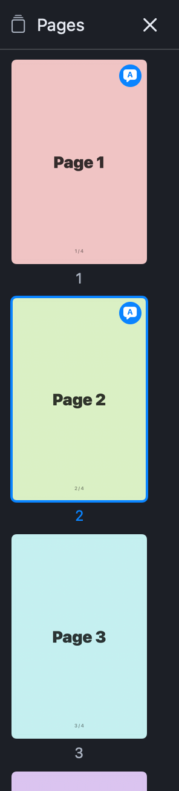
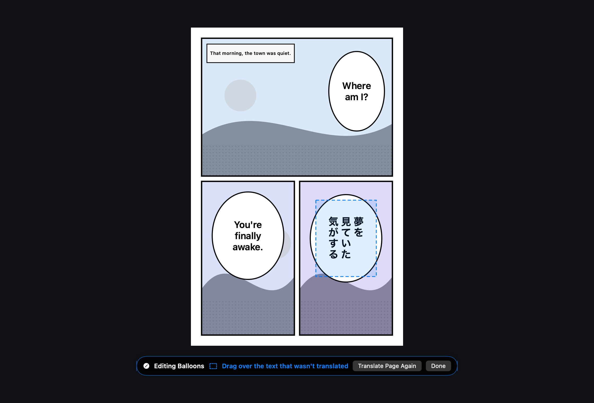
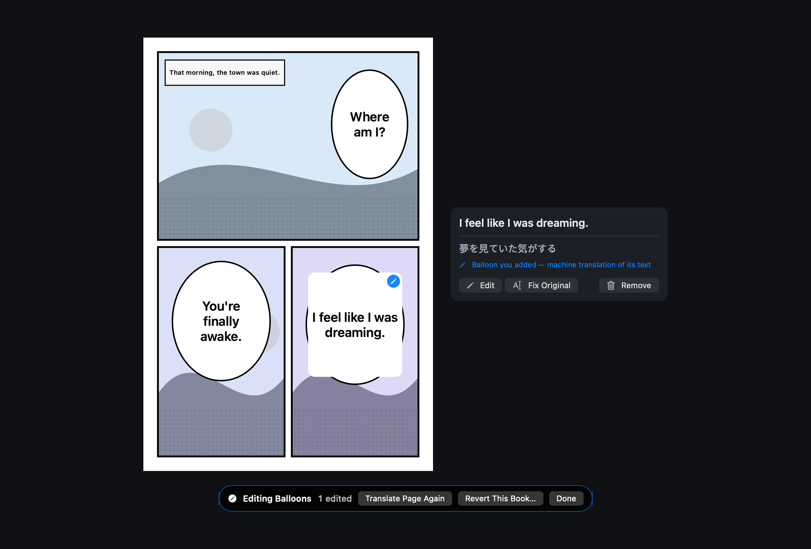

  <strong>English</strong> · <a href="manual.ko.md">한국어</a>

# Panely — User Manual

A visual walkthrough of Panely's reader interface. For the full feature
list, shortcuts table, and build instructions, see the
[README](../README.md).

Quick links: [Zoom and pan](#zoom-and-pan) · [Thumbnail navigation](#finding-pages-with-thumbnails) ·
[Correct balloons](#correcting-balloons) · [Add text OCR missed](#drag-to-translate-text-ocr-missed) ·
[Translate again](#translating-pages-and-books-again)

---

## At a glance

The reader keeps a layout-agnostic chrome that gets out of your way:

- **Library sidebar** (left, pinnable) — continue reading, folder tree, favorites, and per-book bookmarks.
- **Floating toolbar** (top, auto-hides) — layout / fit / zoom / favorite / bookmark / navigation.
- **Viewer** — the page itself, auto-centered with pinch or `⌘`-scroll zoom.
- **Page slider** (bottom, auto-hides) — quick-jump field plus volume + page counter.

---

## Opening a book

On first launch the library is empty:

Choose **Open Folder…** (or press `⌘O`, or drag a folder onto the app
icon) to grant access. `⌘O` also opens a single CBZ / ZIP / CBR / RAR
file. Once granted, the sidebar populates with your tree and any per-book
state:

The sidebar shows these sections whenever they have something in them:

- **Continue Reading** — the unfinished book you read most recently, with its progress; click to pick up where you left off (right-click → **Remove from Continue Reading** to clear it).
- **Volumes** — the volumes inside a zip-in-zip archive, which don't appear in the folder tree.
- **Favorites** — books you've starred (`⌘⇧D` or the ★ toolbar button).
- **Bookmarks** — pages you've marked (`⌘D` or the 🔖 toolbar button) in the current book.
- **Bookmarks in Other Books** — bookmarks you left in other books; click one to open that book on the page.
- **Files** — your library folder tree. Folders and archives (`.cbz` / `.zip` / `.cbr` / `.rar`) are visually distinguished, and books you've started show a progress ring (a check mark once finished).

The header's library button (**Change Library Root…**) picks a different
folder, and **Refresh File Tree** rescans it — the tree also refreshes on
its own when files are added, removed, or renamed. The pin icon (or
`⌃⌘S`) keeps the sidebar open permanently; without pinning, the sidebar
slides in as an overlay when you hover the left edge and slides back out
when you move away (or press `Esc`).

**File → Open Recent** lists the books and folders you opened last, and
**File → Reload Book** (`⌘R`) re-reads the current one. If the open book
changes on disk, a banner offers **Reload**.

Image folders are read in filename order (`1, 2, 10`). Opening a parent
folder containing volumes starts with its first book. Archives containing
other archives can be opened too; choose a nested volume from the sidebar's
**Volumes** section. Changes to images in an open folder also show a reload
banner.

---

## Reading layouts

Three layouts cover all reading styles. Pick directly with
`⌘⇧1` / `⌘⇧2` / `⌘⇧3` — no cycling through unwanted modes.

### Single page (`⌘⇧1`)

One page fills the viewer. Best for portrait scans where each page
stands alone. The next/previous controls advance one page at a time.

### Double page spread (`⌘⇧2`)

Two pages side by side, matching the physical book experience. Both
pages decode in parallel so spread refreshes feel snappy. Combined with
RTL reading direction (below), this is the natural manga setup.

**Standalone-cover offset.** Most scans put a lone cover on page 1, with
the true facing spreads starting at pages 2–3. By default the viewer
pairs (1,2) (3,4)…, which splits every real spread across two viewer
spreads — so the whole book looks shifted by one page. Toggle the
**offset button** (the book-pages icon, shown only in double-page mode)
to stand the cover alone and pair from there instead: 1 | (2,3) (4,5)….
The setting is remembered across launches; leave it off for books whose
spreads already line up.

### Vertical scroll (`⌘⇧3`)

Continuous strip from top to bottom — built for webtoons. Pages stream
in lazily as you scroll, and pages that have scrolled past get released
back to placeholders so even a 1000-page strip never pins every image in
memory.

### Right-to-left manga

Toggle reading direction (toolbar arrow button) to flip the order for
manga. RTL applies to paged layouts only — vertical scroll always reads
top-to-bottom, so the direction toggle disables itself in vertical mode.

In right-to-left reading the arrow keys follow the page: `←` goes to the
next page and `→` to the previous one (`Space` still goes forward).

---

## The toolbar

Left to right, the toolbar groups are:

1. **Chrome** — Open file (`⌘O`), pin library (`⌃⌘S`), pin toolbar (`⌃⌘T`)
2. **Layout** — Single / Double / Vertical, reading direction toggle, and (in double-page mode) the standalone-cover offset toggle
3. **Fit & Zoom** — Fit screen / width / height (`⌘1` / `⌘2` / `⌘3`), zoom in/out (`⌘+` / `⌘−`), view-size lock (`⌘L`)
4. **Bookmarks** — Favorite book (`⌘⇧D`), bookmark page (`⌘D`), bookmark list menu, toggle thumbnail sidebar (`⌃⌘P`), and — with the experimental translation assist on — the translation panel
5. **Navigation** (right edge) — Previous/next volume (`[` / `]`), previous/next page (`←` / `→`)

Hover any icon to see its name and shortcut right away.

When the window is too narrow for the whole row — a small window, or the
library pinned — the Fit & Zoom group, and then the Layout group, fold into
a single menu button each, so no button is ever cut off.

The toolbar auto-hides when your cursor leaves the top edge. Pin it with
`⌃⌘T` to keep it visible while reading.

---

## Zoom and pan

- **Fit to Screen** (`⌘1`) shows the whole page; **Fit to Width** (`⌘2`) and
  **Fit to Height** (`⌘3`) match that dimension. Clicking the current fit
  button in the toolbar returns to that fit after zooming or panning.
- Use `⌘+` / `⌘−` or a trackpad pinch to zoom. Hold `⌘` while scrolling to
  zoom around the pointer. Double-click the image to switch between 1× and
  2×; `⌘0` returns to the current fit mode.
- Scroll or drag the image to reach parts outside the window. **In balloon
  edit mode, dragging selects an area**: scroll to pan, or choose **Done**
  before dragging the image.
- **Lock View Size** (`⌘L`) keeps the scale when resizing the window,
  opening a sidebar or switching layouts. Unlock it to fit again on window
  resize. Opening a new book or explicitly choosing a fit mode still applies
  that fit while locked.

---

## Page navigation

The bottom slider region contains:

- **Volume + page counter** (`Vol 1 / 3 · 1 / 24`) — current sibling volume index plus page within the current book.
- **Quick-jump field** — click and type a page number, press Return to jump.
- **Slider** — drag for visual seek across the whole book.

The slider follows the same auto-hide rules as the toolbar. Hover the
bottom edge to bring it back, or pin both via `⌃⌘T`.

For larger jumps the **Go to Page…** prompt (`⌘G`) takes a number from
1 to the page count and clamps silently on out-of-range input.

### Finding pages with thumbnails

Use the toolbar's thumbnails button, **View → Show Thumbnails**, or `⌃⌘P`
to open the page list on the right. Click a thumbnail to jump there. A blue
border marks the current page; the list follows when you navigate with the
keyboard or slider too.

A blue speech-balloon badge marks a page fully translated into the current
translation language; it does not mark your edits. Close the list with its
**×** or `⌃⌘P`. Its visibility is remembered across launches.

### Scroll to turn pages

In the paged layouts (single and double), a plain scroll — mouse wheel
or trackpad — turns the page: scroll down for the next page, up for the
previous one. When the page is zoomed past the viewport, scrolling pans
it first; the turn only happens on a fresh scroll that starts with the
page already pinned at its top or bottom edge, so overshooting a tall
page never flips it by accident. Trackpad swipes turn exactly one page
each — leftover inertia is ignored. Vertical-scroll layout is
unaffected: there, scrolling is how you read.

Prefer scrolling to only ever pan? Turn it off via
**View → Disable Scroll Page Turning**.

---

## Volume continuity

When a series spans multiple files in the same folder, Panely treats
them as sibling volumes and surfaces continuation cards at the
boundaries.

Press `]` / `[` (or `⌘]` / `⌘[`) at any time to jump straight to the
next / previous book or archive in the folder.

### Opening a single file

macOS only lets Panely read what you opened. If you open one archive on
its own (double-click in Finder, **Open…**), the rest of its folder is
off-limits, so there is nothing to step to. Press `]` and Panely says so
and offers **Allow Folder Access…** — pick the folder once and volume
stepping works. The grant is remembered: the next time you open a book
from that folder, its neighbours are already available.

### End of volume

When you reach the last page of a volume and a next sibling exists, an
**Up next** card appears at the bottom of the viewer. It shows the next
volume's filename so you know what you're about to start. Pressing
`→` or `Space` once (or clicking **Next volume**) loads it.
**Restart** rewinds the current volume to page 1.

### Previous volume

Pressing back (`←`) at page 0 of any volume past the first — or paging
back onto page 0 — arms the **Previous** card. A second back press opens
the previous volume.

The card is intent-gated — it doesn't auto-appear on every fresh open
at page 0, so opening Volume 2 cold doesn't badger you about Volume 1.
Only an explicit backward signal surfaces it.

### Per-series memory

Layout, reading direction, and fit mode are remembered **per series** — a
series being the folder its volumes live in (or the archive itself for
zip-in-zip). Read one series right-to-left double-page and another as a
vertical webtoon, and each reopens the way you left it. Changing a setting
also updates the global default, which becomes the starting point for any
series you open for the first time.

Manual **zoom** carries the same way, for the current session: it stays as
you move between sibling volumes, each series remembers its zoom until you
quit, and jumping to a different series snaps the new book back to its fit
(returning to the earlier series restores its zoom). Sidebar pin, toolbar
pin, and the view-size lock stay global across every book.

---

## Loading states

Heavy operations show a centred overlay with the current stage so you
always know what's happening:

- **Opening…** — initial file inspection
- **Analyzing archive…** — checking for nested archives
- **Extracting archive…** — zip-in-zip unpacking (with a 5 GB safety cap)
- **Scanning folder…** — building the page list from a directory
- **Loading pages…** — decoding image data
- **Building vertical strip…** — laying out the lazy window for webtoon mode

All extraction and decoding runs on background threads, so the UI
remains responsive throughout.

Successfully extracted zip-in-zip archives are cached under
`~/Library/Caches/panely-extraction-cache/` (10 GB budget, LRU eviction),
so reopening the same archive is instant on subsequent launches.

---

## General settings

Panely follows your Mac's primary language when it's English or Korean,
and shows English for any other language. To choose yourself, open
**File → Settings… → General → Language** and pick **System Default**,
**English**, or **한국어**. Language names are always shown in their own
language, so the right one is easy to find whichever language is on screen.

The switch happens immediately — the window, settings, and every menu,
including the standard macOS ones (Edit, Window, Quit, and so on), change
as soon as you pick. No restart is needed.

---

## Library settings

Open **File → Settings…** (or **Panely → Settings…**) and choose the
**Library** tab to control how Panely remembers your library folder.

- **Reopen last folder on launch** — on by default: a cold launch reopens
  the last folder you browsed, so you don't have to pick it every session.
  Turn it off to always start empty. The saved folder is kept, so
  re-enabling picks up where you left off.
- **Last opened** — the folder a launch would reopen. Hover for the full
  path.
- **Forget Now** — drops the saved folder immediately. One-shot: the next
  folder you open is remembered again.

---

## Storage and cache

Open **File → Settings…** (or **Panely → Settings…**) to inspect and clear
the zip-in-zip extraction cache from the Storage tab.

- **Extraction cache** — total disk space currently used by extracted
  nested archives.
- **Clearable cache** — bytes that can be removed immediately. If the
  current book is open from a cached extraction, that active cache entry
  is kept so reading is not interrupted.
- **Cache limit** — the automatic LRU budget (10 GB).
- **Clear Cache** — removes clearable extraction cache entries and
  refreshes the totals.

The same cleanup is available from **File → Clear Extraction Cache**.
Cache clearing is disabled while a book is loading or extracting.

## Diagnostics

### Export Diagnostic Report

Choose **File → Export Diagnostic Report…** to create a zip that can be
attached to a bug report. The same action is also available from **Settings →
Diagnostics**. It includes:

- App version/build and macOS version.
- Recent Panely log lines.
- Recent open/load events with file paths redacted to filename, extension,
  and type.
- Extraction cache size, current reader settings, and the last reader error.
- Session ID and app launch time for correlating a report with recent logs.
- Diagnostic log level and file-log retention policy.

### Clear Diagnostic Logs

Choose **File → Clear Diagnostic Logs** to clear Panely's recent file log.
The same button is also available in **Settings → Diagnostics**.

This removes Panely's `recent-log.txt` file from the diagnostics cache so
future diagnostic reports include only new file logs. It does not clear
macOS system OSLog entries, extraction cache data, recent files, bookmarks,
favorites, or reading position.

The file log is intentionally bounded: Panely keeps one `recent-log.txt` file
up to 768 KB, trims it back to roughly 384 KB when it grows past that limit,
and includes the latest 256 KB in diagnostic reports. Use **Open Logs Folder**
in **Settings → Diagnostics** (or **File → Open Diagnostic Logs Folder**) to
inspect the file directly.

The **Log level** control changes which future Panely diagnostic events are
written to OSLog and the file log. It does not rewrite or filter logs that
were already recorded.

---

## Bookmarks and favorites

### Favoriting a book

Press `⌘⇧D` (or the ★ toolbar button) while a book is open to add it
to the **Favorites** section of the sidebar. Favorites persist across
launches via security-scoped bookmarks — moving the underlying file
within the same volume continues to work because stale bookmarks are
regenerated on the fly. Right-click a favorite → **Remove from Favorites**
to drop it.

### Bookmarking a page

Press `⌘D` (or the 🔖 toolbar button) to mark the current page in the
**Bookmarks** sidebar section. Each book gets its own list (capped at
500 entries per book, 200 books total), keyed by a stable identifier
that survives temp-directory re-extractions of zip-in-zip archives.

Each row shows a thumbnail of the page. Click a row to jump there; hover
it and click ✕ (or right-click → **Remove Bookmark**) to delete it. The
trash button in the section header removes every bookmark in the book
after a confirmation.

Step between bookmarks within the current book with `⌘⇧[` / `⌘⇧]`.

### Bookmarks in other books

Bookmarks aren't lost when you move on to another book. The sidebar's
**Bookmarks in Other Books** section lists every other bookmarked book;
expand one and click a page to open that book right on it. Right-click a
book → **Remove This Book's Bookmarks…** to clear just that book.

The same list is available without the sidebar:

- the **bookmark list** button in the toolbar (next to 🔖), and
- **Go → Bookmarks** in the menu bar.

**Go → Remove All Bookmarks in This Book…** clears the open book's
bookmarks, and **Go → Remove All Bookmarks…** clears the bookmarks in
every book.

---

## Translation assist (experimental)

For comics in a language you don't read. Panely reads the text in the speech
balloons and shows an on-device machine translation over the page. It's meant
to help you follow the story — not to replace a real translation — so the
original is always one click away. OCR and machine translation run on your
Mac, and your original files are never changed. **Improve with an AI Chat**
below is a separate workflow where you choose to give text to an external chat.

Requires **macOS 26** or later. It's off by default.

### Turning it on

Open **File → Settings… → Experimental** and switch on **Translation
Assist**. The same tab sets:

- **Default Language** — the language new series are shown in. **System
  Default** follows Panely's interface language. Panely translates between
  Japanese, Chinese (Simplified and Traditional), Korean and English.
- **Translation Model** — Google's Gemma 4 E2B, run on your Mac's GPU. One
  model translates every pair, with no modes to choose: it reads a page's
  balloons together with the lines before them, so names and each speaker's
  speech level carry over — a king's commands stay commands, casual lines stay
  casual, polite ones polite. It's downloaded once (3.35 GB, from Hugging
  Face) — here, or from the translation panel the first time you translate —
  with a progress bar and **Cancel**, and checked before it's used. **Delete
  Translation Model…** frees the space; books already translated stay
  translated. Nothing you read leaves your Mac. While translating it uses
  about 3.5 GB of memory, and lets it go two minutes after the last balloon.
- **Your Edits** — how many pages you've corrected, and a button to delete
  the edits. They're stored apart from the cache.
- **Translation Cache** — how much space finished translations take, and a
  button to clear them.

Sound effects (スッ, パチパチ, 쾅) are left as drawn. OCR reads few of the drawn
ones, and those only as fragments, so translating them added noise rather
than meaning.

### Where things are

Translation is spread over a few places, each for one job:

- **The toolbar's translate button** switches between the original and the
  translation (`⇧⌘T`). Before a book has anything translated, it opens the
  panel.
- **The language name next to it** ("Korean ▾", or "Original ▾") is a menu:
  pick the language to show, start another language, or open the panel or
  edit mode. It names what's actually on screen — a new volume of a series
  read in Korean says "Original" until it's translated, and the menu's first
  item translates it into Korean.
- **The translation panel** is for translating this book: what to do next,
  which language to view, and the book's own settings.
- **The pill over the page** shows progress while a job runs, with pause
  and stop.
- **Edit mode** (`⇧⌘E`) is for correcting balloons, right on the page.
- **Window → Jobs** (`⌥⌘J`) lists every translation and export in
  progress — this book's and other books' — and the books you've exported.
  The small pill for other books and exports opens it.
- **Settings → Experimental** holds app-wide choices; the panel's ⚙︎ opens it.
- **The View menu** has the same commands: **Show Translation** / **Hide
  Translation** (`⇧⌘T`), **Translate This Book** / **Pause Translating**
  (`⌥⌘T`), **Edit Balloons** (`⇧⌘E`) and **Show Hidden Balloons**.

### Translating a book

Open the panel from the translate button (or the language menu's
**Translation Panel…**) and press the big **Translate This Book** button (`⌥⌘T`).

Translation starts at the page you're on and keeps ahead of you as you read:

- A detector trained on comics finds the balloons, so all the lines of one
  balloon are translated together and neighbouring balloons stay apart. A translation can use the
  room inside its balloon — when nothing else is drawn there — so a long one
  isn't squeezed into the original's narrow lines. **Hide** is for whatever still
  slips through (see below).
- If the detector finds a text area but OCR returns no text, Panely automatically
  reads that area again, enlarged. Use the drag-to-add steps below for anything
  still missed.
- Balloons appear with a pulsing outline and "…" as soon as they're found, and
  fill in one by one.
- The line under the button, and the pill over the page, show progress and the
  time left. The first translation after installing takes a minute or two
  while the models load — the pill says so.
- Finished pages get a badge in the thumbnail sidebar.

Before the first translation, the big button is **Download Translation Model
(3.35 GB)** (the banner over the page offers **Download** too). It shows a
progress bar with **Cancel** while the model downloads, then becomes
**Translate This Book**; a job that was waiting for the model starts by
itself. On an M1 Pro a balloon takes about a quarter of a second, a page a
few seconds; each balloon fills in as soon as its translation is written.

The first time you translate a series, Panely works out which language the
book is in and remembers it for the series. If it guessed wrong, open **This
Book & Series** in the panel and change **Book's Language**; the same section
holds **Translate This Series Automatically** and **Translate Entire Series**.

In **Vertical scroll** the pages are read as one strip, so a webtoon cut into
many images still gets whole balloons.

### Choosing what to view

Use the language menu next to the translate button, or the panel's **View**
list: **Original
(translation off)** or any language the book has been translated into, with
its progress. The choice is remembered for the series. `⇧⌘T` switches between
the original and the translation.

To read in another language too, choose **Translate into Another Language**.
Each language is translated and stored separately, so you can read in Korean
while an English translation runs; a language's **⋯** menu starts, pauses or
stops it.

Click any balloon to see its translation, the book's other languages and the
original together. The text is selectable, so you can copy it or look a word up.

### Correcting balloons

Choose the action that matches what went wrong:

| Problem on the page | Action |
|---|---|
| The original is right but the translation is awkward | Click the balloon → **Edit** |
| OCR misread the original | Click the balloon → **Fix Original** |
| Text has no translation balloon at all | **Edit Balloons** → [drag a box over the text](#drag-to-translate-text-ocr-missed) |
| Artwork or background was mistaken for text | **Hide** |
| An area you added is wrong | Click your balloon → **Remove**, then add the right area |

#### Rewriting a translation or fixing the original

1. Click the balloon. You can correct it while reading, without entering
   edit mode first. Right-click → **Edit Translation…** / **Fix Original…**
   opens the text editor directly.
2. For a translation alone, choose **Edit**, type your translation and
   press **Save**. What you write applies only to the current language.
3. For an OCR mistake, choose **Fix Original**, type the correct original
   and press **Translate Again**. The correction also applies to the book's
   other translated languages; a language with no new translation yet offers
   **Translate Again** in the popover.

While typing, `↩` saves, `⇧↩` starts a new line (`⌥↩` and `⌃↩` work too),
and `esc` or **Cancel** discards the current draft. A translation you wrote
still takes priority over a corrected original: choose **Revert → Use
Machine Translation** if you want the automatic translation instead.

#### Edit mode, hiding and reverting

Enter from **View → Edit Balloons** (`⇧⌘E`), the toolbar's language menu,
the panel's **Edit Balloons** button, or the page's right-click menu.
Translation Assist must be enabled and this book must have translated pages.
If the button is disabled, run **Translate This Book** first. Entering edit
mode also turns the translation display on.

- **Pencil badges** mark balloons you changed or added. Click to inspect one.
- **Hide** removes a false detection from reading. The banner immediately
  afterwards offers **Undo**. In edit mode a hidden balloon appears as a
  dashed outline; click it to show it again.
- **The hidden-balloon menu** in the edit bar lists them by page: pick one
  to go there, or choose **Show All Hidden Balloons**. **View → Show Hidden
  Balloons** also restores them all.
- **Revert** restores just the clicked balloon. If both its translation and
  original were changed, choose **Use Machine Translation**, **Restore
  Original**, or **Revert Both**.
- **Revert This Book…** in the edit bar asks for confirmation, then undoes
  this book's corrections, hiding and added balloons. To reset every book,
  use **Settings → Experimental → Your Edits → Delete All Edits…**.

Choose **Done**, `⇧⌘E` or `esc` to return to reading. Done does not discard
saved changes. Edits save automatically apart from the translation cache,
survive reopening the book or clearing the cache, and appear in exported books.

### Drag to translate text OCR missed

When whole-page OCR misses dialogue or a title, you can mark its area to
read and translate it again. This adds a new balloon.

1. Pick the language to view in the toolbar's language menu and enter
   **Edit Balloons** (`⇧⌘E`). Alternatively, right-click the page → **Add a
   Balloon Here…**. That command opens edit mode and prompts you to drag;
   it does not immediately create a balloon where you right-clicked.
2. Zoom in if needed. Start **outside an existing translation balloon**,
   hold the mouse down and drag diagonally to enclose all the missed text.
   Mark one line of dialogue or title at a time, leaving out unrelated text.

3. Release the mouse. Panely enlarges and reads just that area with OCR.
   If text is recognized, it **automatically translates into the language
   currently shown** and displays the new balloon. This can recover text
   the whole-page pass could not read.
4. Click the added balloon to check its original and translation. Correct
   OCR mistakes with **Fix Original → Translate Again**, or change just the
   translation with **Edit → Save**.

If it does not work as expected:

| What happens | What to do |
|---|---|
| Dragging pans the page | Turn on **Edit Balloons**. |
| You get a click rather than a selection box | Start outside existing balloons and draw a larger box. Very small drags do not select an area. |
| A balloon was added but no text was read | Click its dashed area in edit mode, type the original with **Fix Original**, then **Translate Again**. You can also write the translation directly with **Edit**. |
| There is an original but no translation | If prompted, download the translation model, then click the balloon's **Translate Again**. Check **Book's Language** in the panel too. |
| You marked the wrong area or added a duplicate | Choose **Remove** on your added balloon (**Remove This Balloon** on right-click), then draw again. |
| The translation is missing after switching languages | In edit mode, click that area and choose **Translate Again**, or write its translation in that language. |

Added balloons are saved, included in book-level reverting and painted into
exports. Their recognized original and area carry across languages; each
language has its own translation.

### Translating pages and books again

Use a full-page retry when you want to re-read the whole page, rather than
add one area. It also updates older results such as a balloon previously
split into two. There is no need to clear the cache first.

- **Pages on screen** — right-click or use the toolbar's language menu →
  **Translate This Page Again**, or **Translate Page Again** in the edit bar.
  In double-page layout, this processes both displayed pages.
- **The whole book** — translation panel → **This Book & Series → Translate
  This Book Again…**, then confirm. It can take as long as the first pass.

Your edits stay, though an edit may no longer apply if recognition changes
how a balloon is grouped or placed. Check the results afterwards.

### Improving with an AI chat

A chat model that reads a whole book at once fixes what
translating balloon by balloon can't: who's speaking, how they speak, names
kept the same. Panely doesn't call one itself; use the one you already have
(ChatGPT, Claude, Gemini…) by passing it a text file:

1. Open **Improve with an AI Chat…** — from the language menu, by
   right-clicking a page, or from **This Book & Series** in the panel. It
   starts with the whole book: a chat reading the whole story keeps
   speakers and names straight. **Choose Pages** narrows it for a chat that
   can't take a whole book.
2. **Save as Text File…** saves the balloons, one per line: an id like
   `[p12-3]` (page 12, third balloon), the original and the current
   translation. Attach the file to a new chat.
3. The sheet shows a prompt to go with it — select it or press **Copy
   Prompt**, paste it into the chat and change it if you like. It asks the
   chat to send every balloon back as `[id] translation`, as a text file
   (or one code block).
4. Save the chat's reply as a `.txt` file and press **Open the Reply…** —
   or, if it answered in the conversation, copy the reply and press
   **Paste the Reply**. Each balloon whose translation it changed takes the
   new one, as your own edit (a pencil in edit mode, **Use Machine
   Translation** to go back one by one); **Undo** puts the whole reply back.
   Balloons the reply left out are named — ask the chat for those, or choose
   fewer pages.

A file carries a whole book where pasted text can be cut short. Your text
leaves your Mac only when you give it to a chat; some chats refuse mature
content.

### Other books and whole series

Translating continues when you open another book. While it runs, a small pill
over the page says which book and how far along it is; click it to open
**Window → Jobs**, where you can pause, resume, stop, or jump back to the book. One job
runs at a time, and whatever you're looking at goes first.

**Translate Entire Series** (under **This Book & Series**) queues the other
volumes of the series — only those whose titles match once volume numbers are
ignored, and the panel lists them before you start.

A few limits are shown where they apply:

- A book inside an archive (zip-in-zip) pauses when you open another book and
  continues when you come back. **Translate Entire Series** skips such
  volumes and names them in the panel — open each one to translate it.
- Quitting Panely stops translating and exporting. Finished pages are kept,
  and the rest continues when you start again.
- If a job in the background stops on an error, it stays in the list with the
  reason until you dismiss it.

### Exporting a translated copy

To keep a translation, or read it in another app, export the book: Panely
saves a copy with the translation painted into the pages — your edits
included, hidden balloons left out — as a **CBZ**, a **ZIP** or a **folder of
images**. CBZ and ZIP are the same archive; pick ZIP for an app or service
that only takes `.zip`.
The original is left as it is.

Start it from:

- the language menu in the toolbar — **Export Translated Book…**, and
  **Export Translated Series…** when the book has other volumes;
- **File → Export Translated Book…**;
- the panel's **This Book & Series**, under **Translate Entire Series**;
- the library: right-click a book for **Export Translated Book…**, or a
  folder of volumes for **Export Translated Series (N Volumes)…** (the
  **Volumes** header offers **Export Translated Series…** too). The book
  needn't be open.

A short sheet asks for the language, the format, what to do with **Pages Not
Translated Yet** (**Translate Them First**, or **Export As They Are**) and
where to save (**Save To**) — chosen once and remembered, like the format
and the choice for untranslated pages. The language starts as the one the
series is shown in.

Exporting runs in the background: keep reading, or open another book. Each
book is its own job in **Window → Jobs** (`⌥⌘J`) — first translating what's
left (through the same queue as other translations), then writing the pages —
and can be cancelled there. A job that stops (the model not downloaded, say)
stays listed with the reason and **Try Again**. Finished books stay listed,
across launches, with **Show in Finder** and **Open**; the pill over the page
says when one is done. A volume inside another archive exists only while
that archive is open, so keep it open until the export finishes — the sheet
says so.

Pages come out numbered in reading order (`001.jpg`, `002.jpg`…). Pages with
nothing translated are copied unchanged; translated ones keep their format
(PNG stays PNG, the rest become high-quality JPEG). A name that's taken gets a
number ("… [Korean] 2.cbz").

---

## Keyboard shortcuts

The full list lives in
[README → Shortcuts & Gestures](../README.md#shortcuts--gestures).
The most-used:

| Action | Shortcut |
|---|---|
| Next / previous page | `→` / `←` (swapped in right-to-left; also `Space` for next) |
| Next / previous volume | `]` / `[` (also `⌘]` / `⌘[`) |
| Next / previous bookmark | `⌘⇧]` / `⌘⇧[` |
| Open file | `⌘O` |
| Reload current book | `⌘R` |
| Go to page… | `⌘G` |
| Bookmark / unbookmark page | `⌘D` |
| Favorite / unfavorite book | `⌘⇧D` |
| Layout: single / double / vertical | `⌘⇧1` / `⌘⇧2` / `⌘⇧3` |
| Fit: screen / width / height | `⌘1` / `⌘2` / `⌘3` |
| Zoom in / out / reset | `⌘+` / `⌘−` / `⌘0` |
| Pin library / pin toolbar / show thumbnails | `⌃⌘S` / `⌃⌘T` / `⌃⌘P` |
| Lock view size | `⌘L` |
| Translation: original ↔ translation | `⇧⌘T` |
| Translation: translate this book / pause | `⌥⌘T` |
| Translation: edit balloons / done | `⇧⌘E` |
| Jobs window (translations, exports) | `⌥⌘J` |
