

  <strong>English</strong> · <a href="manual.ko.md">한국어</a>

# Panely — User Manual

A visual walkthrough of Panely's reader interface. For the full feature
list, shortcuts table, and build instructions, see the
[README](../README.md).

---

## At a glance

The reader keeps a layout-agnostic chrome that gets out of your way:

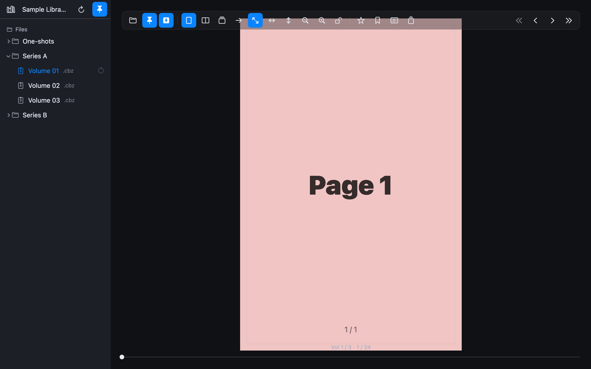

- **Library sidebar** (left, pinnable) — folder tree, favorites, and per-book bookmarks.
- **Floating toolbar** (top, auto-hides) — layout / fit / zoom / favorite / bookmark / navigation.
- **Viewer** — the page itself, auto-centered with pinch + scroll-wheel zoom.
- **Page slider** (bottom, auto-hides) — quick-jump field plus volume + page counter.

---

## Opening a book

On first launch the library is empty:

Choose **Pick Folder…** (or press `⌘O`, or drag a folder onto the app
icon) to grant access. Once granted, the sidebar populates with your tree
and any per-book state:

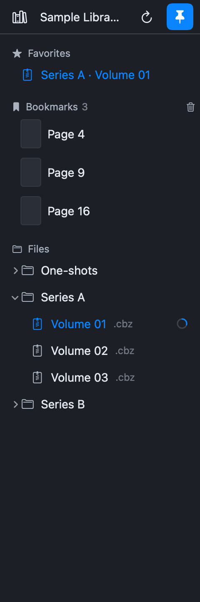

The sidebar surfaces up to three sections automatically:

- **Favorites** — books you've starred (`⌘⇧D` or the ★ toolbar button).
- **Bookmarks** — pages you've marked (`⌘D` or the 🔖 toolbar button) in the current book.
- **Bookmarks in Other Books** — bookmarks you left in other books; click one to open that book on the page.
- **Files** — your library folder tree. Folders and archives (`.cbz` / `.zip`) are visually distinguished.

The pin icon at the top of the sidebar (or `⌃⌘S`) keeps it open
permanently; without pinning, the sidebar slides in as an overlay when
you hover the left edge and slides back out when you move away.

---

## Reading layouts

Three layouts cover all reading styles. Pick directly with
`⌘⇧1` / `⌘⇧2` / `⌘⇧3` — no cycling through unwanted modes.

### Single page (`⌘⇧1`)

One page fills the viewer. Best for portrait scans where each page
stands alone. The next/previous controls advance one page at a time.

### Double page spread (`⌘⇧2`)

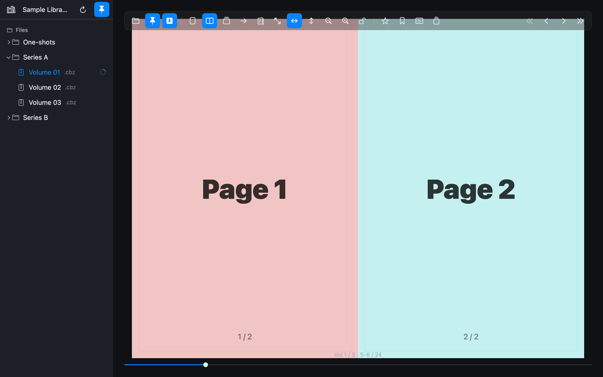

Two pages side by side, matching the physical book experience. Both
pages decode in parallel so spread refreshes feel snappy. Combined with
RTL reading direction (below), this is the natural manga setup.

**Standalone-cover offset.** Most scans put a lone cover on page 1, with
the true facing spreads starting at pages 2–3. By default the viewer
pairs (1,2) (3,4)…, which splits every real spread across two viewer
spreads — so the whole book looks shifted by one page. Toggle the
**offset button** (the book-pages icon, shown only in double-page mode)
to stand the cover alone and pair from there instead: 1 | (2,3) (4,5)….
The setting is remembered across launches; leave it off for books whose
spreads already line up.

### Vertical scroll (`⌘⇧3`)

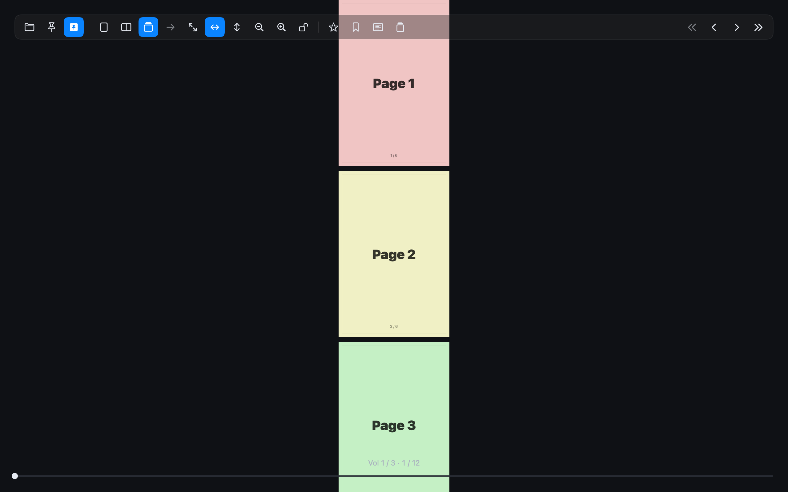

Continuous strip from top to bottom — built for webtoons. Pages stream
in lazily as you scroll, and pages that have scrolled past get released
back to placeholders so even a 1000-page strip never pins every image in
memory.

### Right-to-left manga

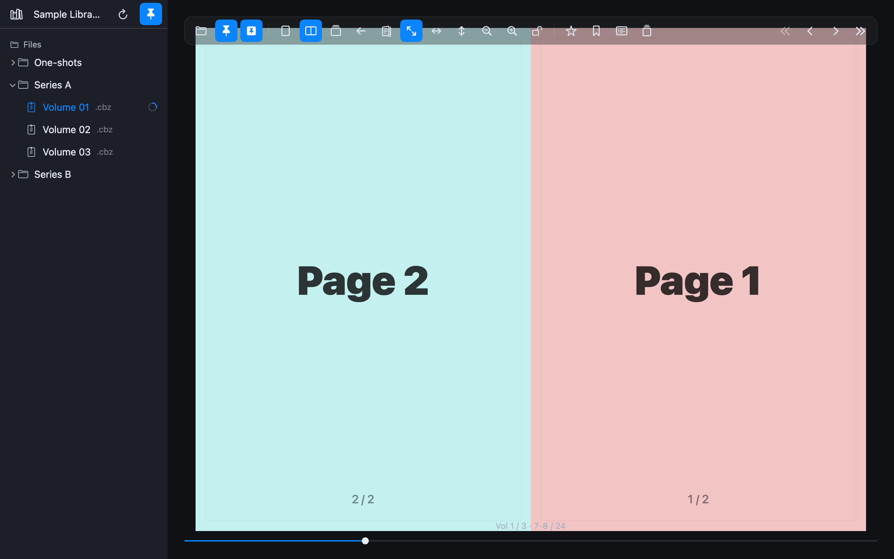

Toggle reading direction (toolbar arrow button) to flip the order for
manga. RTL applies to paged layouts only — vertical scroll always reads
top-to-bottom, so the direction toggle disables itself in vertical mode.

---

## The toolbar

Left to right, the toolbar groups are:

1. **Chrome** — Open file (`⌘O`), pin library (`⌃⌘S`), pin toolbar (`⌃⌘T`)
2. **Layout** — Single / Double / Vertical, reading direction toggle, and (in double-page mode) the standalone-cover offset toggle
3. **Fit & Zoom** — Fit screen / width / height (`⌘1` / `⌘2` / `⌘3`), zoom in/out (`⌘+` / `⌘−`), view-size lock (`⌘L`)
4. **Bookmarks** — Favorite book (`⌘⇧D`), bookmark page (`⌘D`), bookmark list menu, toggle thumbnail sidebar (`⌃⌘P`), and — with the experimental translation assist on — the translation panel
5. **Navigation** (right edge) — Previous/next volume (`[` / `]`), previous/next page (`←` / `→`)

Hover any icon to see its name and shortcut right away.

When the window is too narrow for the whole row — a small window, or the
library pinned — the Fit & Zoom group, and then the Layout group, fold into
a single menu button each, so no button is ever cut off.

The toolbar auto-hides when your cursor leaves the top edge. Pin it with
`⌃⌘T` to keep it visible while reading.

---

## Page navigation

The bottom slider region contains:

- **Volume + page counter** (`Vol 1 / 3 · 1 / 24`) — current sibling volume index plus page within the current book.
- **Quick-jump field** — click and type a page number, press Return to jump.
- **Slider** — drag for visual seek across the whole book.

The slider follows the same auto-hide rules as the toolbar. Hover the
bottom edge to bring it back, or pin both via `⌃⌘T`.

For larger jumps the **Go to Page…** prompt (`⌘G`) takes a number from
1 to the page count and clamps silently on out-of-range input.

### Scroll to turn pages

In the paged layouts (single and double), a plain scroll — mouse wheel
or trackpad — turns the page: scroll down for the next page, up for the
previous one. When the page is zoomed past the viewport, scrolling pans
it first; the turn only happens on a fresh scroll that starts with the
page already pinned at its top or bottom edge, so overshooting a tall
page never flips it by accident. Trackpad swipes turn exactly one page
each — leftover inertia is ignored. Vertical-scroll layout is
unaffected: there, scrolling is how you read.

Prefer scrolling to only ever pan? Turn it off via
**View → Disable Scroll Page Turning**.

---

## Volume continuity

When a series spans multiple files in the same folder, Panely treats
them as sibling volumes and surfaces continuation cards at the
boundaries.

Press `]` / `[` (or `⌘]` / `⌘[`) at any time to jump straight to the
next / previous book or archive in the folder.

### Opening a single file

macOS only lets Panely read what you opened. If you open one archive on
its own (double-click in Finder, **Open…**), the rest of its folder is
off-limits, so there is nothing to step to. Press `]` and Panely says so
and offers **Allow Folder Access…** — pick the folder once and volume
stepping works. The grant is remembered: the next time you open a book
from that folder, its neighbours are already available.

### End of volume

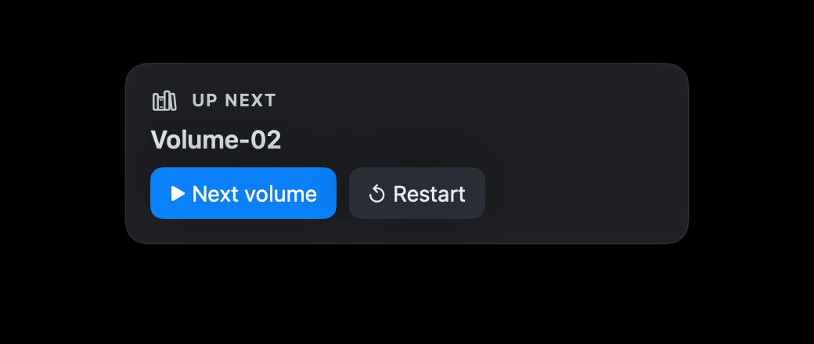

When you reach the last page of a volume and a next sibling exists, an
**Up next** card appears at the bottom of the viewer. It shows the next
volume's filename so you know what you're about to start. Pressing
`→` or `Space` once (or clicking **Next volume**) loads it.
**Restart** rewinds the current volume to page 1.

### Previous volume

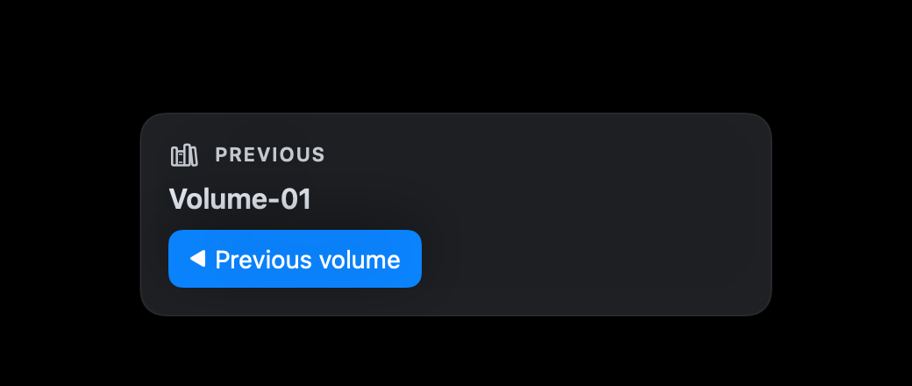

Pressing back (`←`) at page 0 of any volume past the first arms the
**Previous** card. A second back press opens the previous volume.

The card is intent-gated — it doesn't auto-appear on every fresh open
at page 0, so opening Volume 2 cold doesn't badger you about Volume 1.
Only an explicit backward signal surfaces it.

### Per-series memory

Layout, reading direction, and fit mode are remembered **per series** — a
series being the folder its volumes live in (or the archive itself for
zip-in-zip). Read one series right-to-left double-page and another as a
vertical webtoon, and each reopens the way you left it. Changing a setting
also updates the global default, which becomes the starting point for any
series you open for the first time.

Manual **zoom** carries the same way, for the current session: it stays as
you move between sibling volumes, each series remembers its zoom until you
quit, and jumping to a different series snaps the new book back to its fit
(returning to the earlier series restores its zoom). Sidebar pin, toolbar
pin, and the view-size lock stay global across every book.

---

## Loading states

Heavy operations show a centred overlay with the current stage so you
always know what's happening:

- **Opening…** — initial file inspection
- **Analyzing archive…** — checking for nested archives
- **Extracting archive…** — zip-in-zip unpacking (with a 5 GB safety cap)
- **Scanning folder…** — building the page list from a directory
- **Loading pages…** — decoding image data
- **Building vertical strip…** — laying out the lazy window for webtoon mode

All extraction and decoding runs on background threads, so the UI
remains responsive throughout.

Successfully extracted zip-in-zip archives are cached under
`~/Library/Caches/panely-extraction-cache/` (10 GB budget, LRU eviction),
so reopening the same archive is instant on subsequent launches.

---

## General settings

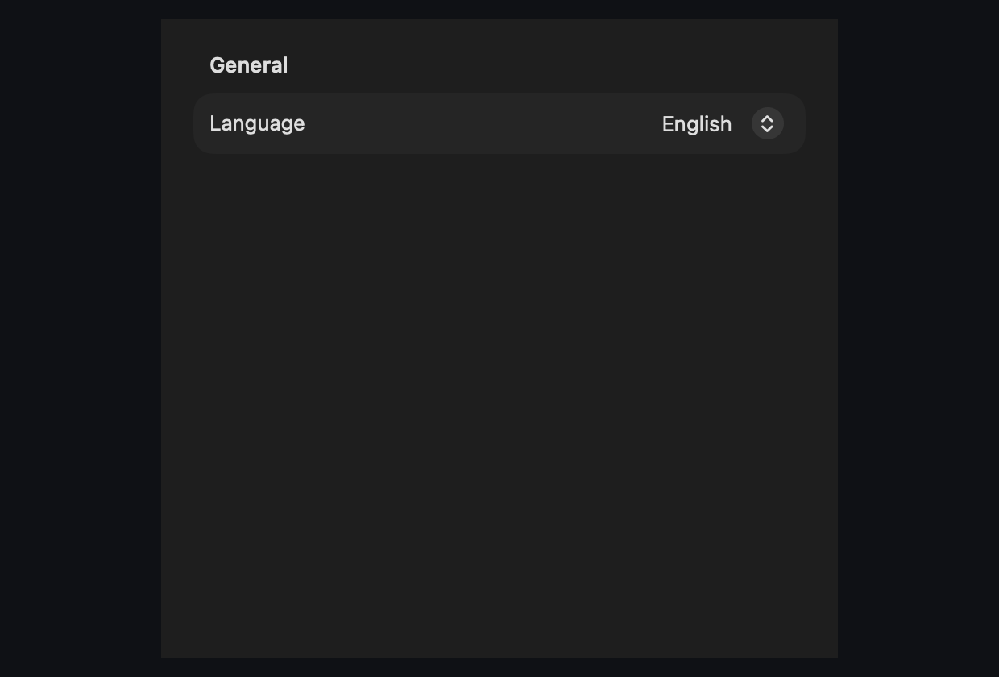

Panely follows your Mac's primary language when it's English or Korean,
and shows English for any other language. To choose yourself, open
**File → Settings… → General → Language** and pick **System Default**,
**English**, or **한국어**. Language names are always shown in their own
language, so the right one is easy to find whichever language is on screen.

The switch happens immediately — the window, menus, and settings change as
soon as you pick. A few menu items that macOS draws itself (the Edit and
Window menus, Quit, and so on) keep the previous language until Panely
restarts; **Restart Now** does that and reopens the book you were reading.

---

## Library settings

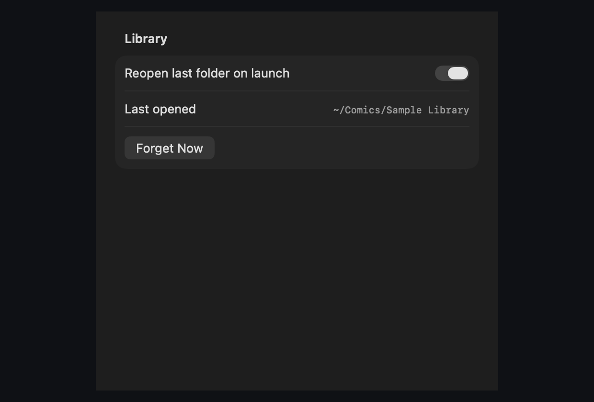

Open **File → Settings…** (or **Panely → Settings…**) and choose the
**Library** tab to control how Panely remembers your library folder.

- **Reopen last folder on launch** — on by default: a cold launch reopens
  the last folder you browsed, so you don't have to pick it every session.
  Turn it off to always start empty. The saved folder is kept, so
  re-enabling picks up where you left off.
- **Last opened** — the folder a launch would reopen. Hover for the full
  path.
- **Forget Now** — drops the saved folder immediately. One-shot: the next
  folder you open is remembered again.

---

## Storage and cache

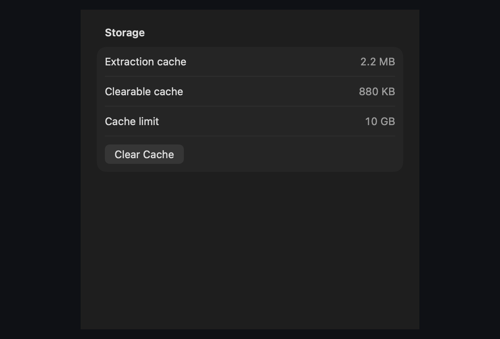

Open **File → Settings…** (or **Panely → Settings…**) to inspect and clear
the zip-in-zip extraction cache from the Storage tab.

- **Extraction cache** — total disk space currently used by extracted
  nested archives.
- **Clearable cache** — bytes that can be removed immediately. If the
  current book is open from a cached extraction, that active cache entry
  is kept so reading is not interrupted.
- **Cache limit** — the automatic LRU budget (10 GB).
- **Clear Cache** — removes clearable extraction cache entries and
  refreshes the totals.

The same cleanup is available from **File → Clear Extraction Cache**.
Cache clearing is disabled while a book is loading or extracting.

## Diagnostics

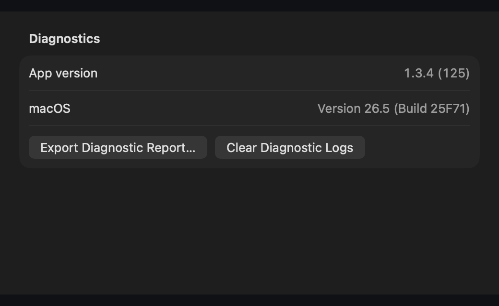

### Export Diagnostic Report

Choose **File → Export Diagnostic Report…** to create a zip that can be
attached to a bug report. The same action is also available from **Settings →
Diagnostics**. It includes:

- App version/build and macOS version.
- Recent Panely log lines.
- Recent open/load events with file paths redacted to filename, extension,
  and type.
- Extraction cache size, current reader settings, and the last reader error.
- Session ID and app launch time for correlating a report with recent logs.
- Diagnostic log level and file-log retention policy.

### Clear Diagnostic Logs

Choose **File → Clear Diagnostic Logs** to clear Panely's recent file log.
The same button is also available in **Settings → Diagnostics**.

This removes Panely's `recent-log.txt` file from the diagnostics cache so
future diagnostic reports include only new file logs. It does not clear
macOS system OSLog entries, extraction cache data, recent files, bookmarks,
favorites, or reading position.

The file log is intentionally bounded: Panely keeps one `recent-log.txt` file
up to 768 KB, trims it back to roughly 384 KB when it grows past that limit,
and includes the latest 256 KB in diagnostic reports. Use **Open Logs Folder**
in **Settings → Diagnostics** to inspect the file directly.

The **Log level** control changes which future Panely diagnostic events are
written to OSLog and the file log. It does not rewrite or filter logs that
were already recorded.

---

## Bookmarks and favorites

### Favoriting a book

Press `⌘⇧D` (or the ★ toolbar button) while a book is open to add it
to the **Favorites** section of the sidebar. Favorites persist across
launches via security-scoped bookmarks — moving the underlying file
within the same volume continues to work because stale bookmarks are
regenerated on the fly.

### Bookmarking a page

Press `⌘D` (or the 🔖 toolbar button) to mark the current page in the
**Bookmarks** sidebar section. Each book gets its own list (capped at
500 entries per book, 200 books total), keyed by a stable identifier
that survives temp-directory re-extractions of zip-in-zip archives.

Each row shows a thumbnail of the page. Click a row to jump there; hover
it and click ✕ (or right-click → **Remove Bookmark**) to delete it. The
trash button in the section header removes every bookmark in the book
after a confirmation.

Step between bookmarks within the current book with `⌘⇧[` / `⌘⇧]`.

### Bookmarks in other books

Bookmarks aren't lost when you move on to another book. The sidebar's
**Bookmarks in Other Books** section lists every other bookmarked book;
expand one and click a page to open that book right on it.

The same list is available without the sidebar:

- the **bookmark list** button in the toolbar (next to 🔖), and
- **Go → Bookmarks** in the menu bar.

**Go → Remove All Bookmarks…** clears the bookmarks in every book.

---

## Translation assist (experimental)

For comics in a language you don't read. Panely reads the text in the speech
balloons and shows an on-device machine translation over the page. It's meant
to help you follow the story — not to replace a real translation — so the
original is always one click away. Nothing leaves your Mac, and your files
are never changed.

Requires **macOS 26** or later. It's off by default.

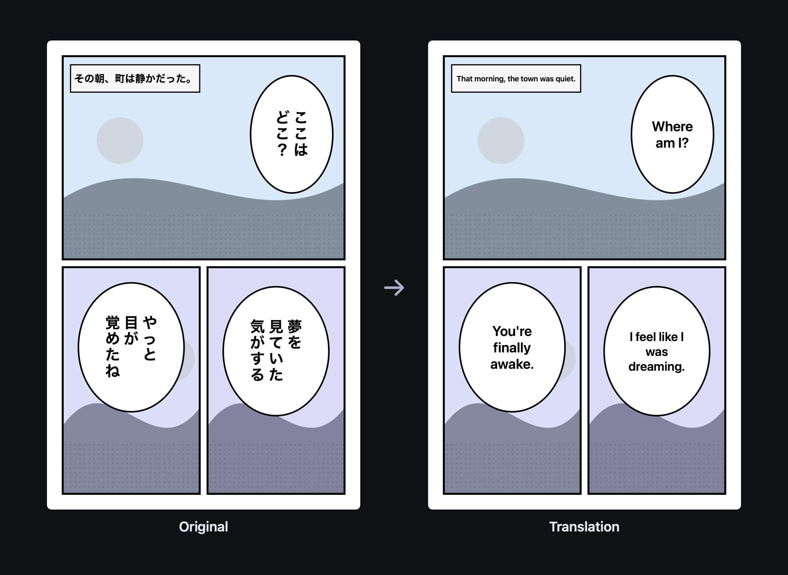

### Turning it on

Open **File → Settings… → Experimental** and switch on **Translation
Assist**. The same tab sets:

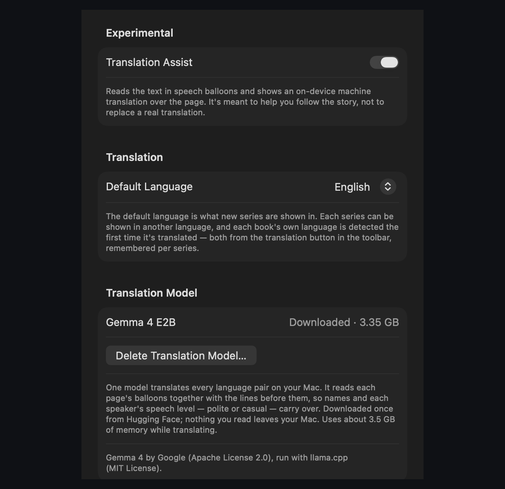

- **Default Language** — the language new series are shown in. **System
  Default** follows Panely's interface language.
- **Translate Sound Effects** — off by default; onomatopoeia like スッ or
  パチパチ is left as drawn.
- **Your Edits** — how many pages you've corrected, and a button to delete
  the edits. They're stored apart from the cache.
- **Translation Cache** — how much space finished translations take, and a
  button to clear them.

### Where things are

Translation is spread over a few places, each for one job:

- **The toolbar's translate button** switches between the original and the
  translation (`⇧⌘T`). Before a book has anything translated, it opens the
  panel.
- **The language name next to it** ("Korean ▾", or "Original ▾") is a menu:
  pick the language to show, start another language, or open the panel or
  edit mode. It names what's actually on screen — a new volume of a series
  read in Korean says "Original" until it's translated, and the menu's first
  item translates it into Korean.
- **The translation panel** is for translating this book: what to do next,
  which language to view, and the book's own settings.
- **The pill over the page** shows progress while a job runs.
- **Edit mode** (`⇧⌘E`) is for correcting balloons, right on the page.
- **Window → Jobs** (`⌥⌘J`) lists everything running in the background —
  other books' translations and exports — and the books you've exported.
  The pill over the page opens it.
- **Settings → Experimental** holds app-wide choices; the panel's ⚙︎ opens it.

### Translating a book

Open the panel from the translate button (or the language menu's
**Translation Panel…**) and press the big **Translate This Book** button (`⌥⌘T`).

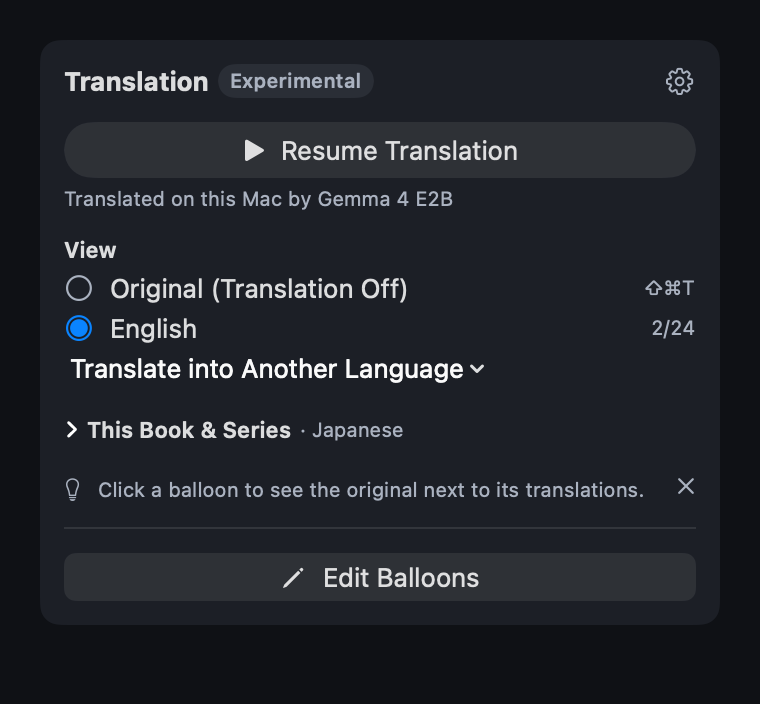

Translation starts at the page you're on and keeps ahead of you as you read:

- Balloons appear with a pulsing outline and "…" as soon as they're found, and
  fill in one by one.
- The line under the button, and the pill over the page, show progress and the
  time left. The first translation after installing takes a minute or two
  while the models load — the pill says so.
- Finished pages get a badge in the thumbnail sidebar and a mark under the
  page slider.

The same line says whether the language pack is installed. If it's missing,
the big button becomes **Download Language Pack…**.

The first time you translate a series, Panely works out which language the
book is in and remembers it for the series. If it guessed wrong, open **This
Book & Series** in the panel and change **Book's Language**; the same section
holds **Translate This Series Automatically** and **Translate Entire Series**.

In **Vertical scroll** the pages are read as one strip, so a webtoon cut into
many images still gets whole balloons.

### Choosing what to view

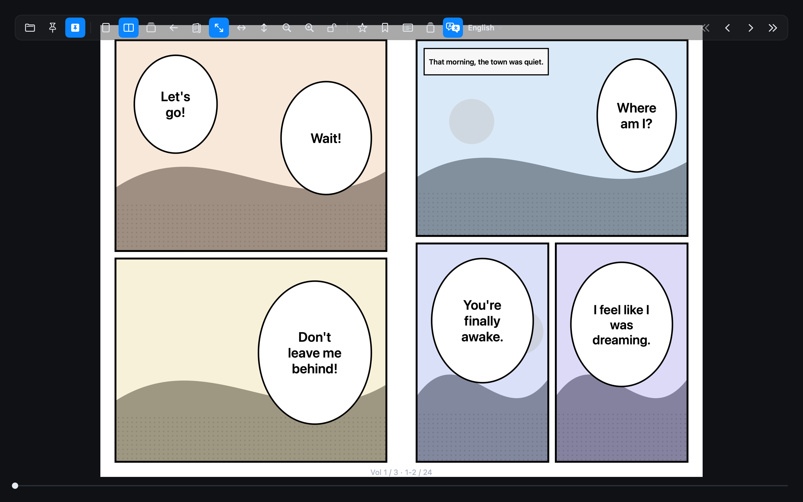

Use the language menu next to the translate button, or the panel's **View**
list: **Original
(translation off)** or any language the book has been translated into, with
its progress. The choice is remembered for the series. `⇧⌘T` switches between
the original and the translation.

To read in another language too, choose **Translate into Another Language**.
Each language is translated and stored separately, so you can read in Korean
while an English translation runs; a language's **⋯** menu starts, pauses or
stops it.

Click any balloon to see its translation, the book's other languages and the
original together. The text is selectable, so you can copy it or look a word up.

### Correcting balloons

Reading shows nothing but the translation. To correct balloons, turn on edit
mode — **Edit Balloons** in the panel or the language menu, the
**Edit…** link in a balloon's popover, or `⇧⌘E`. A bar over the page shows
you're editing; `esc` or **Done** goes back to reading.

In edit mode a balloon's popover offers:

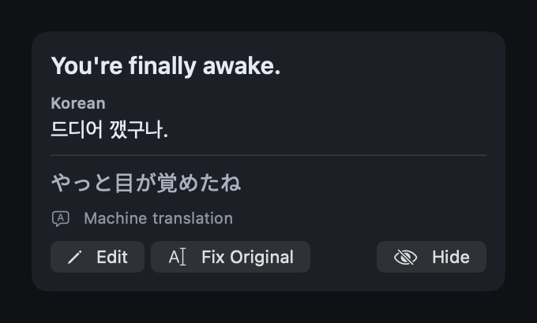

- **Edit** — rewrite the translation. Your translation applies to that
  language only.
- **Fix Original** — when OCR misread the text, correct it and it's
  translated again, into every language the book is translated into.
- **Hide** — for a "balloon" OCR made up out of artwork or background. The
  banner that follows offers **Undo**.
- **Revert** — undo that balloon alone; when both its translation and its
  original were changed, pick either or both.

Edited balloons carry a small pencil in their corner, and hidden balloons show
as dashed outlines — click one to bring it back. The bar counts what's edited,
lists hidden balloons by page (pick one to go there, or show them all), and
**Revert This Book…** undoes everything changed in this book only.

`↩` saves, `⇧↩` starts a new line (`⌥↩` and `⌃↩` work too), `esc` cancels.
Edits are stored apart from the translation cache, so clearing the cache or
switching modes keeps them.

### Other books and whole series

Translating continues when you open another book. While it runs, a small pill
over the page says which book and how far along it is; click it to open
**Window → Jobs**, where you can pause, resume, stop, or jump back to the book. One job
runs at a time, and whatever you're looking at goes first.

**Translate Entire Series** (under **This Book & Series**) queues the other
volumes of the series — only those whose titles match once volume numbers are
ignored, and the panel lists them before you start.

A few limits are shown where they apply:

- A book inside an archive (zip-in-zip) pauses when you open another book and
  continues when you come back.
- Quitting Panely stops translating and exporting. Finished pages are kept,
  and the rest continues when you start again.
- If a job in the background stops on an error, it stays in the list with the
  reason until you dismiss it.

### Exporting a translated copy

To keep a translation, or read it in another app, export the book: Panely
saves a copy with the translation painted into the pages — your edits
included, hidden balloons left out — as a **CBZ**, a **ZIP** or a **folder of
images**. CBZ and ZIP are the same archive; pick ZIP for an app or service
that only takes `.zip`.
The original is left as it is.

Start it from:

- the language menu in the toolbar — **Export Translated Book…**, and
  **Export Translated Series…** when the book has other volumes;
- **File → Export Translated Book…**;
- the panel's **This Book & Series**, under **Translate Entire Series**;
- the library: right-click a book for **Export Translated Book…**, or a
  folder of volumes for **Export Translated Series (N Volumes)…**. The book
  needn't be open.

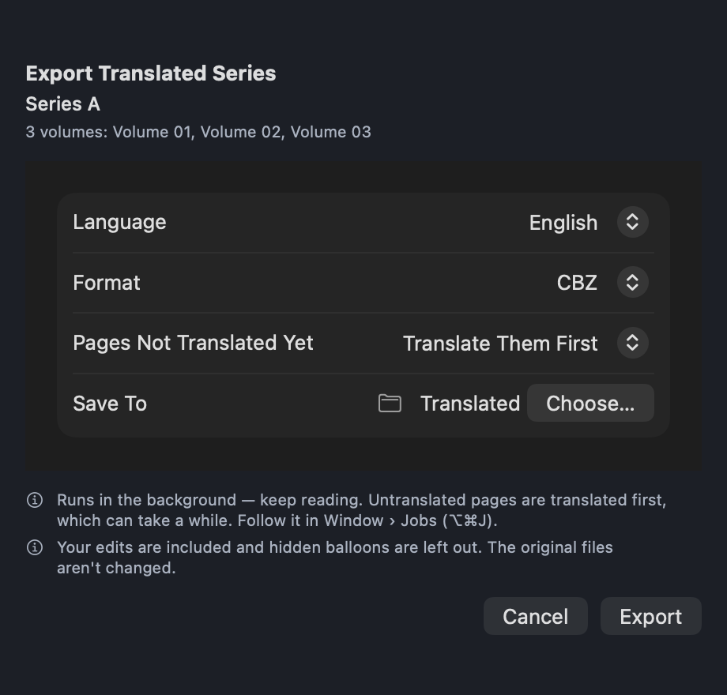

A short sheet asks for the language, the format, what to do with **Pages Not
Translated Yet** (**Translate Them First**, or **Export As They Are**) and
where to save — chosen once and remembered, like the rest of the sheet.

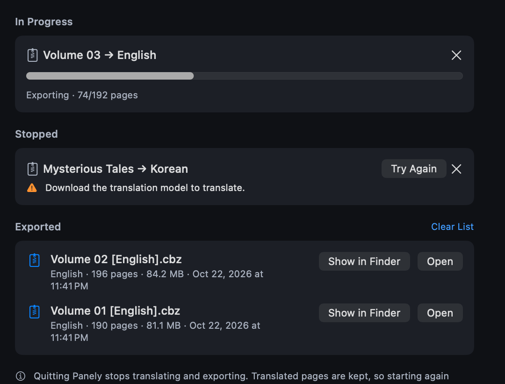

Exporting runs in the background: keep reading, or open another book. Each
book is its own job in **Window → Jobs** (`⌥⌘J`) — first translating what's
left (through the same queue as other translations), then writing the pages —
and can be cancelled there. A job that stops (a missing language pack, say)
stays listed with the reason and **Try Again**. Finished books stay listed,
across launches, with **Show in Finder** and **Open**; the pill over the page
says when one is done.

Pages come out numbered in reading order (`001.jpg`, `002.jpg`…). Pages with
nothing translated are copied unchanged; translated ones keep their format
(PNG stays PNG, the rest become high-quality JPEG). A name that's taken gets a
number ("… [Korean] 2.cbz").

---

## Keyboard shortcuts

The full list lives in
[README → Shortcuts & Gestures](../README.md#shortcuts--gestures).
The most-used:

| Action | Shortcut |
|---|---|
| Next / previous page | `→` / `←` (also `Space` for next) |
| Next / previous volume | `]` / `[` (also `⌘]` / `⌘[`) |
| Next / previous bookmark | `⌘⇧]` / `⌘⇧[` |
| Open file | `⌘O` |
| Reload current book | `⌘R` |
| Go to page… | `⌘G` |
| Bookmark / unbookmark page | `⌘D` |
| Favorite / unfavorite book | `⌘⇧D` |
| Layout: single / double / vertical | `⌘⇧1` / `⌘⇧2` / `⌘⇧3` |
| Fit: screen / width / height | `⌘1` / `⌘2` / `⌘3` |
| Zoom in / out / reset | `⌘+` / `⌘−` / `⌘0` |
| Pin library / toolbar / thumbnails | `⌃⌘S` / `⌃⌘T` / `⌃⌘P` |
| Lock view size | `⌘L` |
| Translation: original ↔ translation | `⇧⌘T` |
| Translation: translate this book / pause | `⌥⌘T` |
| Translation: edit balloons / done | `⇧⌘E` |
| Jobs window (translations, exports) | `⌥⌘J` |
